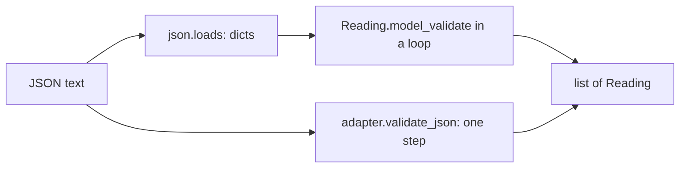

{:class="cover"}

---

By the end of this lesson you will be able to measure how long validation takes, and use `TypeAdapter` and `model_validate_json` to validate large batches of data efficiently.

Pydantic v2 does its validation in Rust, so it is already fast. For a hobby robot you may never need to think about speed. But if you log thousands of readings, it helps to know the one habit that matters, and how to measure instead of guess.

## Measure first

Never optimise on a hunch. Time the thing you care about. Here we make 10,000 readings as JSON text, then validate them two ways:

```python
import json
import time

from pydantic import BaseModel, TypeAdapter


class Reading(BaseModel):
    sensor: str
    temperature_c: float
    battery_mv: int


payload = json.dumps(
    [{"sensor": f"pico-{i % 5}", "temperature_c": 20 + i % 7, "battery_mv": 3900} for i in range(10_000)]
)

# Way 1: parse JSON to dicts, then validate each dict in a Python loop
start = time.perf_counter()
readings = [Reading.model_validate(item) for item in json.loads(payload)]
slow = time.perf_counter() - start

# Way 2: hand the whole JSON text to a TypeAdapter and let Rust do the work
adapter = TypeAdapter(list[Reading])
start = time.perf_counter()
readings = adapter.validate_json(payload)
fast = time.perf_counter() - start

print(len(readings), "readings")
print(f"loop of model_validate: {slow * 1000:.1f} ms")
print(f"TypeAdapter.validate_json: {fast * 1000:.1f} ms")
```

On the machine used for this course the output was:

```
10000 readings
loop of model_validate: 17.8 ms
TypeAdapter.validate_json: 11.5 ms
```

Your numbers will be different, because they depend on your computer, so run it yourself. What matters is the ratio and the habit.

## What this tells us

**`TypeAdapter`** validates things that are not models, such as `list[Reading]`, `dict[str, int]` or a lone `int`. Create it once (building the validator has a cost) and reuse it.

**`model_validate_json`** (and `TypeAdapter.validate_json`) parse and validate in one step inside Rust. You skip building an intermediate Python dictionary for every message. For one message that is a tiny saving, for 100,000 it adds up.

**Other habits that help:**

- Build `TypeAdapter` objects at module level, not inside a loop or a function that runs often.
- Validate at the edge, once. Do not re-validate the same object at every layer.
- Use `model_construct()` only for data you have already validated and trust, because it skips every check.
- Keep validators simple. A `field_validator` written in Python runs for each field, and slow work in it slows every request.
- Use specific types such as `list[int]` rather than `Any`, since the typed form is checked in Rust.



**Why this matters:** a robot that streams sensors at 50 Hz makes 180,000 readings an hour. Knowing the efficient path means your Raspberry Pi 4 keeps up without effort.

**Common mistakes:**

- Optimising before measuring. The slow part is usually the network or the disk, not validation.
- Creating `TypeAdapter(list[Reading])` inside a loop, which rebuilds the validator each time.

## Try it Yourself

1. Change `range(10_000)` to `range(100_000)` and rerun. Do the two ways scale the same?
2. Move the `TypeAdapter(...)` creation inside the timed region and see what it costs.
3. Time `Reading.model_construct(**item)` for each item, and note what you give up.
4. Challenge: use `timeit` to repeat each measurement 5 times and report the best.

## Common Issues

- **Problem**: Your timings jump around from run to run.
- **Solution**: Repeat the measurement several times and take the smallest.
- **Why**: Other programs on the computer compete for the processor, so single runs are noisy.

- **Problem**: `validate_json` raises "Invalid JSON" for text that looks fine.
- **Solution**: Make sure the text is real JSON, with double quotes, produced by `json.dumps` and not by `print` or `str()` of a dict.
- **Why**: Python prints dicts with single quotes, which JSON does not allow.

## Check your understanding


? What does `TypeAdapter(list[Reading])` let you do?
- [ ] Turn a model into a class
- [x] Validate a list of models without writing a wrapper model
- [ ] Speed up the Pico
> A TypeAdapter validates any type, not just models.

? Why is `model_validate_json` often faster than `json.loads` plus `model_validate`?
- [ ] It skips validation
- [x] It parses and validates in one step, without building intermediate dicts
- [ ] It caches the results forever
> The parsing and checking both happen inside Rust.

? What should you do before optimising?
- [x] Measure where the time actually goes
- [ ] Rewrite everything in C
- [ ] Remove all validation
> The slow part is often not validation at all.

