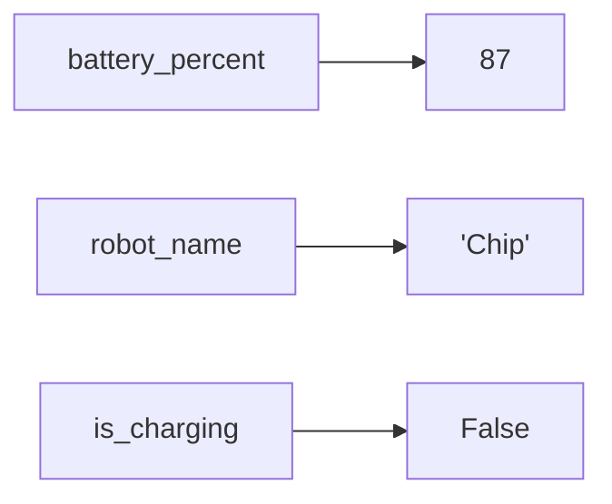

{:class="cover"}

---

By the end of this lesson you will be able to store information in variables, choose the right data type, add comments, and combine values with operators.

---

## Variables and data types

A variable is a name that points at a value, like a label on a storage box. Every robot program is full of them: a battery level, a speed, a name, a flag that says "I'm stuck".



Python has four basic data types you will use all the time:

- **Integers** are whole numbers, such as `10`, `15`, `22`.
- **Floats** are decimal numbers, such as `1.5`, `2.67`, `3.14`.
- **Booleans** are truth values, either `True` or `False`.
- **Strings** are text in quotes, such as `'hello'` or `"Chip"`.


robot_name = "Chip"        # a string
battery_percent = 87       # an integer
wheel_diameter_cm = 6.5    # a float
is_charging = False        # a boolean

print(robot_name, "is at", battery_percent, "percent")
print(type(wheel_diameter_cm))



You do not have to declare a type. Python works it out from the value, and `type()` tells you what it decided.

**Why this matters:** the type decides what you are allowed to do. You can add two numbers, but adding a number to a string is an error.

**Common mistakes:**

- Starting a name with a digit (`2wheels = 2`) is not allowed. Use `two_wheels`.
- Names are case sensitive: `Speed` and `speed` are different variables.
- Writing `True` as `true` fails. Booleans start with a capital letter.

## Basic syntax

Python uses **indentation** (four spaces is the convention) to show which lines belong together. Other languages use curly brackets; Python uses the shape of the code.


battery_percent = 15

if battery_percent < 20:
    print("Battery low, heading to the charger")
    print("This line is also inside the if")
print("This line always runs")



Python reads statements one line at a time, from top to bottom. For a very long statement you can continue on the next line with a backslash, or put it inside brackets:

```python
total_distance = 10 + 20 + 30 + \
                 40 + 50
```
{: .no-snakie }

## Comments

Comments are notes for people. Python ignores everything after a `#` on a line. Future you will thank present you for writing them.


# This whole line is a comment
print("Hello, robot!")  # This is an inline comment



Python has no true multi-line comment. A triple-quoted string that is not assigned to anything is ignored, so some people use one as a comment, but starting each line with `#` is the clearest way.

## Operators

Operators combine values. Here is the wheel of a small robot working out how far it travels:


import math

wheel_diameter_cm = 6.5
turns = 10

circumference = math.pi * wheel_diameter_cm   # distance per turn
distance = circumference * turns

print("Distance:", round(distance, 1), "cm")

# The arithmetic operators on two whole numbers
x = 10
y = 3
print(x + y)    # addition: 13
print(x - y)    # subtraction: 7
print(x * y)    # multiplication: 30
print(x / y)    # division: 3.3333333333333335
print(x // y)   # floor division, rounds down: 3
print(x % y)    # modulus, the remainder: 1
print(x ** y)   # exponent, x to the power y: 1000



**Comparison operators** give back a boolean: `==` (equal), `!=` (not equal), `>`, `<`, `>=`, `<=`. **Logical operators** `and`, `or`, `not` combine booleans:


battery_percent = 80
is_charging = False

print(battery_percent == 100)               # False
print(battery_percent >= 20)                # True
print(battery_percent > 50 and not is_charging)  # True



**Common mistake:** a single `=` stores a value (`x = 5`) while a double `==` asks a question (`x == 5`). Mixing them up is the most common beginner bug.

---

## Try it Yourself

1. Make variables for your robot's `name`, `speed_cm_s` and `has_camera`, then print a sentence using all three.
1. Change `wheel_diameter_cm` and `turns` in the operators example and predict the distance before you run it.
1. Challenge: use `//` and `%` to turn 135 seconds into minutes and seconds (the answer is 2 minutes 15 seconds).

## Common Issues

- **Problem**: `NameError: name 'speed' is not defined`.
- **Solution**: Check the spelling and capital letters, and make sure the variable is assigned on an earlier line.
- **Why**: Python only knows names it has already seen, and names are case sensitive.

- **Problem**: `IndentationError: unexpected indent` or `expected an indented block`.
- **Solution**: Make every line in a block start with the same number of spaces, and indent the line after a colon.
- **Why**: Python uses indentation instead of brackets, so inconsistent spacing changes the meaning.

- **Problem**: `TypeError: can only concatenate str (not "int") to str`.
- **Solution**: Convert the number with `str(battery_percent)`, or give both to `print()` separated by commas.
- **Why**: Python will not guess whether you want to add numbers or join text.

## Check your understanding


? What is `7 // 2` in Python?
- [ ] 3.5
- [x] 3
- [ ] 1
> `//` is floor division: it divides and rounds down to a whole number. `7 % 2` would give the remainder, 1.

? What data type is `True`?
- [ ] String
- [ ] Integer
- [x] Boolean
> Booleans are either `True` or `False`, with a capital letter.

? What is the difference between `=` and `==`?
- [ ] There is none
- [x] `=` stores a value in a variable, `==` compares two values
- [ ] `==` stores a value, `=` compares
> A single equals sign assigns. A double equals sign asks whether two things are equal.

? What does Python do with the text after a `#`?
- [ ] Runs it as code
- [x] Ignores it, it is a comment
- [ ] Prints it
> Comments are notes for people and are skipped by the interpreter.


---

## Summary

You can now store data in variables, tell the four basic types apart, write comments, and combine values with operators. Next up are data structures, which let you keep many values together.
