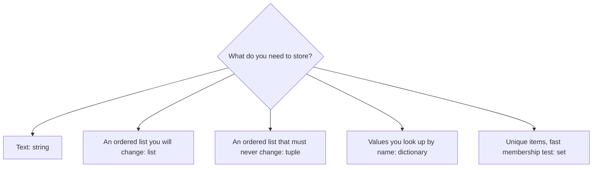

{:class="cover"}

---

By the end of this lesson you will be able to choose between strings, lists, tuples, dictionaries and sets, and use each one to hold information about a robot.

---

Data structures are containers that group values together. A robot has many sensor readings, many waypoints and many settings, so you need ways to keep them tidy. Python has five built-in containers, and choosing the right one makes your code much easier to read.

## Strings

A string is a sequence of characters in quotes. Single and double quotes are the same[^1]. You can pick out characters by position, starting at 0, but you cannot change them in place: strings are **immutable**.

[^1]: Many people prefer double quotes, because then you can use apostrophes inside a string without escaping them, like `"It's here"`. The [Black](18_tips_and_tricks.html#pep-8-and-the-black-code-formatter) code formatter uses double quotes too.


greeting = "Hello, World!"

print(greeting[0])        # H, the first character
print(greeting[-1])       # !, the last character
print(greeting.upper())   # HELLO, WORLD!
print(len(greeting))      # 13

# f-strings drop values straight into text
robot = "Chip"
battery = 87
print(f"{robot} has {battery}% battery")



Trying `greeting[0] = "h"` raises a `TypeError`. To change a string you build a new one, for example `"h" + greeting[1:]`.

## Lists

A list is an ordered, changeable collection, written with square brackets. It can hold items of different types. A list is perfect for a series of sensor readings.


distances_cm = [42, 38, 15, 60]

print(distances_cm[0])        # 42
distances_cm[2] = 17          # change an item
distances_cm.append(55)       # add to the end
distances_cm.remove(60)       # remove by value

print(distances_cm)           # [42, 38, 17, 55]
print(len(distances_cm))      # 4
print(min(distances_cm))      # 17



## Tuples

A tuple is like a list that is locked once created, written with round brackets. Use it for things that belong together and should not change, like an x, y position.


home = (10.0, 20.0)

x, y = home            # unpack into two variables
print(x, y)            # 10.0 20.0

# home[0] = 5.0 would raise a TypeError, tuples are immutable



## Dictionaries

A dictionary stores key and value pairs, written with curly brackets. You look values up by name instead of position. In modern Python a dictionary also remembers the order you added things.


robot = {"name": "Chip", "wheels": 2, "sensors": ["ultrasonic", "line"]}

print(robot["name"])            # Chip
robot["wheels"] = 4             # change a value
robot["colour"] = "red"         # add a new key
print(robot.get("weight", "unknown"))   # unknown, a safe lookup

for key, value in robot.items():
    print(key, "=", value)



## Sets

A set is an unordered collection of unique items, written with curly brackets and no key/value pairs. Adding something that is already in the set does nothing. Sets are great for removing duplicates and checking "have I seen this before?".


visited = {"kitchen", "hall"}

visited.add("hall")          # already there, nothing changes
visited.add("garage")
print("kitchen" in visited)  # True
print(len(visited))          # 3

readings = [1, 2, 2, 3, 3, 3]
print(set(readings))         # {1, 2, 3}



Because sets are unordered, the items may print in a different order each time. Do not rely on the order. Note that `{}` on its own makes an empty dictionary, not an empty set: use `set()` for an empty set.

---

## Try it Yourself

1. Make a dictionary describing your favourite robot, with keys for `name`, `wheels` and `sensors` (a list). Print how many sensors it has with `len()`.
1. Add a new sensor to the list with `append()`, then print the dictionary again.
1. Make a list of ten distance readings with some repeats. Use a set to count how many different values there are.
1. Challenge: store three waypoints as tuples inside a list, then loop over the list and print each x and y.

## Common Issues

- **Problem**: `KeyError: 'weight'` when reading a dictionary.
- **Solution**: Use `robot.get("weight")`, which returns `None` (or a default you choose) instead of failing, or check `"weight" in robot` first.
- **Why**: Square brackets demand that the key exists. `get()` is the forgiving version.

- **Problem**: `IndexError: list index out of range`.
- **Solution**: Remember counting starts at 0, so a list of 4 items has indexes 0 to 3. Check `len()` first.
- **Why**: You asked for a position that does not exist.

- **Problem**: `TypeError: 'tuple' object does not support item assignment`.
- **Solution**: Make a new tuple, or use a list if the data needs to change.
- **Why**: Tuples and strings are immutable on purpose, so they are safe to share.

## Check your understanding


? Which data structure can't be changed after it's created?
- [ ] List
- [x] Tuple
- [ ] Dictionary
> Tuples are immutable. Lists, dictionaries and sets can all be changed.

? What happens if you add `'apple'` to a set that already contains `'apple'`?
- [x] Nothing, the set still has one `'apple'`
- [ ] The set now has two `'apple'` items
- [ ] Python raises an error
> Sets only hold unique values, so adding a duplicate has no effect.

? How do you read the value stored under the key `"name"` in a dictionary called `robot`?
- [ ] `robot.name()`
- [x] `robot["name"]`
- [ ] `robot[0]`
> Dictionaries are looked up by key in square brackets, not by position.


---

## Summary

You met strings, lists, tuples, dictionaries and sets, and when to reach for each one. Next we will make programs that decide things and repeat themselves.
