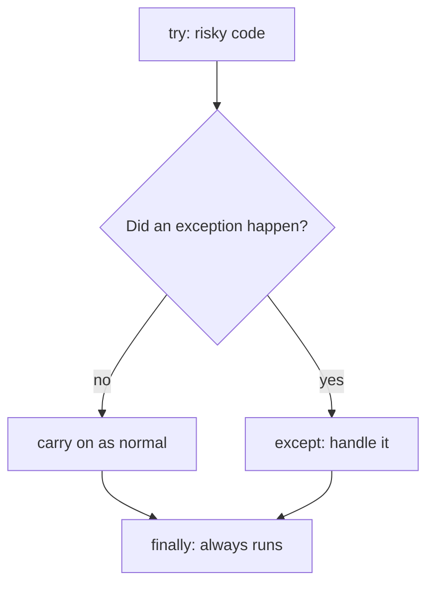

{:class="cover"}

---

By the end of this lesson you will be able to read an error message, catch exceptions with `try` and `except`, run clean-up code with `finally`, and raise your own errors.

---

Errors are bound to happen. Sometimes they are our own mistakes; sometimes they come from things we cannot control, like a missing file or a sensor that returns rubbish. Good programs notice and carry on, or stop with a clear message. Bad ones crash with a wall of red text.

## What are exceptions?

An exception is an event that interrupts the normal flow of a program. When Python meets something it cannot do, such as dividing by zero, it **raises** an exception. If nothing handles it, the program stops and prints a **traceback**, which shows where it went wrong. Read a traceback from the bottom up: the last line names the error and the lines above show where it happened.

## Catching exceptions

Put risky code in a `try` block and say what to do in an `except` block:


speed = 10
time_taken = 0

try:
    rate = speed / time_taken    # raises ZeroDivisionError
except ZeroDivisionError:
    rate = 0                     # a safe fallback

print("Rate:", rate)



Name the exception you expect. A bare `except:` catches everything, including mistakes you would rather see, so it hides bugs.

## Several exceptions and finally

You can stack `except` blocks for different problems. A `finally` block runs whether or not there was an error, which makes it the place for clean-up.


def read_setting(text):
    try:
        return int(text)
    except ValueError:
        print("That is not a number:", text)
        return 0
    finally:
        print("Checked", repr(text))

print(read_setting("42"))
print(read_setting("hello"))

try:
    f = open("non_existent_file.txt", "r")
except FileNotFoundError:
    print("File not found.")



The most common exceptions you will meet are `ValueError` (right type, wrong value, like `int("hello")`), `TypeError` (the wrong type), `KeyError` (missing dictionary key), `IndexError` (list position out of range) and `FileNotFoundError`.

## Raising exceptions

Your own functions can protect themselves. If a value makes no sense, `raise` an exception with a helpful message:


def set_speed(percent):
    if not 0 <= percent <= 100:
        raise ValueError(f"speed must be 0 to 100, got {percent}")
    print("Speed set to", percent)

set_speed(50)

try:
    set_speed(250)
except ValueError as error:
    print("Caught:", error)



`as error` gives you the exception object, so you can print its message. Raising early with a clear message is kinder than letting a motor spin at nonsense speeds.

---

## Try it Yourself

1. Run the `read_setting` example with the text `"7.5"`. What happens, and why? Change the code so it handles decimals.
1. Write a loop that keeps asking `input("Speed? ")` until the user types a whole number, using `try` and `except ValueError`.
1. Wrap a call that reads a file in `try` and `except FileNotFoundError`, and print a friendly message.
1. Challenge: add a check to `set_speed` that raises `TypeError` if the speed is not a number.

## Common Issues

- **Problem**: My `except` block never runs.
- **Solution**: Check you named the right exception type. Read the last line of the traceback and use that name.
- **Why**: `except` only catches the kinds of exception you list.

- **Problem**: The program carries on but gives wrong answers, and I cannot see why.
- **Solution**: Avoid a bare `except:` that silently does nothing. At least print the error with `except Exception as error: print(error)`.
- **Why**: Swallowing errors hides the clue you need to find the bug.

- **Problem**: I put too much code inside `try`.
- **Solution**: Keep the `try` block to the one or two lines that can fail.
- **Why**: A big block can catch errors from lines you did not mean to protect.

## Check your understanding


? When does a `finally` block run?
- [ ] Only when there's an error
- [ ] Only when there's no error
- [x] Every time, error or not
> `finally` is for clean-up code that must always run.

? What does `int("hello")` raise?
- [x] `ValueError`
- [ ] `ZeroDivisionError`
- [ ] `FileNotFoundError`
> The string can't be turned into a number, so Python raises a `ValueError`.

? How do you read a traceback?
- [ ] From the top, the first line names the error
- [x] From the bottom, the last line names the error
- [ ] You cannot, it is only for experts
> The final line gives the exception type and message, and the lines above show where it came from.


---

## Summary

Exceptions are not the end of the world: you can catch them, clean up after them and raise your own. Next we will see how to borrow other people's code with modules and libraries.
