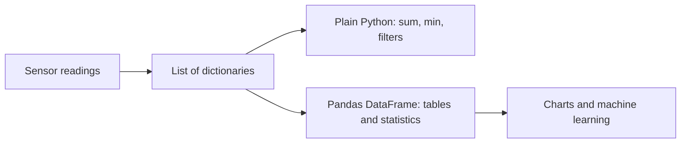

{:class="cover"}

---

By the end of this lesson you will be able to analyse a list of sensor readings with plain Python, and recognise when to use Pandas and how to install it.

---

Robots produce a lot of data: distances, temperatures, battery voltages, one reading after another. From here on, the course takes a tour of what Python can do with that data and more. Each lesson gives you one small, complete example and points to a deeper course when you want more.



## Start with plain Python

You already know enough to do real analysis. A tidy way to store a log is a **list of dictionaries**, where each dictionary is one reading. Press **Run** to try it:


readings = [
    {"time": "10:00", "temp_c": 21.5, "distance_cm": 80},
    {"time": "10:01", "temp_c": 21.7, "distance_cm": 42},
    {"time": "10:02", "temp_c": 22.1, "distance_cm": 15},
    {"time": "10:03", "temp_c": 22.4, "distance_cm": 63},
]

temps = [r["temp_c"] for r in readings]
print("Average temperature:", round(sum(temps) / len(temps), 2))

close = [r["time"] for r in readings if r["distance_cm"] < 50]
print("Something was close at:", close)



The two lines that build `temps` and `close` are **list comprehensions**: a compact way to loop over a list and collect results, optionally with an `if` filter. Plain Python handles this size of job comfortably, and you will often need nothing more.

## When plain Python gets tedious

Imagine 100,000 readings, several sensors, missing values and a request to group by hour. You could write all that with loops, but it would be long. That is what **Pandas** is for. It gives you the **DataFrame**, a table with labelled columns and numbered rows, much like a spreadsheet, and ready-made tools for the maths.

Pandas is not built in, so install it into a virtual environment (see lesson 7 for how to make one):

```bash
pip install pandas
```
{: .no-snakie }

Then save this as `readings.py` and run it:

```python
import pandas as pd

readings = pd.DataFrame({
    "time": ["10:00", "10:01", "10:02", "10:03"],
    "temp_c": [21.5, 21.7, 22.1, 22.4],
    "distance_cm": [80, 42, 15, 63],
})

print(readings)
print("Average temperature:", round(readings["temp_c"].mean(), 2))
print("Closest object:", readings["distance_cm"].min(), "cm")

# Keep only the rows where something was close
print(readings[readings["distance_cm"] < 50])
```
{: .no-snakie }

You should see the table printed with row numbers 0 to 3, then `Average temperature: 21.93`, `Closest object: 15 cm`, and a smaller table with just the 10:01 and 10:02 rows. Selecting a column with `readings["temp_c"]` gives you a whole column at once, and `readings["distance_cm"] < 50` produces a true/false answer for every row, which then filters the table. No loops needed.

> ## Learn more about Pandas
>
> There is a whole course on it: [Data Manipulation with Pandas and Numpy](/learn/pandas_and_numpy/) covers installing, loading CSV files, cleaning data and analysis.

---

## Try it Yourself

1. In the plain Python example, add a fifth reading, then print the maximum temperature with `max(temps)`.
1. Use a list comprehension to make a list of the distances in inches (divide centimetres by 2.54).
1. Install Pandas in a virtual environment and run the DataFrame example. Print `readings["distance_cm"].max()`.
1. Challenge: save the DataFrame to a file with `readings.to_csv("readings.csv", index=False)` and open the file in a text editor.

## Common Issues

- **Problem**: `ModuleNotFoundError: No module named 'pandas'`.
- **Solution**: Activate your virtual environment and run `pip install pandas`.
- **Why**: Pandas is not part of Python, and each environment has its own libraries.

- **Problem**: `KeyError: 'temperature'` on a DataFrame.
- **Solution**: Print `readings.columns` and use the exact column name, including capital letters.
- **Why**: Column names are looked up exactly like dictionary keys.

- **Problem**: My filter raises `ValueError: The truth value of a Series is ambiguous`.
- **Solution**: Use `&` and `|` between conditions, each in brackets, such as `df[(df["a"] < 5) & (df["b"] > 2)]`, not `and` and `or`.
- **Why**: Pandas compares whole columns at once, and Python's `and` cannot do that.

## Check your understanding


? In Pandas, what is a DataFrame?
- [ ] A single list of values
- [x] A table of rows and columns
- [ ] A chart
> A DataFrame is like a spreadsheet: labelled columns and numbered rows.

? What does `[r["temp_c"] for r in readings]` build?
- [ ] A dictionary
- [x] A list containing the `temp_c` value of every reading
- [ ] A single number
> It is a list comprehension: it loops over `readings` and collects one value from each dictionary.

? How do you install Pandas?
- [ ] `import pandas`
- [x] `pip install pandas`
- [ ] It comes with Python
> Pandas is not built in. Install it with `pip`, ideally inside a virtual environment.


---

## Summary

You can analyse readings with plain lists and dictionaries, and you know when a DataFrame is worth installing. Next we will fetch data from the web.
