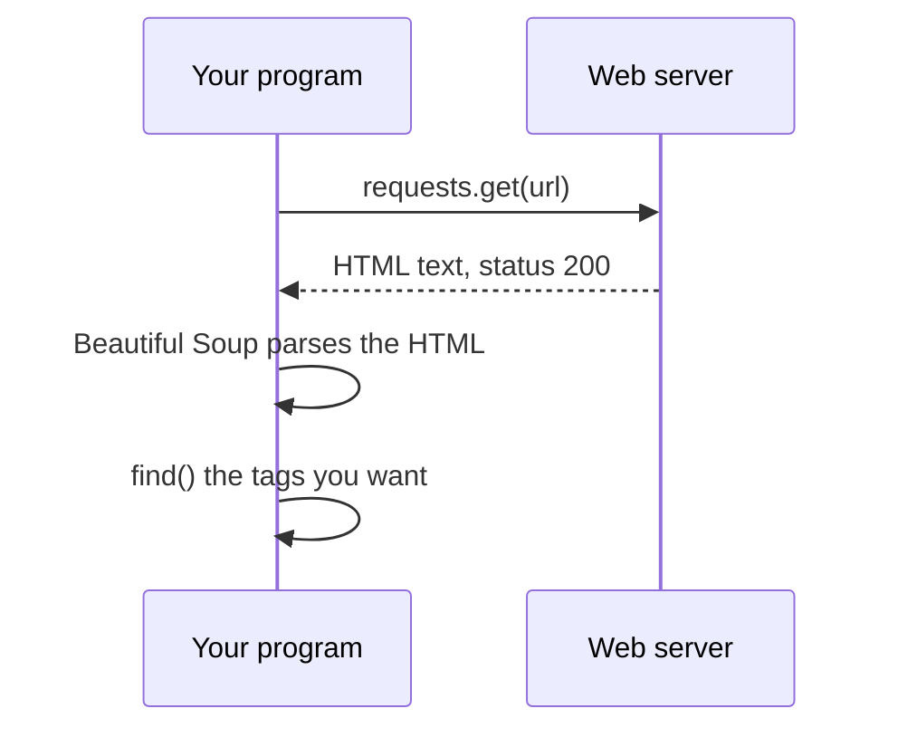

{:class="cover"}

---

By the end of this lesson you will be able to download a web page with `requests`, pick data out of its HTML with Beautiful Soup, and scrape politely.

---

Web scraping means getting information out of a web page with a program: a list of parts and prices, a weather reading, the titles on a page. It is two jobs: **download** the page, then **parse** its HTML to find the bits you want.



## Install the libraries

Make a virtual environment (lesson 7), activate it, then install both libraries. The Beautiful Soup package is called `beautifulsoup4`, but you import it as `bs4`.

```bash
pip install requests beautifulsoup4
```
{: .no-snakie }

## Parsing HTML you already have

Start without the internet at all. Beautiful Soup can read any HTML text, so here is a tiny made-up parts shop page held in a string. Save this as `parts.py` and run it:

```python
from bs4 import BeautifulSoup

html = """
<html>
  <head><title>Robot parts shop</title></head>
  <body>
    <h1>In stock</h1>
    <ul>
      <li class="part"><span class="name">Micro servo</span> <span class="price">3.50</span></li>
      <li class="part"><span class="name">Ultrasonic sensor</span> <span class="price">2.80</span></li>
      <li class="part"><span class="name">Wheel pair</span> <span class="price">4.20</span></li>
    </ul>
  </body>
</html>
"""

soup = BeautifulSoup(html, "html.parser")
print(soup.title.text)

total = 0
for part in soup.find_all("li", class_="part"):
    name = part.find("span", class_="name").text
    price = float(part.find("span", class_="price").text)
    total += price
    print(f"{name}: {price:.2f}")

print(f"Total: {total:.2f}")
```
{: .no-snakie }

It prints the title `Robot parts shop`, one line per part, and `Total: 10.50`. The key tools are `find()` (the first match) and `find_all()` (every match). `class_` has an underscore because `class` is already a Python keyword. `.text` gives you the words inside a tag.

## Downloading a real page

`requests.get()` fetches a page. `example.com` is a page that exists for exactly this kind of practice:

```python
import requests
from bs4 import BeautifulSoup

URL = "https://example.com"

try:
    response = requests.get(URL, timeout=10)
    response.raise_for_status()      # raises an error for 404, 500 and so on
except requests.RequestException as error:
    print("Could not fetch the page:", error)
else:
    print("Status:", response.status_code)

    soup = BeautifulSoup(response.text, "html.parser")
    print("Title:", soup.title.text)
    print("Heading:", soup.find("h1").text)

    for link in soup.find_all("a"):
        print("Link:", link.get("href"))
```
{: .no-snakie }

A status code of `200` means success. You should see the title and heading `Example Domain`, followed by the page's link. The `timeout` stops your program hanging forever if the server never answers, and `raise_for_status()` plus `try` and `except` (from the errors lesson) means a missing page or lost Wi-Fi gives a friendly message instead of a crash.

To scrape your own pages, right-click an element in your browser and choose Inspect. That shows you the tag and `class` to hand to `find()`.

## Scrape responsibly

- Check the site's terms of use and its `robots.txt` file (for example `https://example.com/robots.txt`) to see what it allows.
- Do not hammer a site with requests: add a pause with `time.sleep()` between pages.
- If the site offers an API, use that instead. It is more reliable than scraping, because page layouts change and break scrapers.
- Do not collect personal data, and respect copyright on what you gather.

> **Teachers**: Scraping needs internet access, and some school networks block unfamiliar sites or the installation of libraries. The offline `parts.py` example works with no network at all, so use it as the fallback. Remind learners to scrape only sites that allow it and to keep requests slow, because a whole class running a loop at once looks like an attack to a small website.

---

## Try it Yourself

1. Run `parts.py` and change a price in the HTML string. Check the total changes.
1. Add a fourth part to the HTML and make the loop print it.
1. Change the program so it only prints parts costing less than 4.00.
1. Challenge: fetch `https://example.com` and save the title and the current time to a file, using the files lesson.

## Common Issues

- **Problem**: `ModuleNotFoundError: No module named 'bs4'`.
- **Solution**: Install `beautifulsoup4` (not `bs4`) with `pip install beautifulsoup4`, inside the active virtual environment.
- **Why**: The package name and the import name differ.

- **Problem**: `AttributeError: 'NoneType' object has no attribute 'text'`.
- **Solution**: `find()` returned `None` because nothing matched. Check the tag and class name, and test with `if tag is not None`.
- **Why**: A typo, or content the page adds later with JavaScript, means the HTML you downloaded does not contain it.

- **Problem**: The status code is `403` or `429`.
- **Solution**: The site is refusing you. Slow down, check `robots.txt`, and look for an official API.
- **Why**: Servers block clients that look like they are making too many requests.

- **Problem**: The page loads in my browser but the data is missing from `response.text`.
- **Solution**: The site builds its content with JavaScript. Look for a data API, or use a browser automation tool (see the automation lesson).
- **Why**: `requests` downloads the HTML only. It does not run the page's scripts.

## Check your understanding


? What does a status code of `200` mean?
- [x] The request succeeded
- [ ] The page wasn't found
- [ ] The server had an error
> 200 means OK. 404 means not found, and 500 is a server error.

? Which library turns a downloaded page's HTML into something you can search?
- [ ] `requests`
- [x] Beautiful Soup
- [ ] `math`
> `requests` downloads the page, and Beautiful Soup parses it so you can use `find()` and `find_all()`.

? What is a polite way to scrape many pages?
- [ ] Request them as fast as possible
- [x] Check `robots.txt` and add a pause between requests
- [ ] Ignore the site's terms of use
> Checking the rules and slowing down protects the website and keeps you from being blocked.


---

## Summary

You can download a page, parse its HTML and pick out the pieces you need, politely. Next we will turn numbers into pictures.
