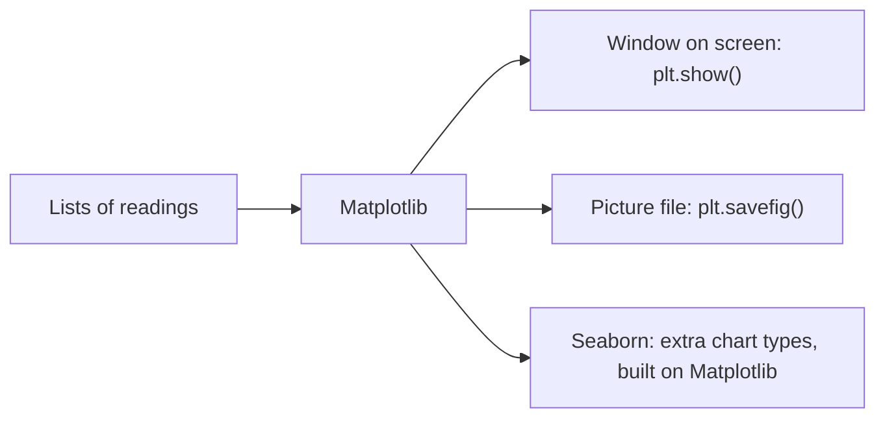

{:class="cover"}

---

By the end of this lesson you will be able to install Matplotlib in a virtual environment, draw a labelled line chart, save it as a picture, and make a histogram with Seaborn.

---

A column of numbers hides patterns that a chart shows at a glance. Is the sensor noisy? Did the robot slow down before the wall? Is the battery draining faster than it should? Data visualisation turns numbers into pictures so you can spot trends, outliers and mistakes.



## Install the libraries

In an activated virtual environment (see lesson 7):

```bash
pip install matplotlib seaborn
```
{: .no-snakie }

Seaborn is built on top of Matplotlib, and it also installs Pandas and NumPy for you.

## A line chart with Matplotlib

Matplotlib is the workhorse plotting library for Python. Here a robot closes in on a wall, and we mark the distance at which it should stop. Save this as `approach.py` and run it:

```python
import matplotlib.pyplot as plt

seconds = [0, 1, 2, 3, 4, 5, 6, 7]
distance_cm = [80, 72, 61, 50, 38, 25, 14, 9]

plt.plot(seconds, distance_cm, marker="o")
plt.axhline(20, color="red", linestyle="--", label="Stop distance")
plt.title("Robot approaching a wall")
plt.xlabel("Time (seconds)")
plt.ylabel("Distance (cm)")
plt.legend()
plt.savefig("approach.png")
plt.show()
```
{: .no-snakie }

`plt.plot()` takes the x values and the y values. The other lines add the red dashed threshold, a title, axis labels and a legend. `plt.savefig()` writes a picture file next to your program, and `plt.show()` opens a window and pauses the program until you close it. You should see a falling line that crosses the red line between 5 and 6 seconds, a sign the robot was already too close by the time it reached the stop distance.

{:loading="lazy"}

Always label your axes, with units. A chart without labels is only half an answer.

## A histogram with Seaborn

A histogram counts how many readings fall into each range, which shows how noisy a sensor is. Seaborn makes attractive statistical charts with very little code:

```python
import matplotlib.pyplot as plt
import seaborn as sns

# Thirty noisy readings from a distance sensor pointing at a wall
readings = [50, 51, 49, 50, 52, 48, 50, 51, 50, 49, 53, 47, 50, 50, 51,
            49, 50, 52, 50, 48, 51, 50, 49, 50, 50, 54, 46, 50, 51, 49]

sns.histplot(readings, bins=8)
plt.title("How noisy is the sensor?")
plt.xlabel("Reading (cm)")
plt.savefig("noise.png")
plt.show()
```
{: .no-snakie }

You should see a tall bar around 50 cm with shorter bars either side. That bell shape tells you the sensor is accurate on average, with small random errors.

{:loading="lazy"}

Seaborn draws on Matplotlib, so the same `plt.title()`, `plt.xlabel()`, `plt.savefig()` and `plt.show()` calls still work. Seaborn also includes some example datasets via `sns.load_dataset()`, but these are downloaded from the internet when you ask for them, so they will not work offline. Using your own data, as above, avoids that.

Pandas can also feed straight into these libraries, so a column from a DataFrame (previous lesson) can be plotted with the same calls. The [Data Manipulation with Pandas and Numpy](/learn/pandas_and_numpy/) course has a whole lesson on visualisation.

---

## Try it Yourself

1. Change the distances in the line chart to a robot that stops in time, then re-run and watch the line.
1. Add a second line to the same chart, such as a robot that moves faster, with another `plt.plot()` call before `plt.legend()`. Give each a `label="..."`.
1. Use `plt.bar(["Left", "Middle", "Right"], [12, 40, 25])` to chart three line-sensor values.
1. Challenge: build a list of 200 readings with `random.gauss(50, 2)` and plot its histogram.

## Common Issues

- **Problem**: `ModuleNotFoundError: No module named 'matplotlib'`.
- **Solution**: Activate your virtual environment and run `pip install matplotlib seaborn`.
- **Why**: Libraries are installed per environment.

- **Problem**: The program runs but no window appears (common over SSH or on a Pi without a desktop).
- **Solution**: Use `plt.savefig("chart.png")` and open the picture, because there is no screen to draw on.
- **Why**: `plt.show()` needs a graphical desktop.

- **Problem**: The program seems to hang after the chart opens.
- **Solution**: Close the chart window.
- **Why**: `plt.show()` waits until the window is closed before continuing.

- **Problem**: A chart I saved is blank, or has the previous chart's lines.
- **Solution**: Call `plt.savefig()` before `plt.show()`, and call `plt.figure()` at the start of each new chart.
- **Why**: After the window closes, Matplotlib clears the figure it was drawing.

## Check your understanding


? What opens the window showing your chart in a Python script?
- [ ] `plt.plot()`
- [x] `plt.show()`
- [ ] `sns.histplot()`
> `plot()` and Seaborn functions draw the chart; `plt.show()` displays it.

? How do you save a chart as a picture file?
- [ ] `plt.title("chart.png")`
- [x] `plt.savefig("chart.png")`
- [ ] `plt.legend("chart.png")`
> `savefig()` writes the current figure to a file, such as a PNG.

? What does a histogram show?
- [ ] How a value changes over time
- [x] How many readings fall into each range of values
- [ ] Which reading is the largest
> A histogram groups values into bins and counts them, so it shows how spread out or noisy the readings are.


---

## Summary

You can now turn a list of readings into a labelled chart or histogram, save it and show it. In the next lesson we will go one step further and let a computer learn from data.
