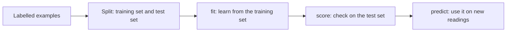

{:class="cover"}

---

By the end of this lesson you will be able to explain what machine learning is, install scikit-learn in a virtual environment, and train and test a small model that classifies sensor readings.

---

Normally you write the rules: "if the distance is under 20, turn". With **machine learning** you give the computer examples and let it find the rules itself. That is handy when the rules are too fiddly to write by hand, such as telling carpet from tile using a brightness sensor and a vibration sensor.



## Types of machine learning

- **Supervised learning**: the examples come with answers (labels), and the model learns to predict the label for new data. This lesson uses it.
- **Unsupervised learning**: no labels. The model looks for hidden groups or patterns on its own.
- **Reinforcement learning**: an agent learns by trying actions and getting rewards, like a robot learning to balance. Our [Reinforcement Learning](/learn/reinforcement_learning/) course covers it.

## Install scikit-learn

Scikit-learn is one of the most popular machine learning libraries for Python. In an activated virtual environment (lesson 7):

```bash
pip install scikit-learn
```
{: .no-snakie }

You import it as `sklearn`, even though you install it as `scikit-learn`.

## Teach a robot to tell floors apart

Our robot has two sensors under its body: a brightness sensor and a vibration sensor. Tile is bright and smooth. Carpet is darker and bumpy. We will invent 80 readings (so you can run this with no robot), train a model, and ask it about a new reading. Save this as `floor.py`:

```python
import random

from sklearn.model_selection import train_test_split
from sklearn.neighbors import KNeighborsClassifier

random.seed(1)  # same "random" data every run

# Pretend sensor data: [brightness 0-100, vibration 0-100] for each floor type.
# Tile is bright and smooth, carpet is darker and bumpy.
features = []
labels = []
for _ in range(40):
    features.append([random.gauss(70, 14), random.gauss(20, 14)])
    labels.append("tile")
    features.append([random.gauss(40, 14), random.gauss(55, 14)])
    labels.append("carpet")

X_train, X_test, y_train, y_test = train_test_split(
    features, labels, test_size=0.25, random_state=0
)

model = KNeighborsClassifier(n_neighbors=3)
model.fit(X_train, y_train)

print("Accuracy on unseen readings:", model.score(X_test, y_test))

# Ask the model about a brand new reading
new_reading = [[65, 25]]
print("A reading of", new_reading[0], "looks like:", model.predict(new_reading)[0])
```
{: .no-snakie }

Here is what each part does:

- `features` holds the inputs (`X`), and `labels` holds the right answers (`y`). Each reading is a list of two numbers.
- `train_test_split()` keeps 25% of the readings back for testing, so we can check the model on data it has never seen.
- `KNeighborsClassifier` is a simple model: to classify a reading it looks at the 3 most similar readings it learned from and takes a vote.
- `model.fit()` trains the model, `model.score()` returns the share of test readings it got right (1.0 means all of them), and `model.predict()` labels new readings.

When we ran it, it reported an accuracy of `1.0` and labelled `[65, 25]` as `tile`. The two floors are easy to tell apart, so a perfect score is normal here. Real data is messier, so expect lower numbers on your own robot's readings. Try making the two kinds of floor closer together (change the numbers `70` and `40`) and watch the accuracy drop.

**Why this matters:** the model never saw a rule such as "bright means tile". It worked out the pattern from examples, and you checked it honestly on readings it had not seen.

> ## Where next?
>
> The classic scikit-learn practice dataset is `datasets.load_iris()`, which holds measurements of 150 flowers and is built into the library. Try swapping it into the example above, and read more in the [scikit-learn user guide](https://scikit-learn.org/stable/user_guide.html). For running trained models on a Raspberry Pi with a camera, see the [Computer Vision on Raspberry Pi with CVZone](/learn/cvzone/) course.

---

## Try it Yourself

1. Run `floor.py`, then change the `new_reading` to `[35, 60]` and `[55, 40]`. What does the model say about each?
1. Change `n_neighbors=3` to `1` and then to `15`. Does the accuracy change?
1. Add a third floor type, such as wood, with its own brightness and vibration values and the label `"wood"`.
1. Challenge: change `test_size` to `0.5` and `0.1` and explain why the accuracy becomes less reliable when the test set is tiny.

## Common Issues

- **Problem**: `ModuleNotFoundError: No module named 'sklearn'`.
- **Solution**: Install it with `pip install scikit-learn` (not `sklearn`) inside your active virtual environment.
- **Why**: The package on PyPI is named `scikit-learn`, but you import it as `sklearn`.

- **Problem**: My accuracy is different from the one in the lesson.
- **Solution**: That is fine. Different data, a different `random_state` or a newer library version can change the score slightly.
- **Why**: Splitting and training involve chance, and `random_state` is what fixes it.

- **Problem**: `ValueError: Expected 2D array, got 1D array instead`.
- **Solution**: Pass a list of lists, such as `[[65, 25]]`, even for a single reading.
- **Why**: Scikit-learn expects a table of rows, one row per reading.

- **Problem**: The model scores 100% on training data but badly on new data.
- **Solution**: Always judge a model on the test set it never trained on.
- **Why**: A model can memorise its training examples without learning the pattern.

## Check your understanding


? Why do we split data into training and test sets?
- [ ] To make training faster
- [x] To check the model works on data it hasn't seen
- [ ] Because scikit-learn needs two datasets
> Testing on the training data would only show the model can remember answers, not that it can generalise.

? Learning from labelled examples is called...
- [x] Supervised learning
- [ ] Unsupervised learning
- [ ] Reinforcement learning
> The labels "supervise" the learning by giving the right answer for each example.

? What does `model.fit(X_train, y_train)` do?
- [ ] Measures the accuracy
- [x] Trains the model on the training examples
- [ ] Splits the data
> `fit()` is the learning step. `score()` checks the result and `predict()` uses it.


---

## Summary

You have trained a model from examples, tested it on readings it had not seen, and used it to label a new reading. Next we will meet neural networks and deep learning.
