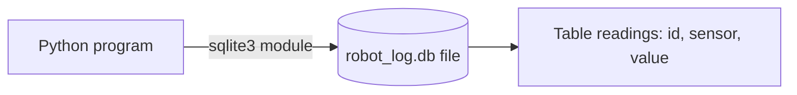

{:class="cover"}

---

By the end of this lesson you will be able to create a SQLite table from Python, insert, read, update and delete rows safely using `?` placeholders, and know where to learn more.

---

A text file is fine for a short log, but once you have thousands of readings you want to ask questions like "what was the average distance today?" or "show me every reading under 20 cm". A **database** stores data in an organised way and answers questions like that quickly.

## What are databases?

- **Relational (SQL) databases** such as SQLite, MySQL and PostgreSQL store data in tables of rows and columns, and you query them with SQL (Structured Query Language).
- **NoSQL databases** such as MongoDB and Redis store data as documents, key and value pairs or other shapes.



## SQLite: a database in one file

SQLite is a lightweight database that lives in a single file. It needs no server and no installation, because Python comes with the `sqlite3` module built in. That makes it perfect for a robot or a Raspberry Pi project.

The four everyday jobs are known as CRUD: **C**reate, **R**ead, **U**pdate and **D**elete. This program does all four on a table of sensor readings. Press **Run**, or save it as `robot_db.py`:


import sqlite3

conn = sqlite3.connect("robot_log.db")
cursor = conn.cursor()

cursor.execute("""
    CREATE TABLE IF NOT EXISTS readings (
        id INTEGER PRIMARY KEY,
        sensor TEXT,
        value REAL
    )
""")

# Start fresh each time we run this lesson example
cursor.execute("DELETE FROM readings")

# Create: insert rows using ? placeholders
data = [("distance", 42.0), ("distance", 15.5), ("temperature", 21.7), ("distance", 63.0)]
cursor.executemany("INSERT INTO readings (sensor, value) VALUES (?, ?)", data)
conn.commit()

# Read: ask for only the rows we want
sensor = "distance"
for row in cursor.execute("SELECT id, value FROM readings WHERE sensor = ? ORDER BY value", (sensor,)):
    print(row)

# Update
cursor.execute("UPDATE readings SET value = ? WHERE id = ?", (16.0, 2))

# Delete
cursor.execute("DELETE FROM readings WHERE sensor = ?", ("temperature",))
conn.commit()

cursor.execute("SELECT COUNT(*), AVG(value) FROM readings")
count, average = cursor.fetchone()
print("Rows:", count, "Average:", round(average, 2))

conn.close()



You should see the three distance readings in order (`(2, 15.5)`, `(1, 42.0)`, `(4, 63.0)`), then `Rows: 3 Average: 40.33`. Walking through it:

- `sqlite3.connect("robot_log.db")` opens the database file, creating it if needed.
- A **cursor** is what you use to run SQL commands.
- `CREATE TABLE IF NOT EXISTS` makes the table once and does nothing on later runs.
- `conn.commit()` saves your changes. Without it they can be lost when the program ends.
- `fetchone()` returns one row, here the count and the average.

## Always use placeholders

Notice the `?` marks. Never build SQL by gluing values into a string with an f-string. A placeholder lets the database handle quoting, so odd characters in your data (or deliberately malicious ones, called SQL injection) cannot be mistaken for SQL commands.

```python
# Safe: the value travels separately from the SQL
cursor.execute("SELECT * FROM readings WHERE sensor = ?", (sensor,))

# Unsafe: never do this
# cursor.execute(f"SELECT * FROM readings WHERE sensor = '{sensor}'")
```
{: .no-snakie }

The values go in a tuple, even when there is only one, which is why you see `(sensor,)` with a comma.

## Go further

This is a first taste. When you want more, the site has courses for each step:

- [Create Databases with Python and SQLite3](/learn/sqlite3/) goes much deeper into this very module.
- [Getting Started with SQL](/learn/sql/) teaches the query language itself.
- [Mastering Pydantic for Robust Data Validation](/learn/pydantic/) checks that data is the right shape before you store it.
- Document and key-value stores have their own courses: [MongoDB](/learn/mongodb/) and [Redis](/learn/redis/).

> **Teachers**: SQLite is a good first database for a classroom because there is no server, no account and no cost, and a learner's whole database is one file they can copy or hand in. The file is saved wherever the program runs, so agree on a folder. Browser Run boxes keep the file only temporarily.

---

## Try it Yourself

1. Add another row to `data`, such as `("distance", 8.0)`, and check the average changes.
1. Change the read query to show only readings below 30, using `WHERE sensor = ? AND value < 30`.
1. Add a `time` column (type `TEXT`) to the table and store a time such as `"10:15"` with each reading.
1. Challenge: write a function `add_reading(sensor, value)` that opens the database, inserts one row, commits and closes it. Call it three times.

## Common Issues

- **Problem**: My data disappeared after the program ended.
- **Solution**: Call `conn.commit()` after inserts, updates and deletes.
- **Why**: Changes are held in a transaction until you commit them.

- **Problem**: `sqlite3.ProgrammingError: Incorrect number of bindings supplied`.
- **Solution**: Make sure the number of `?` marks matches the number of values, and that the values are in a tuple, such as `(sensor,)`.
- **Why**: Each `?` needs exactly one value.

- **Problem**: `sqlite3.OperationalError: no such table: readings`.
- **Solution**: Run the `CREATE TABLE` statement first, and check you are opening the right database file.
- **Why**: `connect()` makes a new empty database if the file name is not found, so a typo gives you an empty one.

- **Problem**: `sqlite3.OperationalError: database is locked`.
- **Solution**: Close other programs or connections using the file, and call `conn.close()` when finished.
- **Why**: SQLite lets one writer change the file at a time.

## Check your understanding


? Why use `?` placeholders in SQL queries?
- [ ] They make queries run faster
- [x] They safely insert values and prevent SQL injection
- [ ] SQLite doesn't support any other way
> Placeholders let the database handle quoting, so data can't be mistaken for SQL.

? What does `conn.commit()` do?
- [ ] Closes the database
- [x] Saves your changes to the database file
- [ ] Creates a table
> Inserts, updates and deletes are only made permanent when you commit them.

? Do you need to install anything to use SQLite from Python?
- [ ] Yes, `pip install sqlite3`
- [x] No, the `sqlite3` module is built in
- [ ] Yes, a database server
> SQLite needs no server, and Python ships with the `sqlite3` module.


---

## Summary

You can now create a table, add, read, update and delete rows with Python, and do it safely with placeholders. Next we will look at three advanced Python features.
