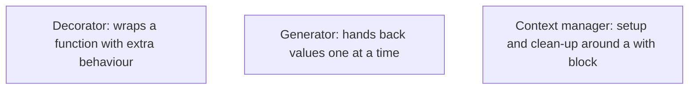

{:class="cover"}

---

By the end of this lesson you will be able to write a simple decorator, use a generator to produce values one at a time, and build a context manager that always switches a motor off.

---

Python is a rich language, and a few of its features make a big difference once you start writing larger programs. These three are used everywhere in robotics code and libraries, so it is worth recognising them even before you write your own.

## Watch the video



In this livestream I go beyond the basics with Python for robotics.

## Python decorators

A decorator wraps another function to extend what it does, without permanently modifying it. You apply one with an `@` line above the function.


def my_decorator(func):
    def wrapper():
        print("Before function call")
        func()
        print("After function call")
    return wrapper

@my_decorator
def say_hello():
    print("Hello!")

say_hello()  # prints: Before function call, Hello!, After function call



That `wrapper()` only works for functions with no arguments. A more general decorator passes everything through, and keeps the original function's name with `functools.wraps`. This one times how long a function takes, which is handy for finding the slow part of a robot's control loop:


import functools
import time

def timer(func):
    @functools.wraps(func)
    def wrapper(*args, **kwargs):
        start = time.perf_counter()
        result = func(*args, **kwargs)
        print(f"{func.__name__} took {time.perf_counter() - start:.3f}s")
        return result
    return wrapper

@timer
def add(a, b):
    return a + b

print(add(2, 3))



`@timer` is shorthand for `add = timer(add)`. This `time.perf_counter()` is a computer-side function. On a MicroPython board such as the Pico you would use `time.ticks_ms()` instead.

## Python generators

A generator is a function that uses `yield` to hand back values one at a time, only when asked. A list of a million readings takes a lot of memory, but a generator makes each one on demand. You cannot index a generator, but you can loop over it.


import random

def sensor_readings(count):
    """Pretend to read a distance sensor, one value at a time."""
    for _ in range(count):
        yield 50 + random.randint(-5, 5)

for reading in sensor_readings(3):
    print(reading)

# A generator can describe a huge stream without building it
stream = sensor_readings(1_000_000)
print(next(stream))   # only the first value has been made so far



`next()` asks a generator for its next value. Your numbers will differ because they are random.

## Python context managers

You have already used one: `with open(...)` closes the file for you. A context manager is any object that does some **setup** when a `with` block starts and some **clean-up** when it ends, even if an error happens in the middle. You can build your own with two special methods, `__enter__` and `__exit__`. This one makes sure a motor always gets switched off:


class MotorGuard:
    """Make sure the motor is switched off, whatever happens."""

    def __enter__(self):
        print("Motor on")
        return self

    def __exit__(self, exc_type, exc_value, traceback):
        print("Motor off")
        return False   # do not hide any error

with MotorGuard():
    print("Driving...")

try:
    with MotorGuard():
        raise RuntimeError("wheel stuck")
except RuntimeError as error:
    print("Caught:", error)



Both runs print `Motor off`, even the one that failed. Returning `False` from `__exit__` lets the error carry on up to your `except`.

---

## Try it Yourself

1. Add a `@timer` decorator to a function that loops through `range(1_000_000)`. How long does it take?
1. Write a generator `countdown(n)` that yields `n`, `n - 1`, down to 1, and loop over it.
1. Change `MotorGuard` so it also prints `Motor error!` in `__exit__` when `exc_type` is not `None`.
1. Challenge: write a decorator `announce` that prints the function's name before running it, using `functools.wraps`.

## Common Issues

- **Problem**: `TypeError: wrapper() takes 0 positional arguments but 2 were given`.
- **Solution**: Make the wrapper accept anything with `def wrapper(*args, **kwargs)` and pass them on.
- **Why**: The wrapper replaces the original function, so it has to accept the same arguments.

- **Problem**: Looping over the same generator a second time gives nothing.
- **Solution**: Call the generator function again to get a fresh generator, or store the values in a list.
- **Why**: A generator is used up once all its values have been produced.

- **Problem**: `AttributeError: __enter__` when using `with`.
- **Solution**: Check the class defines both `__enter__` and `__exit__`, with the double underscores on each side.
- **Why**: The `with` statement looks for exactly those method names.

## Check your understanding


? What keyword turns a function into a generator?
- [ ] `return`
- [x] `yield`
- [ ] `generate`
> A function containing `yield` hands back values one at a time.

? What does the `@timer` line above a function do?
- [x] Wraps the function with the `timer` decorator
- [ ] Runs the function on a schedule
- [ ] Makes the function private
> `@timer` is shorthand for `add = timer(add)`.

? When does the `__exit__` method of a context manager run?
- [ ] Only if the block succeeds
- [x] When the `with` block ends, even if an error happened
- [ ] Before the block starts
> That is what makes a context manager good for clean-up such as switching a motor off.


---

## Summary

You have met decorators, generators and context managers, and seen how each one keeps robot code tidy. Next we will put everything together in a project.
