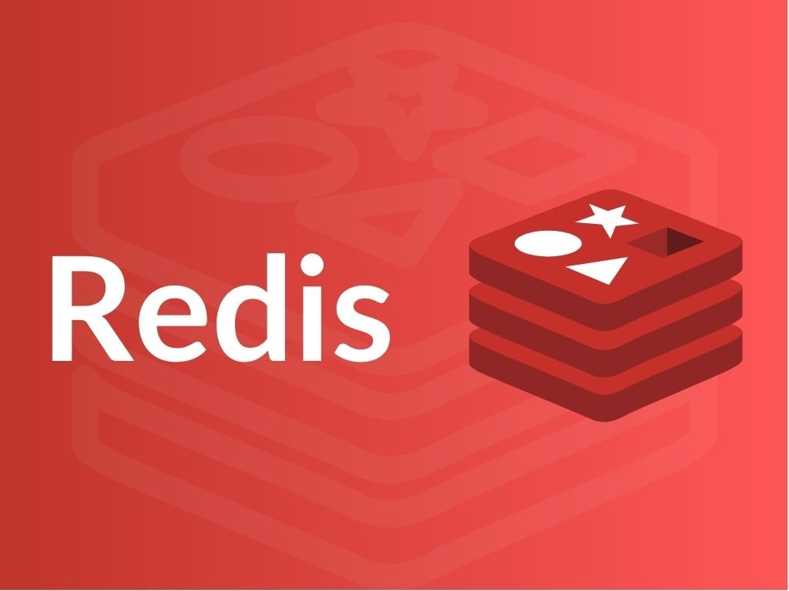

{:class="cover"}

### Overview

Welcome to the `Using Redis with Python` course! Redis is a super-fast data store that lives in memory. It's used everywhere from big websites to home projects, for caching, counters, queues, leaderboards and sending messages between programs. You could use it to pass sensor readings from a robot to a dashboard, for example.

### Course Content

1. **Introduction** - what Redis is and what it's good for
2. **Redis basics** - install Redis and connect from Python
3. **Data types** - a quick tour of strings, hashes, lists, sets and sorted sets
4. **Commands and transactions** - run several commands together safely, and handle errors
5. **Lists, sets, hashes and sorted sets** - one lesson on each, in more depth
6. **Pub/sub** - send messages between programs
7. **Summary** - a recap and where to go next

### Prerequisites

You should be comfortable writing simple Python programs. If you're new to Python, take [Python for beginners](/learn/python/) first.

### How the course works

Each lesson explains a topic, shows the Redis commands, then shows the same thing in Python. Most lessons end with a quick quiz, and your progress is saved in your browser and shown in the sidebar.

---

### Lesson Content

In this lesson, we will cover:

* [What is Redis?](#what-is-redis)
* [Redis use cases](#redis-use-cases)
* [Where to download Redis](#where-to-download-redis)

---

### What is Redis?

Redis is an in-memory data structure store that can be used as a database, cache, and message broker. Redis supports a wide variety of data structures, including strings, hashes, lists, sets, and sorted sets. Redis is designed to be fast, efficient, and scalable.

---

### Redis use cases

Redis has many use cases, including:

* Caching frequently accessed data to improve application performance
* Storing session data for web applications
* Building real-time applications with pub/sub messaging
* Implementing leaderboards, analytics, and other high-performance applications

---

### Where to download Redis

Redis runs on Linux and macOS, including the Raspberry Pi. On Windows, run it with Docker or WSL. You'll find installation instructions on the official Redis website at <https://redis.io/downloads/>, and the next lesson walks you through the easiest options.

> ## Redis or Valkey?
>
> In 2024 Redis changed its licence, and the Linux Foundation started [Valkey](https://valkey.io), an open source fork. Valkey works with the same commands and the same Python library, so everything in this course works with either.

---

### Key Takeaways

After completing this course, you will be able to:

* Install Redis and connect to it from Python
* Store and retrieve strings, hashes, lists, sets and sorted sets
* Group commands into transactions and handle errors
* Send messages between programs with pub/sub

---

### What you'll need

To complete this lesson, you will need:

* A computer with Python 3 installed. A Raspberry Pi works well
* An internet connection to install Redis and the `redis` Python library

---

### Conclusion

In this lesson, we introduced Redis and its use cases. We covered what Redis is, why you should use it, and where to download it. In the next lesson, we will cover how to use Redis with Python.

---
