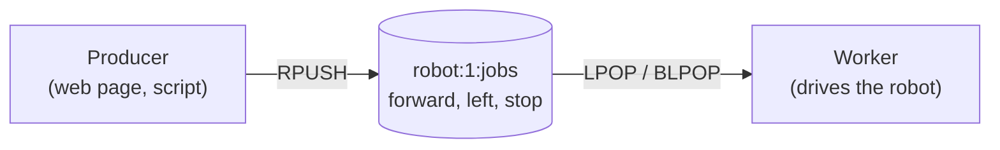

{:class="cover"}

---

By the end of this lesson you will be able to build a job queue with a Redis list, keep only the latest few readings with `ltrim`, and explain why a list is a better queue than pub/sub.

---

## Overview

A Redis list is an ordered collection of strings. You can add to either end and take from either end, and both are very fast even with millions of items, because Redis lists are built for working at the ends. Reaching into the middle of a long list is slower, so lists shine as **queues** and **recent history**, not as something you search.

Two jobs a maker will meet constantly:

- **A queue of commands**: a web page or a script adds jobs ("forward", "left", "stop") and the robot takes them one at a time
- **The last N readings**: a rolling window of the newest values for a graph



Pushing on the right and popping from the left means the first job in is the first job out, just like a queue at the shop.

## Adding, reading and removing

```
127.0.0.1:6379> rpush robot:1:jobs forward left stop
(integer) 3
127.0.0.1:6379> llen robot:1:jobs
(integer) 3
127.0.0.1:6379> lpop robot:1:jobs
"forward"
127.0.0.1:6379> lrange robot:1:jobs 0 -1
1) "left"
2) "stop"
```

- `rpush` adds to the end (right) and replies with the new length. `lpush` adds to the start (left)
- `lpop` removes and returns the first item, and `rpop` the last
- `llen` gives the length
- `lrange key 0 -1` shows everything: `0` is the first item and `-1` means the last one

If the list is empty, `lpop` returns `(nil)` straight away. A worker that loops on `lpop` would spin the processor. The fix is `blpop`, which waits for you.

## A job queue in Python

`blpop` means blocking pop: it sleeps until something arrives or a timeout runs out. Save this as `queue_demo.py`:

```python
import redis

r = redis.Redis(host='localhost', port=6379, decode_responses=True)
r.delete('robot:1:jobs')

# Producer: queue some jobs
r.rpush('robot:1:jobs', 'forward', 'left', 'forward', 'stop')
print('Queued', r.llen('robot:1:jobs'), 'jobs')

# Worker: take jobs until none arrive for 1 second
while True:
    item = r.blpop('robot:1:jobs', timeout=1)
    if item is None:
        print('No more jobs')
        break
    key, job = item
    print('Doing:', job)
```

It prints:

```
Queued 4 jobs
Doing: forward
Doing: left
Doing: forward
Doing: stop
No more jobs
```

`blpop` returns a pair, the key name and the value, because it can watch several lists at once. When the timeout passes with nothing to take it returns `None`. In a real robot you would run the producer and the worker as two separate programs, and the worker would wait forever with `timeout=0`.

> ## Why not use pub/sub for jobs?
>
> Pub/sub (lesson 9) throws a message away if nobody is listening. A list keeps jobs safely until a worker takes them, so a robot that is switched off for a minute still gets its jobs when it wakes up.

## Keep the last 10 readings

`ltrim` cuts a list down to a range. Combine it with `lpush` and the list never grows beyond the size you choose:

```python
import redis

r = redis.Redis(host='localhost', port=6379, decode_responses=True)
r.delete('readings')

def log_reading(value):
    r.lpush('readings', value)   # newest first
    r.ltrim('readings', 0, 9)    # keep only 10

for v in range(15):
    log_reading(v)

print(r.lrange('readings', 0, -1))
```

This prints:

```
['14', '13', '12', '11', '10', '9', '8', '7', '6', '5']
```

The newest reading is at the front, and readings 0 to 4 have been dropped. This is the same trick used to keep a rolling log without a cleanup job.

## Try it Yourself

1. In `redis-cli`, `lpush` the numbers 40, 42 and 39 onto `recent:distance`. In which order does `lrange` show them?
2. Change `log_reading` to keep only the last 5 readings
3. Make the queue demo add two more jobs while the worker is running (use a second terminal and `redis-cli rpush`) and watch the worker pick them up
4. Challenge: write a worker that treats the job `stop` as the signal to exit the loop

## Common Issues

- **Problem**: The worker loop uses 100% of the processor.
- **Solution**: Use `blpop` with a timeout instead of calling `lpop` in a tight loop.
- **Why**: `lpop` returns immediately when the list is empty, so the loop never rests.

- **Problem**: Jobs come out in the wrong order.
- **Solution**: Use `rpush` to add and `lpop` to take (or `lpush` and `rpop`). Mixing `lpush` with `lpop` gives you a stack.
- **Why**: The first job in only comes out first if you add and remove at opposite ends.

- **Problem**: The list keeps growing forever.
- **Solution**: Add `ltrim` after each push, as in the `log_reading` example.
- **Why**: Redis keeps everything in memory until you remove it.

## Check your understanding


? What does `lrange mylist 0 -1` return?
- [ ] The first element
- [x] Every element in the list
- [ ] The last element
> `-1` means the last element, so 0 to -1 is the whole list.

? Which pair makes a first-in, first-out queue?
- [x] `rpush` to add, `lpop` to take
- [ ] `lpush` to add, `lpop` to take
- [ ] `ltrim` to add, `llen` to take
> Adding at one end and taking from the other keeps the order of arrival.

? Why use `blpop` instead of `lpop` in a worker?
- [ ] It deletes the whole list
- [x] It waits for a job instead of returning immediately when the list is empty
- [ ] It returns the job faster
> Blocking lets the worker sleep until work arrives, instead of spinning.


> **Teachers**: queues are a lovely way to show how a web page and a robot cooperate, but a shared server means a shared queue. If two groups use the same `robot:1:jobs` key, they will steal each other's jobs. Give every group its own key prefix, such as `team3:jobs`, and agree it before the first run.
