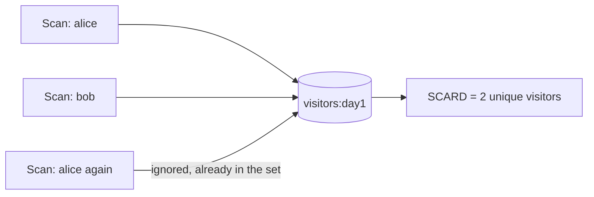

{:class="cover"}

---

By the end of this lesson you will be able to count unique items with a Redis set, test membership, and combine sets to find who came on both days.

---

## Overview

Imagine your robot greets people at a maker fair, or an RFID reader logs who opens the workshop door. People walk past again and again, but you only want to count each person **once**. That is exactly what a Redis set does: it stores unique strings with no order, and quietly ignores anything you add twice.



Adding, removing and checking membership all take the same short time however big the set gets, so sets stay quick even with thousands of members.

## Adding and checking

```
127.0.0.1:6379> sadd visitors:day1 alice bob carol
(integer) 3
127.0.0.1:6379> sadd visitors:day1 alice
(integer) 0
127.0.0.1:6379> scard visitors:day1
(integer) 3
127.0.0.1:6379> sismember visitors:day1 bob
(integer) 1
127.0.0.1:6379> sismember visitors:day1 zed
(integer) 0
```

- `sadd` returns how many members were **new**, so adding `alice` a second time gives `0`
- `scard` counts the members, which is your unique-visitor total
- `sismember` answers `1` for yes and `0` for no. Python gives you the same `1` or `0`, so `if r.sismember(...)` still works
- `srem` removes a member, `smembers` lists them all, and `spop` removes and returns a random one

## Comparing sets

Sets really shine when you combine them. Let's add a second day:

```
127.0.0.1:6379> sadd visitors:day2 bob dave
(integer) 2
127.0.0.1:6379> sinter visitors:day1 visitors:day2
1) "bob"
127.0.0.1:6379> sunion visitors:day1 visitors:day2
1) "alice"
2) "bob"
3) "carol"
4) "dave"
127.0.0.1:6379> sdiff visitors:day2 visitors:day1
1) "dave"
```

- `sinter` is the **intersection**: who came on both days
- `sunion` is the **union**: everyone who came on either day
- `sdiff` is the **difference**: members of the first set that are not in the second, so here, people who are new on day 2

Redis does not promise any order for set members, so the order you see may differ from ours.

## A door log in Python

Save this as `door_log.py`. It pretends an RFID reader scanned some badges over two days:

```python
import redis

r = redis.Redis(host='localhost', port=6379, decode_responses=True)
r.delete('visitors:day1', 'visitors:day2')

day1_scans = ['alice', 'bob', 'alice', 'carol', 'bob', 'alice']
day2_scans = ['bob', 'dave', 'bob']

for badge in day1_scans:
    r.sadd('visitors:day1', badge)
for badge in day2_scans:
    r.sadd('visitors:day2', badge)

print('Scans on day 1:', len(day1_scans))
print('Unique visitors on day 1:', r.scard('visitors:day1'))
print('Back for day 2:', sorted(r.sinter('visitors:day1', 'visitors:day2')))
print('Everyone:', sorted(r.sunion('visitors:day1', 'visitors:day2')))
print('New on day 2:', sorted(r.sdiff('visitors:day2', 'visitors:day1')))
print('Is carol a visitor?', r.sismember('visitors:day1', 'carol'))
```

It prints:

```
Scans on day 1: 6
Unique visitors on day 1: 3
Back for day 2: ['bob']
Everyone: ['alice', 'bob', 'carol', 'dave']
New on day 2: ['dave']
Is carol a visitor? 1
```

Six scans, but only three people. We wrapped the results in `sorted()` only to make the printed order predictable, because sets have no order.

> ## Counting really big crowds
>
> A set stores every member, so a million visitors means a million strings in memory. Redis has a cheaper, approximate counter called HyperLogLog for huge counts, but a set is the right tool while you need exact answers or want to ask "is this one in there?".

## Try it Yourself

1. In `redis-cli`, create a set `sensors:fitted` holding `ultrasonic`, `camera` and `imu`. Check whether `lidar` is a member
2. Add a third day to `door_log.py` and find who has come on all three days. Hint: `sinter` takes several keys
3. Use `sdiff` to find who came on day 1 but not on day 2
4. Challenge: make the set remove itself at midnight by giving it a time to live (the expiry lesson shows how)

## Common Issues

- **Problem**: The members print in a different order from the lesson.
- **Solution**: Wrap the result in `sorted()` if you need a stable order.
- **Why**: Sets are unordered, and Redis may return members in any order.

- **Problem**: `sadd` returns `0` and you think it failed.
- **Solution**: Nothing is wrong. Use `scard` to confirm the member is there.
- **Why**: `0` means the member was already in the set, so nothing new was added.

- **Problem**: `smembers` on a huge set freezes the server for a moment.
- **Solution**: Use `scard` to count, `sismember` to check one member, or `sscan` to read it in small chunks.
- **Why**: `smembers` returns every member in one go.

## Check your understanding


? What does `sadd` return when you add an element that's already in the set?
- [x] 0
- [ ] 1
- [ ] An error
> It returns how many new elements were added, so a duplicate gives 0.

? Which command finds the visitors who came on both days?
- [ ] `sunion`
- [x] `sinter`
- [ ] `sdiff`
> `sinter` is the intersection: members found in every set you name.

? Six badge scans came from three different people. What does `scard` report?
- [ ] 6
- [x] 3
- [ ] 0
> A set holds each member once, so `scard` counts unique members.


> **Teachers**: a visitor log is personal data. If learners scan real names or school badge numbers, remember data protection rules at your school, and keep the data on a local server. A good classroom alternative is to use made-up nicknames or random numbers, which teach the same idea with nothing sensitive stored.
