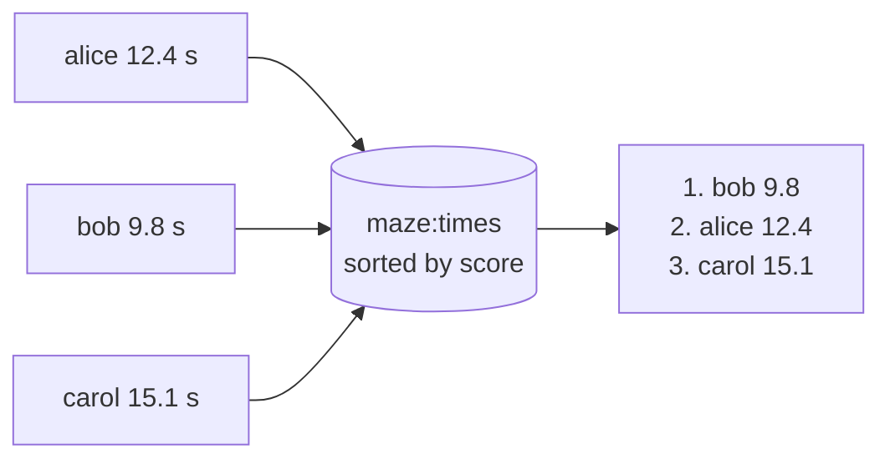

{:class="cover"}

---

By the end of this lesson you will be able to build a leaderboard with a Redis sorted set, read the top few entries in either direction, and keep only each player's best time.

---

## Overview

A sorted set is a set with a twist: every member carries a numeric **score**, and Redis keeps the members in score order all the time. Members are unique, but two members can share a score. You never sort anything yourself. You just add entries and ask for a slice.

That makes sorted sets perfect for anything ranked: the fastest robots through a maze, the top scores in a game you wrote, or the nearest obstacles ordered by distance.



## Adding and ranking

```
127.0.0.1:6379> zadd maze:times 12.4 alice 9.8 bob 15.1 carol
(integer) 3
127.0.0.1:6379> zadd maze:times 8.9 alice
(integer) 0
127.0.0.1:6379> zrange maze:times 0 -1 withscores
1) "alice"
2) "8.9"
3) "bob"
4) "9.8"
5) "carol"
6) "15.1"
127.0.0.1:6379> zrank maze:times alice
(integer) 0
127.0.0.1:6379> zscore maze:times carol
"15.1"
```

- `zadd` takes score first, then the member. Adding `alice` again with a new score **updates** her score, and replies `0` because no new member was created
- `zrange key 0 -1` returns members from the **lowest** score up. For maze times, lowest is best
- `withscores` includes the scores
- `zrank` is a member's position counting from 0 at the lowest score, and `zscore` gives the score itself

For a game where a high score wins, you want the highest first. Use `rev`:

```
127.0.0.1:6379> zadd points 120 alice 95 bob 150 carol
(integer) 3
127.0.0.1:6379> zincrby points 40 bob
"135"
127.0.0.1:6379> zrange points 0 2 rev withscores
1) "carol"
2) "150"
3) "bob"
4) "135"
5) "alice"
6) "120"
127.0.0.1:6379> zrevrank points bob
(integer) 1
```

- `zincrby` adds to a member's score and replies with the new total
- `zrange ... rev` counts from the highest. Older tutorials use `zrevrange`, which still works but `zrange` with `rev` is the current spelling
- `zrevrank` is the position counting from the highest, so `bob` is second (index 1)
- `zrangebyscore points 130 +inf` returns members whose score is 130 or more, `zrem` removes a member, and `zcard` counts them

## A maze leaderboard in Python

Save this as `leaderboard.py`. It records maze runs and keeps only each robot's best time:

```python
import redis

r = redis.Redis(host='localhost', port=6379, decode_responses=True)
r.delete('maze:times')

def record_run(robot, seconds):
    # lt=True: only update if the new score is lower (a better time)
    r.zadd('maze:times', {robot: seconds}, lt=True)

record_run('alice', 12.4)
record_run('bob', 9.8)
record_run('carol', 15.1)
record_run('alice', 8.9)     # alice improves
record_run('bob', 11.0)      # bob is slower, so this is ignored

print('Top 3 fastest:')
board = r.zrange('maze:times', 0, 2, withscores=True)
for place, (robot, seconds) in enumerate(board, start=1):
    print(place, robot, seconds)

print('Robots ranked:', r.zcard('maze:times'))
print("Carol's place:", r.zrank('maze:times', 'carol') + 1)
```

It prints:

```
Top 3 fastest:
1 alice 8.9
2 bob 9.8
3 carol 15.1
Robots ranked: 3
Carol's place: 3
```

Let's unpack it. With `lt=True` Redis only updates a member whose new score is lower than the old one, so a slow run never overwrites a personal best. (The `lt` option needs Redis 6.2 or newer.) `withscores=True` makes Python return `(member, score)` pairs, with the score as a float, and `enumerate(..., start=1)` turns positions into friendly places. We added 1 to `zrank` because ranks start at 0.

> ## Scores are numbers
>
> Unlike set members and hash values, a score is a real floating point number, so `zscore` comes back as a `float` in Python. Members are still text.

## Try it Yourself

1. In `redis-cli`, add four players to a `points` sorted set, then use `zrange ... rev` to see the top two
2. In `leaderboard.py`, change it so higher is better (a points table) using `gt=True` and `desc=True`
3. Add a `zincrby` call so each run adds 10 points to a season total in a second sorted set
4. Challenge: use `zrangebyscore` to list every robot that finished the maze in under 10 seconds

## Common Issues

- **Problem**: The best player is at the bottom of the list.
- **Solution**: Add `desc=True` in Python (or `rev` in `redis-cli`) when a high score is best.
- **Why**: Redis always sorts from the lowest score up unless you say otherwise.

- **Problem**: `AttributeError: 'str' object has no attribute 'items'` when you write `zadd('board', 'alice', 12.4)`.
- **Solution**: In Python, pass a dictionary: `zadd('board', {'alice': 12.4})`.
- **Why**: The Python library takes `{member: score}`, while `redis-cli` takes score first.

- **Problem**: A player's best time was overwritten by a worse one.
- **Solution**: Use `lt=True` for lowest-wins tables, or `gt=True` for highest-wins tables.
- **Why**: A plain `zadd` always replaces the old score.

## Check your understanding


? In a sorted set, what must be unique?
- [x] The members
- [ ] The scores
- [ ] Both
> Two players can have the same score, but each player appears only once.

? How do you get the highest scores first in Python?
- [ ] `zrange('points', 0, 2)`
- [x] `zrange('points', 0, 2, desc=True)`
> `desc=True` reverses the order.

? What does `lt=True` do in `zadd`?
- [ ] Locks the key
- [x] Only updates a member if the new score is lower
- [ ] Limits the table to ten entries
> It keeps each robot's personal best time when lower is better.


> **Teachers**: leaderboards are motivating, but a public ranking of children's scores can upset some learners. Consider ranking teams or robots instead of individuals, or showing only the top three. If you run a school competition, remember that a Redis on an open network can be edited by anyone who can reach it, so keep the server private to your own classroom.
