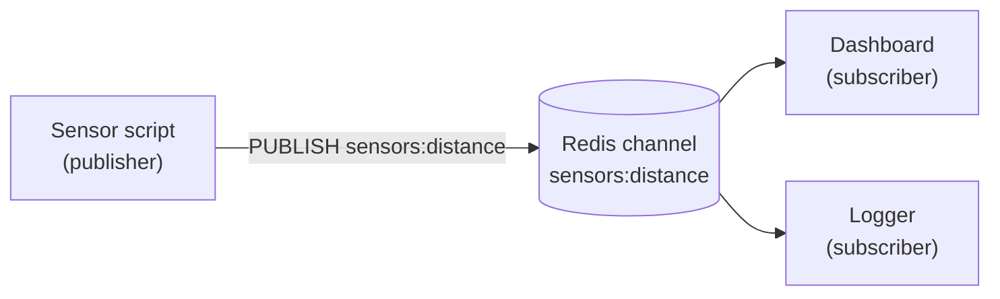

{:class="cover"}

---

By the end of this lesson you will be able to publish readings to a Redis channel, subscribe to it from another program, and explain when pub/sub is the right tool and when a list is safer.

---

## Overview

Lists and hashes are about **keeping** data. Pub/sub is about **telling** someone right now. A **publisher** sends a message to a named **channel**, and every **subscriber** listening to that channel receives it instantly. The publisher does not know who is listening, and the subscribers do not know who is sending.

That makes it a lovely way to link the parts of a robot project. A sensor script publishes `distance` readings, a dashboard shows them, and a logger saves them, all without any of them knowing about each other.



> ## What about the Pico?
>
> `redis-py` is a Python library for a computer such as a Raspberry Pi, and it is not part of the Pico's MicroPython firmware. A common pattern is for the Pico to send its readings over USB serial or Wi-Fi to a Pi, and for a small Python script on the Pi to publish them to Redis. In this lesson we simulate the Pico with random numbers, so you need no hardware.

## Publish and subscribe by hand

Open two terminals with `redis-cli`. In the first, subscribe:

```
127.0.0.1:6379> subscribe sensors:distance
1) "subscribe"
2) "sensors:distance"
3) (integer) 1
```

The terminal now waits. In the second, publish:

```
127.0.0.1:6379> publish sensors:distance 42.5
(integer) 1
```

The `1` means one subscriber received it. The first terminal prints:

```
1) "message"
2) "sensors:distance"
3) "42.5"
```

If you publish when nobody is subscribed, Redis replies `(integer) 0` and the message is gone for good. Redis does not keep it.

## A sensor and a dashboard in Python

Pub/sub needs two programs running at once: one listening and one sending. The subscriber must start **first**, or it will miss messages.

Save this as `dashboard.py` and run it first:

```python
import redis

r = redis.Redis(host='localhost', port=6379, decode_responses=True)

pubsub = r.pubsub()
pubsub.subscribe('sensors:distance')

print('Dashboard listening...')
for message in pubsub.listen():
    if message['type'] == 'message':
        if message['data'] == 'stop':
            print('Sensor says stop. Goodbye!')
            break
        print('Distance:', message['data'], 'cm')
```

Then, in a second terminal, save and run `sensor.py`:

```python
import random
import time
import redis

r = redis.Redis(host='localhost', port=6379, decode_responses=True)

for _ in range(3):
    distance = round(random.uniform(10, 100), 1)
    listeners = r.publish('sensors:distance', distance)
    print('Sent', distance, 'to', listeners, 'subscriber(s)')
    time.sleep(0.5)

r.publish('sensors:distance', 'stop')
```

With `dashboard.py` running, the sensor prints something like this (the numbers are random):

```
Sent 69.9 to 1 subscriber(s)
Sent 24.1 to 1 subscriber(s)
Sent 31.8 to 1 subscriber(s)
```

and the dashboard shows:

```
Dashboard listening...
Distance: 69.9 cm
Distance: 24.1 cm
Distance: 31.8 cm
Sensor says stop. Goodbye!
```

Let's see why it works.

- `pubsub.subscribe()` starts listening on a channel, and `pubsub.listen()` waits for messages, handing each one to the loop as a dictionary
- The first item you receive is a confirmation whose `type` is `'subscribe'`, which is why we only act on messages whose `type` is `'message'`
- `publish()` returns how many subscribers received the message, so a `0` tells the sender nobody is listening
- We use a `'stop'` message as a signal so the demo ends cleanly. In a real dashboard you would just press Ctrl+C

You can subscribe to several channels with one call (`subscribe('sensors:distance', 'sensors:battery')`), or to a whole family with a pattern: `pubsub.psubscribe('sensors:*')`.

> ## Pub/sub does not remember
>
> A message is delivered to whoever is listening at that moment and then forgotten. A dashboard that starts a second late misses it, and a subscriber that crashes loses messages until it reconnects. If the latest value matters, also store it in a string or hash. If jobs must not be lost, use a list as a queue, as in lesson 5.

## Try it Yourself

1. Run two copies of `dashboard.py` in different terminals, then run `sensor.py`. What does the sensor report?
2. Change the channel names so battery readings go to `sensors:battery`, and make the dashboard subscribe to both
3. Use `psubscribe('sensors:*')` so the dashboard hears every sensor channel
4. Challenge: publish a JSON message with `json.dumps({'distance': 42.5, 'battery': 7.3})`, and have the dashboard decode it with `json.loads`

## Common Issues

- **Problem**: The dashboard prints nothing.
- **Solution**: Start the dashboard first, and check both programs use exactly the same channel name.
- **Why**: Pub/sub drops messages that have no listener, and a typo makes a different channel.

- **Problem**: `publish` returns `0`.
- **Solution**: Start a subscriber on that channel, then publish again.
- **Why**: `0` means no one was listening, so the message was thrown away.

- **Problem**: The first thing the dashboard prints is a strange dictionary with `subscribe` in it.
- **Solution**: Only handle messages where `message['type'] == 'message'`.
- **Why**: Redis first sends a confirmation that the subscription worked.

## Check your understanding


? A message is published before any subscriber is listening. What happens to it?
- [ ] It's stored until someone subscribes
- [x] It's lost
- [ ] Redis returns an error
> Pub/sub doesn't store messages. Use a list as a queue if messages must not be missed.

? What does the number returned by `publish()` tell you?
- [ ] How long the message is
- [x] How many subscribers received it
- [ ] The message's position in the queue
> A result of 0 means nobody was listening.

? You want a dashboard to show the latest reading even if it starts late. What should you do as well as publishing?
- [x] Also store the reading in a string or hash
- [ ] Publish it twice
- [ ] Switch the channel to a list
> Pub/sub forgets messages, so keep the latest value in a key a new dashboard can read.


> **Teachers**: pub/sub needs two programs running together, so each pair needs two terminal windows, and it is the lesson where learners most often start things in the wrong order. A good routine is "listener first, sender second". Everyone on a shared server who uses the same channel name will hear each other's messages, which makes a fun demo, but agree channel names with a team prefix such as `team3:sensors` if you want separate results.
