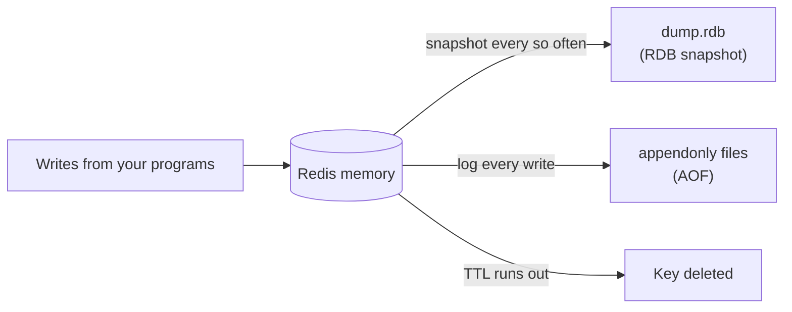

{:class="cover"}

---

By the end of this lesson you will be able to give keys a time to live, use that to build a small cache, and explain what RDB snapshots and the append-only file do to keep your data after a restart.

---

## Overview

Two questions every Redis user meets sooner or later. First, **how do I stop old data piling up?** Second, **what happens to my data if the power goes off?** Redis lives in memory, so the second question is a fair worry. The answers are expiry and persistence.



## Keys that expire

Give a key a **time to live** (TTL) and Redis deletes it for you when the time is up. It is perfect for caches and for anything that goes stale, like "robot online" flags.

```
127.0.0.1:6379> set cache:weather sunny ex 5
OK
127.0.0.1:6379> ttl cache:weather
(integer) 5
127.0.0.1:6379> set robot:1:name BurgerBot
OK
127.0.0.1:6379> ttl robot:1:name
(integer) -1
127.0.0.1:6379> expire robot:1:name 100
(integer) 1
127.0.0.1:6379> persist robot:1:name
(integer) 1
127.0.0.1:6379> ttl nokey
(integer) -2
```

- `set key value ex 5` stores a value and sets a 5 second life in one step. Use `px` for milliseconds
- `ttl` shows the seconds left. `-1` means the key exists and never expires, and `-2` means the key does not exist (or has already gone)
- `expire key seconds` adds a TTL to an existing key, and `persist` removes it

One trap catches everybody. A plain `set` on a key that already has a TTL **removes the TTL**:

```
127.0.0.1:6379> set cache:weather cloudy
OK
127.0.0.1:6379> ttl cache:weather
(integer) -1
```

If you want to change the value and keep the countdown, add `keepttl`: `set key value keepttl`.

### A tiny cache

Let's cache a slow lookup, such as asking a weather website. Save this as `cache_demo.py`:

```python
import time
import redis

r = redis.Redis(host='localhost', port=6379, decode_responses=True)
r.delete('cache:weather')

def slow_weather_lookup():
    time.sleep(1)           # pretend this is a slow web request
    return 'sunny'

def get_weather():
    cached = r.get('cache:weather')
    if cached is not None:
        return cached + ' (from cache)'
    result = slow_weather_lookup()
    r.set('cache:weather', result, ex=2)    # remember it for 2 seconds
    return result + ' (fresh)'

print(get_weather())
print(get_weather())
time.sleep(2.5)
print(get_weather())
```

It prints:

```
sunny (fresh)
sunny (from cache)
sunny (fresh)
```

The first call is slow and stores the answer. The second finds it in Redis and returns at once. After two seconds the key deletes itself, so the third call fetches a fresh answer. Redis removes expired keys both when you touch them and with a background sweep, so you never need to clean up yourself.

## Persistence: surviving a restart

Because Redis keeps data in memory, a power cut could lose it. Redis can write to disk in two ways, and you can use either or both.

**RDB snapshots** save the whole dataset to a file called `dump.rdb` at set times. Recent Redis versions use rules such as "save after 3600 seconds if at least 1 key changed, after 300 seconds if 100 changed, after 60 seconds if 10,000 changed". It is compact and quick to restore, but you can lose everything written since the last snapshot.

**AOF (append-only file)** logs every write command, and Redis replays the log on start-up. With the default setting `appendfsync everysec`, the file is flushed to disk about once a second, so a crash loses at most around a second of writes. It is more thorough and the files are bigger.

You can look at your server's settings:

```
127.0.0.1:6379> config get save
1) "save"
2) "3600 1 300 100 60 10000"
127.0.0.1:6379> config get appendonly
1) "appendonly"
2) "no"
127.0.0.1:6379> config get appendfsync
1) "appendfsync"
2) "everysec"
```

On our test server (the official Docker image) snapshots were on and the AOF was off. Your install may differ, since a package from your Linux distribution brings its own configuration file. To turn the AOF on while the server is running, use `config set appendonly yes`. To keep that setting after a restart, put `appendonly yes` in `redis.conf`.

To see it work, we stored a key and a list, restarted the Redis container (`docker restart redis`), and read them back. Both were still there, because a clean shutdown with snapshot rules configured writes a final `dump.rdb`.

> ## Docker and persistence
>
> Redis writes its files into the `/data` folder. If you delete a container, that folder goes with it. To keep your data, start the container with a named volume: `docker run -d --name redis -p 127.0.0.1:6379:6379 -v redis-data:/data redis`.

Persistence is not a backup. If the SD card in your Pi corrupts or the files are deleted, the data is gone. Copy `dump.rdb` somewhere safe if the data matters. And remember Redis is not a replacement for a database you must never lose: for a robot's sensor history, SQLite or a file may be a better home, with Redis for the live, fast-changing bits.

## Try it Yourself

1. In `redis-cli`, set a key with `ex 30`, then run `ttl` a few times and watch it count down
2. Change `cache_demo.py` so the cache lasts 5 seconds, and call `get_weather()` every second for ten seconds
3. Use `set ... keepttl` to change a value without resetting its countdown, and confirm with `ttl`
4. Challenge: run `config get dir` and `config get dbfilename` to find where your snapshot lives, then work out how you would copy it as a backup

## Common Issues

- **Problem**: A key you gave a TTL never expires.
- **Solution**: Check whether a later plain `set` overwrote it. Use `ttl` to see `-1`, and add `ex` or `keepttl` to your `set`.
- **Why**: Writing a key again with `set` clears its TTL unless you ask to keep it.

- **Problem**: Your data vanished after you removed and recreated the Docker container.
- **Solution**: Start Redis with a volume mounted on `/data`.
- **Why**: Without a volume, the snapshot files lived inside the old container.

- **Problem**: You enabled the AOF with `config set` and it was off again after a reboot.
- **Solution**: Add `appendonly yes` to your `redis.conf` file.
- **Why**: `config set` changes the running server only, not the file on disk.

## Check your understanding


? What does `ttl` return for a key that exists but has no expiry?
- [ ] 0
- [x] -1
- [ ] -2
> `-1` means no expiry, while `-2` means the key does not exist.

? What happens to a key's TTL if you run a plain `set` on it?
- [x] The TTL is removed
- [ ] The TTL is kept
- [ ] Redis raises an error
> Use `keepttl` to change the value but keep the countdown.

? With the AOF using `appendfsync everysec`, how much data can you lose in a crash?
- [ ] Everything since the last snapshot
- [x] About one second of writes
- [ ] Nothing at all
> The file is flushed to disk about once a second.


> **Teachers**: expiry makes data vanish, which can look like a bug to a learner. If a lesson runs over two sessions, anything with a short TTL will be gone next time, so say so up front. Persistence settings also differ between Linux installs and Docker, so don't assume every machine behaves like the examples. Never run `flushall` on a server other groups use, since it deletes every key for everyone.
