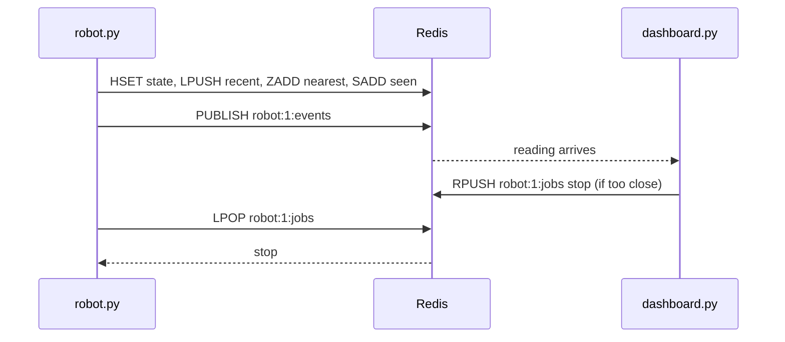

{:class="cover"}

---

By the end of this lesson you will be able to build a two-program system where a robot reports its state through Redis and a dashboard watches it live and sends back commands.

---

## Overview

Time to put everything together. We will build a small **telemetry hub**: a pretend robot that reports its distance sensor every half second, and a dashboard that watches the readings, warns about close obstacles and tells the robot to stop. No hardware is needed. The robot is a Python script with random numbers, and when you are ready you can swap in readings from a real sensor.

Each part of Redis does the job it is best at:

| Job | Redis feature | Key |
| --- | --- | --- |
| Latest state, vanishing if the robot goes quiet | Hash with expiry | `robot:1:state` |
| Last 5 distance readings | List with `ltrim` | `robot:1:recent` |
| Closest approach per robot | Sorted set | `nearest` |
| Which robots have ever reported | Set | `robots:seen` |
| Live readings to the dashboard | Pub/sub channel | `robot:1:events` |
| Commands back to the robot | List used as a queue | `robot:1:jobs` |
{:class="table table-single"}



## The robot

Save this as `robot.py`. It uses `random.seed(3)` so you get the same readings as the output below. Remove that line for different numbers each time.

```python
import random
import time
import redis

r = redis.Redis(host='localhost', port=6379, decode_responses=True)
random.seed(3)

for tick in range(1, 7):
    distance = round(random.uniform(5, 60), 1)

    with r.pipeline() as pipe:
        pipe.hset('robot:1:state', mapping={'mode': 'explore', 'distance': distance})
        pipe.expire('robot:1:state', 5)
        pipe.lpush('robot:1:recent', distance)
        pipe.ltrim('robot:1:recent', 0, 4)
        pipe.zadd('nearest', {'robot:1': distance}, lt=True)
        pipe.sadd('robots:seen', 'robot:1')
        pipe.execute()

    r.publish('robot:1:events', distance)
    print('Reading', tick, ':', distance, 'cm')

    time.sleep(0.5)    # give the dashboard time to reply
    job = r.lpop('robot:1:jobs')
    if job:
        print('  Robot obeys:', job)

r.publish('robot:1:events', 'done')
```

Each tick does five Redis jobs in one pipeline, so the state, history, record and "seen" set stay in step. Then it publishes the reading for anyone watching, and finally checks its job queue for orders.

## The dashboard

Save this as `dashboard.py`. It listens, raises the alarm, and prints a summary at the end:

```python
import redis

r = redis.Redis(host='localhost', port=6379, decode_responses=True)
r.delete('robot:1:state', 'robot:1:recent', 'robot:1:jobs', 'nearest', 'robots:seen')

pubsub = r.pubsub()
pubsub.subscribe('robot:1:events')
print('Dashboard waiting for the robot...')

for message in pubsub.listen():
    if message['type'] != 'message':
        continue
    if message['data'] == 'done':
        break
    distance = float(message['data'])
    print('Dashboard sees', distance, 'cm')
    if distance < 20:
        print('  Too close! Sending stop')
        r.rpush('robot:1:jobs', 'stop')

print()
print('Robots seen:', sorted(r.smembers('robots:seen')))
print('State:', r.hgetall('robot:1:state'))
print('Last 5:', r.lrange('robot:1:recent', 0, -1))
print('Closest approach:', r.zrange('nearest', 0, 0, withscores=True))
```

## Running it

Start the dashboard first (it clears old data and subscribes), then the robot in a second terminal. The robot prints:

```
Reading 1 : 18.1 cm
  Robot obeys: stop
Reading 2 : 34.9 cm
Reading 3 : 25.3 cm
Reading 4 : 38.2 cm
Reading 5 : 39.4 cm
Reading 6 : 8.6 cm
  Robot obeys: stop
```

The dashboard prints:

```
Dashboard waiting for the robot...
Dashboard sees 18.1 cm
  Too close! Sending stop
Dashboard sees 34.9 cm
Dashboard sees 25.3 cm
Dashboard sees 38.2 cm
Dashboard sees 39.4 cm
Dashboard sees 8.6 cm
  Too close! Sending stop

Robots seen: ['robot:1']
State: {'mode': 'explore', 'distance': '8.6'}
Last 5: ['8.6', '39.4', '38.2', '25.3', '34.9']
Closest approach: [('robot:1', 8.6)]
```

Follow one stop command round the loop. The robot publishes 18.1 cm, the dashboard sees it and pushes `stop` onto the job list, and half a second later the robot takes the job off the list and obeys. The `Last 5` list holds the newest five readings, newest first, so the very first reading (18.1) has already been trimmed away. The closest approach is 8.6 cm, held in the sorted set. Your exact timings may vary a little, but the same readings give the same story.

## Ideas to extend it

- Use a real sensor: on a Pi, read it with Python, or have a Pico send readings over serial to a Pi script that replaces the random numbers
- Add `robot:2` and watch the set and the leaderboard cope with two robots
- Store the battery voltage too, and publish JSON so the dashboard receives both values in one message

## Try it Yourself

1. Run the pair twice. What does the dashboard's cleanup line do for the second run?
2. Change the alarm distance from 20 to 15 and predict which readings now trigger a stop
3. Make the robot take **all** waiting jobs each tick, using a `while` loop around `lpop`
4. Challenge: add a second dashboard window that only prints the closest approach each time the sorted set changes

## Common Issues

- **Problem**: The dashboard waits forever and never prints the summary.
- **Solution**: Check the robot ran after the dashboard started, and that it reached the final `done` message.
- **Why**: Pub/sub drops messages with no listener, so a dashboard that starts late misses the `done` signal.

- **Problem**: The summary shows an empty `State: {}`.
- **Solution**: Read the state straight after the robot finishes. Increase the `expire` value if you need longer.
- **Why**: The state hash expires 5 seconds after the last update.

- **Problem**: `float()` raises `ValueError`.
- **Solution**: Make sure the dashboard handles `done` before converting the message to a number.
- **Why**: The text `done` is not a number.

## Check your understanding


? Why does the robot also store the latest state in a hash, as well as publishing it?
- [ ] Publishing does not work without a hash
- [x] A dashboard that starts late can still read the latest state
- [ ] Hashes are faster than channels
> Pub/sub forgets messages, but the hash stays until it expires.

? Which feature gives the robot its commands without losing them if it is busy?
- [ ] Pub/sub
- [x] A list used as a queue
- [ ] A set
> A list keeps the jobs until the robot takes them.

? What does `zadd('nearest', {'robot:1': distance}, lt=True)` record?
- [x] The lowest distance the robot has reported
- [ ] The latest distance
- [ ] The average distance
> `lt=True` only replaces the score when the new one is lower.


> **Teachers**: this project suits pairs, with one learner on each program. It runs in about 90 minutes including the extension ideas. The dashboard clears the project keys when it starts, so make sure pairs on a shared Redis use their own key prefix, or they will delete each other's data. If you add a real sensor, check how your school treats camera or microphone sensors, and keep the robot's wiring away from mains power.
