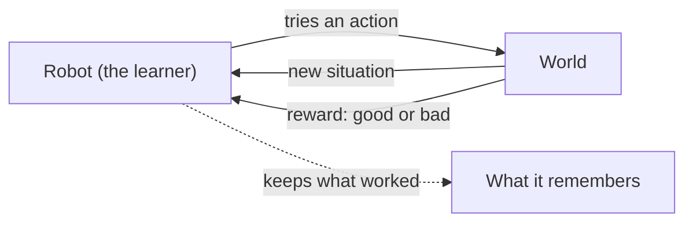

{:class="cover"}

---

By the end of this lesson you will be able to explain why a fixed set of rules can fail in a room it was not written for, and describe in plain words how reinforcement learning replaces rules with reward and practice.

---

Let's start with an honest conversation about the robots most of us have built.

You write a `forward()` function and a `turn_right()`. You pick a threshold: "if the sensor reads under 20 cm, turn right". It works on the kitchen table. You put it on the living-room floor and it crashes into the sofa leg. You change the threshold to 25 cm. Now it spins in a corner for thirty seconds. You stay up until midnight adding more `if` statements.

Sound familiar?

---

## The hardcoded approach

The typical beginner loop looks like this:

```python
def navigate():
    while True:
        distance = get_distance()

        if distance < 20:
            stop()
            turn_right()
        else:
            forward()
```
{: .no-snakie }

It is perfectly reasonable code, but it hides an assumption: **the programmer already knows the right response to every situation the robot will meet.**

Let's see that assumption fail. This program simulates a robot with exactly one rule, "if something is in the way, turn right", in a 7 by 7 room with a big box in the middle. The goal is one cell away from the box, but the rule never takes the robot there.

```python
SIZE = 7
BLOCK = {(r, c) for r in range(2, 5) for c in range(2, 5)}   # a big box in the middle
GOAL = (1, 3)
HEADINGS = [(-1, 0), (0, 1), (1, 0), (0, -1)]    # north, east, south, west


def blocked(r, c):
    return not (0 <= r < SIZE and 0 <= c < SIZE) or (r, c) in BLOCK


def run_rule_robot(steps=200):
    row, col, heading = 3, 0, 1          # start on the left edge, facing east
    visited = set()
    for step in range(1, steps + 1):
        dr, dc = HEADINGS[heading]
        if blocked(row + dr, col + dc):  # the whole "brain": one if-statement
            heading = (heading + 1) % 4  # turn right
        else:
            row, col = row + dr, col + dc
            visited.add((row, col))
        if (row, col) == GOAL:
            return f"Reached the goal after {step} steps"
    return f"Gave up after {steps} steps, having visited {len(visited)} cells"


print(run_rule_robot())
```

The output is:

```
Gave up after 200 steps, having visited 27 cells
```

The robot never crashes, and it never gets anywhere either. It circles the walls of the room for ever, because the rule was written for a different room. Every new room needs a new rule, and every new rule can fight an old one.

---

## The dog-training analogy

Think about how you train a dog to sit. You do not hand it a rulebook. You create a feedback signal: when it sits, it gets a treat. Over many repetitions the dog works out the strategy for itself.

Reinforcement learning is that idea applied to software:



- The **robot** is the dog
- The **task** (reach the goal without bumping) is the trick
- The **reward** is the treat
- **Many attempts** replace the training sessions

The robot's code does not contain the answer at the start. It is discovered through experience.

---

## Where each approach wins

| Hardcoded rules | Learned behaviour |
|---|---|
| You write the rules | The robot discovers the rules |
| Quick for simple, known tasks | Slower to set up, copes with more variety |
| Fails in situations you did not imagine | Can cope with situations seen in training |
| Debugging means editing `if` statements | Debugging means adjusting rewards and training |
| Easy to read | Readable here because the Q-table is small |
{:class="table table-single"}

Be careful with that "copes with more variety". A learned policy only handles situations that look like the ones it practised on. And for a simple problem, `if distance < 20: turn_right()` is often the right answer: do not reach for RL when a rule solves it.

> **Note:** this course is a teaching toy. We learn on a small grid in simulation, which is how the ideas are best understood. Real robots that learn to walk or grasp use far bigger methods and a lot of computing power. We will say clearly which ideas carry over in lesson 14.

---

## Try it Yourself

1. Change `GOAL` in the program to `(3, 6)` and run it. Why does the rule robot now "succeed"? What does that tell you about testing a robot in only one room?
2. Move the start to `row, col, heading = 0, 0, 1` and change the goal back to `(1, 3)`. Does the robot reach it? Try three different starts.
3. Challenge: edit the rule so the robot also turns left every tenth step. Can a tweak like that fix the problem, or just move it?

## Common Issues

- **Problem**: The program prints "Reached the goal" when I expected it to fail.
- **Solution**: Check that `GOAL = (1, 3)` and that `BLOCK` still uses `range(2, 5)` in both places.
- **Why**: The goal at `(3, 6)` lies on the robot's loop around the room, so only goals off that loop expose the weakness.

- **Problem**: I thought RL would be better than rules for everything.
- **Solution**: Use rules when you can write them confidently, and reach for learning when you cannot.
- **Why**: Learning costs training time and gives you a policy that is harder to guarantee than a rule.

## Check your understanding


? Why did the one-rule robot never reach the goal?
- [ ] It crashed into the box
- [x] The rule made it circle the walls, and the goal was not on that loop
- [ ] The goal was blocked by an obstacle
> The robot never crashed. It followed its rule perfectly, but the rule suited a different layout.

? In the dog-training analogy, what plays the part of the treat?
- [ ] The task
- [ ] The robot
- [x] The reward signal
> The reward is the feedback that tells the learner whether it did something worth repeating.

? When is a hardcoded rule still the better choice?
- [x] When the problem is simple and you can write the rule confidently
- [ ] Never, learning is always better
- [ ] Only when the robot has no sensors
> Learning needs training time and is harder to guarantee, so simple, well-understood tasks are often best left to rules.


---

Next up, we give these ideas precise names: agent, environment, state, action and reward.
