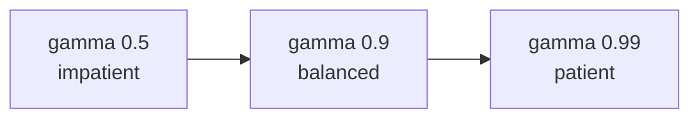

{:class="cover"}

---

By the end of this lesson you will be able to calculate a discounted return, explain what the discount factor gamma does, and use the Bellman idea to spread a goal's value backwards along a path.

---

Would you rather have £10 now, or £10 in six months? Most people take it now. The future is uncertain, and money in hand can be put to work. Reinforcement learning captures that intuition with one number called the **discount factor**, written **gamma** (the Greek letter γ).

---

## The discount factor

Gamma is a number between 0 and 1 that says how much the agent cares about future rewards compared with immediate ones. A reward that arrives `k` steps from now is multiplied by `gamma ** k`. With gamma = 0.9:

| Steps away | Weight | A reward of 10 is worth |
|---|---|---|
| 0 (now) | 1.00 | 10.0 |
| 1 | 0.90 | 9.0 |
| 5 | 0.59 | 5.9 |
| 10 | 0.35 | 3.5 |
{:class="table table-single"}

The further away a reward is, the less it pulls on today's decision. That is what makes a robot prefer the *short* route to a goal: the same prize, fewer steps of shrinking.

---

## Discounted return

The **return** is the total of all the rewards that follow, each discounted. We will trace a corridor where the robot takes four small-cost steps, then reaches the goal for +10, and compare three values of gamma.

```python
gamma = 0.9
rewards = [-0.1, -0.1, -0.1, -0.1, 10.0]    # four small costs, then the goal


def discounted_return(rewards, gamma, start_step=0):
    """Sum the future rewards, shrinking each by gamma for every step away."""
    total = 0.0
    for k, r in enumerate(rewards[start_step:]):
        total += (gamma ** k) * r
    return total


for start in (0, 1, 4):
    print(f"Return from step {start}: {discounted_return(rewards, gamma, start):.4f}")

print()
for g in (0.5, 0.9, 0.99):
    print(f"gamma = {g:<4}: return from step 0 = {discounted_return(rewards, g):.3f}")


def bellman_value(reward, gamma, next_state_value):
    """V(s) = r + gamma * V(s')"""
    return reward + gamma * next_state_value


one_away = bellman_value(-0.1, 0.9, 10.0)
two_away = bellman_value(-0.1, 0.9, one_away)
print()
print(f"One step from the goal:  {one_away:.2f}")
print(f"Two steps from the goal: {two_away:.2f}")
```

Output:

```
Return from step 0: 6.2171
Return from step 1: 7.0190
Return from step 4: 10.0000

gamma = 0.5 : return from step 0 = 0.438
gamma = 0.9 : return from step 0 = 6.217
gamma = 0.99: return from step 0 = 9.212

One step from the goal:  8.90
Two steps from the goal: 7.91
```

Being one step closer is worth more (7.02 against 6.22), because the big +10 is discounted one fewer time. That gradient is what Q-learning follows. Notice also how gamma changes the picture: at 0.5 the goal is almost invisible from the start, while at 0.99 it is almost fully felt.

---

## The Bellman idea

Richard Bellman noticed that the value of a situation can be written in terms of the next one. Here **V(s)** means "the value of being in state s", and **s'** (read "s prime") means the state you land in next:

```python
# V(s) = r + gamma * V(s')
# "How good is it here?" = "what I get now" + "a bit less than how good the next place is"
```
{: .no-snakie }

The last lines of the program use it. A state one step from the goal is worth `-0.1 + 0.9 * 10 = 8.90`. A state two steps away is worth `-0.1 + 0.9 * 8.90 = 7.91`. The value fades smoothly with distance, and each update passes the goal's value one step further back. Q-learning does exactly this, bit by bit, over many episodes.

---

## Choosing gamma



- **Low (around 0.5)**: ignores anything more than a few steps away. Stable, but poor at long tasks.
- **Medium (0.9)**: our default. A goal 15 steps away still carries about 0.9 to the power 15, roughly 0.2, of its value.
- **High (0.99)**: plans far ahead, but learning is slower because the value has to travel further.

---

## Try it Yourself

1. Use `discounted_return` with gamma 0.9 on `[-0.1, -10.0, -0.1, -0.1, 10.0]` (a bump at step 1). How much does the bump cost, compared with the original sequence?
2. Find the smallest gamma where the return from step 0 is positive for the original rewards. Try values by hand or loop over them.
3. Write `bellman_sequence(rewards, gamma)` that works backwards from the last reward and prints the value at each step. Check it matches `discounted_return`.
4. Challenge: a goal 30 steps away with a +10 reward. At gamma 0.9, what is its value from the start, ignoring step costs? What does that say about using 0.9 on big arenas?

## Common Issues

- **Problem**: My agent seems to ignore a far-off goal.
- **Solution**: Raise gamma toward 0.95 or 0.99, or add shaping rewards.
- **Why**: With a low gamma a distant reward shrinks to almost nothing.

- **Problem**: Training swings wildly.
- **Solution**: Try a lower gamma such as 0.8.
- **Why**: A shorter horizon makes value estimates depend on fewer uncertain future steps.

- **Problem**: Can gamma be exactly 1?
- **Solution**: Only for tasks that always end. Keep gamma below 1 otherwise.
- **Why**: With gamma = 1 an endless task can add up rewards (or costs) without limit, so the values never settle.

## Check your understanding


? With gamma = 0.9, roughly how much is a reward worth that arrives 5 steps away?
- [ ] 90% of its face value
- [x] About 59% of its face value
- [ ] 10% of its face value
> The weight is 0.9 to the power 5, which is about 0.59.

? Why is the return from step 1 larger than from step 0 in our corridor?
- [ ] The step costs are smaller
- [x] The big reward is discounted one fewer time
- [ ] Gamma is larger at step 1
> One step closer to the goal means one fewer factor of gamma on the +10.

? What does the Bellman idea say?
- [x] The value here is the reward now plus the discounted value of the next state
- [ ] The value here is the sum of all past rewards
- [ ] The value here is always the goal reward
> It links each state's value to its neighbour's, so value spreads backwards from the goal.


---

Next up: the Q-table itself, the robot's cheat sheet.
