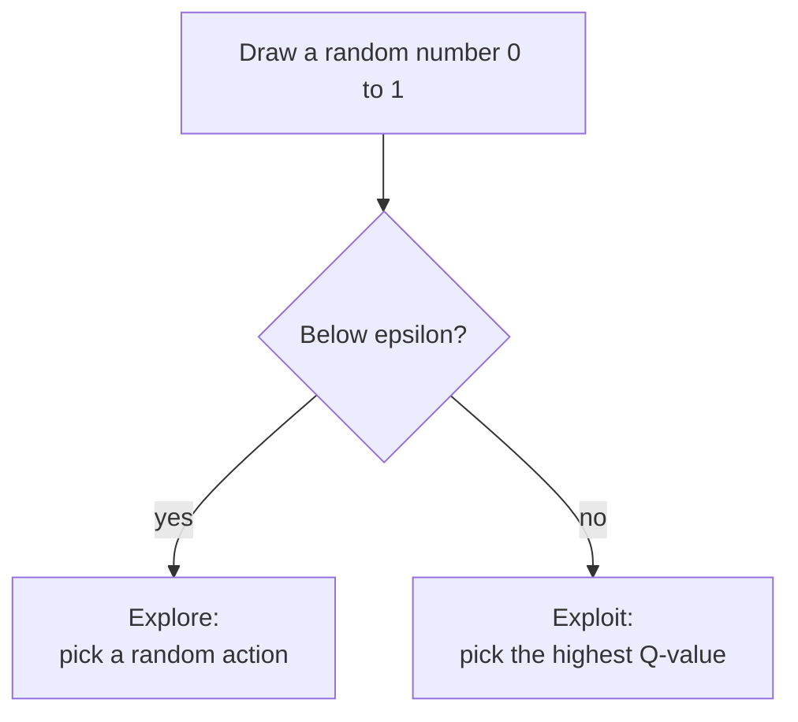
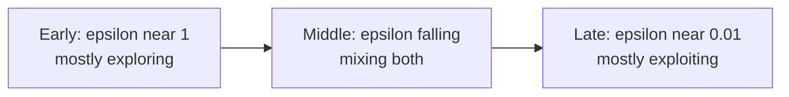

{:class="cover"}

---

By the end of this lesson you will be able to explain the exploration-exploitation dilemma, write an epsilon-greedy action chooser, and decay epsilon over a training run.

---

Imagine a half-learned Q-table. In your current state `turn_left` looks promising (Q = 1.2) and `forward` looks risky (Q = -0.5). Should you always turn left?

Not necessarily. Early in training the Q-values are rough guesses from very little experience. If you always pick the highest one, you may lock in a mediocre habit before you ever discover a better one. If you always pick at random, you never use what you have learned. This is the **exploration-exploitation dilemma**, and every RL algorithm has to deal with it.

---

## The epsilon-greedy strategy

The most popular fix is simple. Most of the time, pick the best-known action (**exploit**). With a small probability, pick a random one (**explore**). That probability is **epsilon** (the Greek letter ε), a number between 0 and 1.



With `epsilon = 0.1` the agent explores 10% of the time. The next program shows why this matters. Our robot has three actions whose true average rewards it does not know: `turn_left` is really the best at 2.0, but `forward` (1.0) looks fine if you only ever try it. Each reward is noisy, and the agent nudges its estimate toward each reward it sees.

```python
import random

ACTIONS = ["forward", "turn_left", "turn_right"]
# The true average reward of each action (the robot does not know these)
TRUE_MEAN = {"forward": 1.0, "turn_left": 2.0, "turn_right": 0.2}


def pull(action):
    """Try an action once and get a noisy reward."""
    return random.gauss(TRUE_MEAN[action], 1.0)


def choose_action(q, epsilon):
    """Epsilon-greedy: explore with probability epsilon, otherwise exploit."""
    if random.random() < epsilon:
        return random.choice(ACTIONS)                          # explore
    best = max(q.values())
    return random.choice([a for a in ACTIONS if q[a] == best])  # exploit, ties broken at random


def run(epsilon, steps=1000, alpha=0.1):
    q = {a: 0.0 for a in ACTIONS}
    total = 0.0
    for _ in range(steps):
        action = choose_action(q, epsilon)
        reward = pull(action)
        q[action] += alpha * (reward - q[action])    # nudge the estimate toward the reward
        total += reward
    return total / steps, max(q, key=q.get)


random.seed(42)
print(f"{'epsilon':>8} {'avg reward':>11}  favourite action")
for eps in (0.0, 0.1, 0.3, 1.0):
    avg, favourite = run(eps)
    print(f"{eps:>8.1f} {avg:>11.2f}  {favourite}")

print()
epsilon, decay_rate, epsilon_min = 1.0, 0.995, 0.01
for episode in range(1001):
    if episode in (0, 50, 100, 200, 300, 500, 750, 1000):
        print(f"Episode {episode:4d}: epsilon = {epsilon:.4f}")
    epsilon = max(epsilon_min, epsilon * decay_rate)
```

The output with the seed fixed:

```
 epsilon  avg reward  favourite action
     0.0        0.99  forward
     0.1        1.93  turn_left
     0.3        1.73  turn_left
     1.0        1.10  turn_left

Episode    0: epsilon = 1.0000
Episode   50: epsilon = 0.7783
Episode  100: epsilon = 0.6058
Episode  200: epsilon = 0.3670
Episode  300: epsilon = 0.2223
Episode  500: epsilon = 0.0816
Episode  750: epsilon = 0.0233
Episode 1000: epsilon = 0.0100
```

Read the table from the top:

- **epsilon 0.0** never explores. With this seed its first random tie-break picked `forward`, which paid out, and it stuck with it, scoring about 1.0 and never discovering `turn_left`.
- **epsilon 0.1** explored just enough to find `turn_left`, then mostly used it. It scores about 1.93, close to the best possible 2.0.
- **epsilon 1.0** explores every time, so it never uses what it learns and scores about the average of all three actions. Its estimates are right (`turn_left` is favourite), but it does not act on them.

The exact numbers shift if you change the seed, but the pattern holds: a little exploration pays for itself.

---

## Epsilon decay

At the start of training the Q-table is empty and exploring is valuable. Late in training the table holds hard-won knowledge, and random moves just waste time. **Epsilon decay** shrinks epsilon as training goes on: after each episode multiply it by a `decay_rate` slightly below 1, but never let it drop under `epsilon_min`, so a little curiosity is always left.

The second half of the program prints how that plays out with `decay_rate = 0.995`. Epsilon is about 0.78 after 50 episodes, 0.08 after 500, and is held at the 0.01 floor by episode 1000 (the raw value would be 0.0067).



### Tuning the decay

- A small grid that is quick to explore: `decay_rate = 0.99`, so epsilon is below 0.1 after about 230 episodes.
- A bigger or trickier task: `decay_rate = 0.999`, which keeps exploring for thousands of episodes.
- If training stalls early with a mediocre policy, slow the decay. If it converges slowly but the policy looks good, speed it up.

> **Tip:** print epsilon next to your episode rewards. You should see reward rise as epsilon falls. If it does not, check the reward function and the Q-update before blaming epsilon.

---

## Try it Yourself

1. Change `0.1` in the loop of epsilons to `0.05` and `0.02`. Does less exploration still find `turn_left`? Try three different seeds.
2. Work out, with a loop, the episode where epsilon first falls below 0.1 for `decay_rate` 0.99 and 0.999.
3. Make `TRUE_MEAN["forward"]` 3.0, so the first-found action really is best. Which epsilon wins now, and why?
4. Challenge: write `softmax_action(q, temperature)` that picks each action with probability proportional to `math.exp(q[a] / temperature)`. How does it behave compared with epsilon-greedy?

## Common Issues

- **Problem**: My agent is still mostly random after 200 episodes.
- **Solution**: Your decay is too slow. Try `decay_rate = 0.99` instead of `0.999`.
- **Why**: At 0.999, epsilon is still about 0.82 after 200 episodes.

- **Problem**: It settles on a policy quickly, but the policy is poor.
- **Solution**: Slow the decay down, or start epsilon at 1.0.
- **Why**: It stopped exploring before it found the better actions, like epsilon 0.0 above.

- **Problem**: Every action looks the same early on, so the agent always picks the first.
- **Solution**: Break ties at random, as `choose_action` does with `random.choice` over the best actions.
- **Why**: With all values at zero, `max()` alone always returns the first action, which biases early learning.

## Check your understanding


? What does epsilon control?
- [ ] How fast the agent learns
- [x] The probability of choosing a random action
- [ ] The size of the reward
> Epsilon is the explore probability. A higher epsilon means more random moves.

? Why did epsilon 0.0 score only about 1.0 in our experiment?
- [x] It never tried `turn_left`, so it never found the best action
- [ ] It crashed
- [ ] Its Q-values were negative
> Without exploring, the agent stayed with the first action that looked fine.

? Why keep an `epsilon_min` of about 0.01?
- [ ] To stop the Q-table growing
- [x] So a little curiosity is left even late in training
- [ ] To make rewards positive
> The floor keeps some exploration going rather than stopping completely.


---

Next up: the full Q-learning update rule, which ties everything together.
