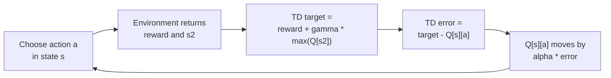

{:class="cover"}

---

By the end of this lesson you will be able to write the Q-learning update rule, explain each of its terms, and run a complete training loop that learns a policy from scratch.

---

We now have all the pieces: a Q-table (lesson 7), epsilon-greedy choices (lesson 8), a discount factor gamma (lesson 6) and a reward signal (lesson 3). This lesson joins them with **the Q-learning update rule**, the single line that makes the whole thing work.

---

## The update rule

Here it is in plain text, as a line of Python:

`Q[s][a] = Q[s][a] + alpha * (reward + gamma * max(Q[s2]) - Q[s][a])`

Every symbol, defined:

- **`s`** is the state the robot was in, **`a`** the action it took, and **`s2`** the state it landed in
- **`Q[s][a]`** is the current estimate of how good action `a` is in state `s`
- **`reward`** is what the environment paid for that step
- **`max(Q[s2])`** is the best Q-value available from the new state: our guess of the best the future can offer
- **`gamma`** is the discount factor from lesson 6
- **`alpha`** is the **learning rate**, a number between 0 and 1 saying how big a step to take toward new evidence

The expression `reward + gamma * max(Q[s2])` is the **TD target**: what `Q[s][a]` *should* be, according to this one experience (TD stands for temporal difference). The gap between that target and the current estimate is the **TD error**. Each update moves the estimate a fraction `alpha` of the way across that gap.



---

## A complete training program

Before the full grid world, let's watch the rule work on the smallest useful problem: a six-cell corridor with the goal in the last cell. Each step costs -1 and reaching the goal pays +10. The best possible episode is five moves, for 4 x (-1) + 10 = 6 points.

```python
import random

ACTIONS = ["left", "right"]
LENGTH = 6                                  # cells 0..5, goal at cell 5


class Corridor:
    def reset(self):
        self.position = 0
        return self.position

    def step(self, action):
        move = 1 if action == "right" else -1
        self.position = max(0, min(LENGTH - 1, self.position + move))
        done = self.position == LENGTH - 1
        return self.position, (10.0 if done else -1.0), done


def choose_action(q_table, state, epsilon):
    if random.random() < epsilon:
        return random.choice(ACTIONS)
    values = q_table[state]
    best = max(values.values())
    return random.choice([a for a in ACTIONS if values[a] == best])


def update_q(q_table, state, action, reward, next_state, alpha, gamma):
    """Q[s][a] = Q[s][a] + alpha * (reward + gamma * max(Q[s2]) - Q[s][a])"""
    current_q = q_table[state][action]
    best_future_q = max(q_table[next_state].values())
    td_target = reward + gamma * best_future_q
    td_error = td_target - current_q
    q_table[state][action] = current_q + alpha * td_error


def train(episodes=200, alpha=0.2, gamma=0.9, epsilon_start=1.0,
          decay_rate=0.98, epsilon_min=0.01, max_steps=100):
    env = Corridor()
    q_table = {s: {a: 0.0 for a in ACTIONS} for s in range(LENGTH)}
    epsilon = epsilon_start
    history = []
    for episode in range(episodes):
        state, total = env.reset(), 0.0
        for _ in range(max_steps):
            action = choose_action(q_table, state, epsilon)
            next_state, reward, done = env.step(action)
            update_q(q_table, state, action, reward, next_state, alpha, gamma)
            state, total = next_state, total + reward
            if done:
                break
        history.append(total)
        epsilon = max(epsilon_min, epsilon * decay_rate)
        if (episode + 1) % 50 == 0:
            avg = sum(history[-50:]) / 50
            print(f"Episode {episode + 1:4d} | avg reward (last 50): {avg:6.2f} | epsilon: {epsilon:.3f}")
    return q_table


random.seed(1)
q = train()
print()
print("cell   left   right   best")
for s in range(LENGTH - 1):
    best = max(q[s], key=q[s].get)
    print(f"{s:>4} {q[s]['left']:>6.2f} {q[s]['right']:>7.2f}   {best}")
```

Output:

```
Episode   50 | avg reward (last 50):  -0.88 | epsilon: 0.364
Episode  100 | avg reward (last 50):   4.26 | epsilon: 0.133
Episode  150 | avg reward (last 50):   5.72 | epsilon: 0.048
Episode  200 | avg reward (last 50):   5.70 | epsilon: 0.018

cell   left   right   best
   0   1.78    3.12   right
   1   1.79    4.58   right
   2   3.12    6.20   right
   3   4.58    8.00   right
   4   6.15   10.00   right
```

The average reward climbs from about -1 to about 5.7, close to the best possible 6. Now check the table against lesson 6. `Q[4]['right']` is 10.00, the goal reward. `Q[3]['right']` is `-1 + 0.9 * 10 = 8.00`. `Q[2]['right']` is `-1 + 0.9 * 8 = 6.20`. The goal's value has travelled backwards through the table, one step per level, exactly as the Bellman idea predicts. (Cell 5 is the goal, where the episode ends, so it never needs a row of its own values.)

> **Note:** the learned numbers will differ a little with a different seed. The pattern (right beats left everywhere, values fading by a factor of gamma each step back) will not.

---

## The three hyperparameters

Three numbers you choose, rather than learn, shape how Q-learning behaves:

| Setting | Typical values | Too low | Too high |
|---|---|---|---|
| alpha (learning rate) | 0.1 to 0.5 | Learning crawls | Estimates swing wildly |
| gamma (discount) | 0.9 to 0.99 | Short-sighted | Slow to converge |
| epsilon start and decay | start 1.0, decay 0.99 to 0.999 | Stops exploring too soon | Still random late on |
{:class="table table-single"}

The grid-world trainer in the next lesson uses `alpha = 0.2`, `gamma = 0.9`, `epsilon` from 1.0 decaying by 0.995 per episode.

---

## Try it Yourself

1. Change `alpha` to `0.01`, then `0.9`, and rerun. How do the averages at episodes 50 and 100 compare with `0.2`?
2. Change the goal reward from `10.0` to `20.0`. Predict `Q[4]['right']` before running, then check.
3. Print the TD error for the first 10 updates by adding a `print` inside `update_q`. Does it shrink as the table fills in?
4. Challenge: make the corridor 12 cells long. How many episodes does it need before the average reward is near the best possible?

## Common Issues

- **Problem**: Q-values explode to huge numbers.
- **Solution**: Lower `alpha` to 0.1 and keep rewards moderate.
- **Why**: A big step toward a big target overshoots, and the next target is even bigger.

- **Problem**: After many episodes the table is still mostly zeros.
- **Solution**: Raise `max_steps` or shrink the arena so episodes reach the goal.
- **Why**: Updates only carry information once the agent has met a non-zero reward.

- **Problem**: Reward improves, then dips for a while.
- **Solution**: That is usually fine. Check the trend over the whole run.
- **Why**: Occasional random exploration or an unlucky run can drag an average down temporarily.

## Check your understanding


? What does alpha control in the Q-learning update?
- [ ] How far ahead the agent plans
- [x] How big a step the estimate takes toward the new evidence
- [ ] How often the agent explores
> Alpha is the learning rate. Gamma is the planning horizon and epsilon is the exploration rate.

? In our corridor, why does `Q[3]['right']` settle at 8.00?
- [ ] The reward at cell 3 is 8
- [x] It equals -1 + 0.9 * 10, the step cost plus the discounted value of the next cell
- [ ] It is the average of left and right
> Each step back multiplies the future value by gamma and adds the step cost.

? What is the TD error?
- [x] The gap between the TD target and the current estimate
- [ ] The number of crashes in an episode
- [ ] The value of epsilon
> The update moves the estimate a fraction alpha of the way across that gap.


---

Next up: building the full grid-world simulation and watching the policy improve.
