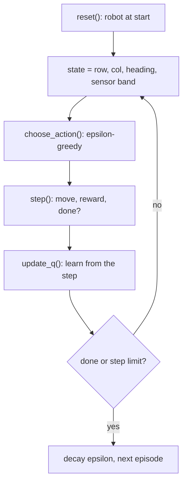

{:class="cover"}

---

By the end of this lesson you will be able to run a complete Q-learning trainer on a grid world, read its learning curve, and test the finished policy.

---

This is the lesson everything has been building toward. We will write one program, using only the Python standard library, that:

1. Simulates a robot on a 7 by 7 grid with obstacles
2. Trains a Q-learning agent over 600 episodes
3. Prints progress so you can watch the policy improve
4. Runs the finished policy once and draws the route it takes

---

## The grid world

The robot starts at the top-left and must reach the goal `G` at the bottom-right, without driving into an obstacle `O` or the wall. It has a position, a heading (north, east, south or west) and a simulated ultrasonic sensor that reports "near", "medium" or "far" for what is straight ahead.

```
. . . O . . .
. O . . . O .
. . . . . . .
O . . O . . .
. . . . . O .
. O . . . . .
. . . . . . G
```



The state is the tuple `(row, col, heading, band)`. The reward comes from lesson 3: -10 for a crash, +50 for the goal, +1 per forward move and -0.1 for anything else. A crash ends the episode.

---

## The complete training program

Save this whole listing as `train.py` and run it with `python3 train.py`. Notice how little is new: `choose_action`, `update_q` and the training loop are the functions from lessons 8 and 9.

```python
"""
BurgerBot Grid-World Q-Learning Trainer
========================================
Trains a tabular Q-learning agent to navigate a 7x7 grid with
obstacles and a goal. No external libraries required.

Run with: python3 train.py
"""

import random
import json
import ast
from collections import defaultdict


# ---------------------------------------------------------------------------
# Configuration
# ---------------------------------------------------------------------------

GRID_ROWS = 7
GRID_COLS = 7

# Obstacle positions (row, col): cannot be start or goal
OBSTACLES = {
    (0, 3), (1, 1), (1, 5),
    (3, 0), (3, 3), (4, 5),
    (5, 1),
}

START = (0, 0)   # top-left
GOAL  = (6, 6)   # bottom-right

ACTIONS = ["forward", "turn_left", "turn_right", "stop"]

# Headings: index maps to (delta_row, delta_col)
HEADINGS = ["north", "east", "south", "west"]
HEADING_DELTA = {
    "north": (-1,  0),
    "east":  ( 0,  1),
    "south": ( 1,  0),
    "west":  ( 0, -1),
}

# Sensor discretisation thresholds (in grid cells)
NEAR_THRESHOLD   = 1   # obstacle 1 cell ahead
MEDIUM_THRESHOLD = 3   # obstacle 2-3 cells ahead

# Training hyperparameters
NUM_EPISODES   = 600
ALPHA          = 0.2    # learning rate
GAMMA          = 0.9    # discount factor
EPSILON_START  = 1.0    # initial exploration probability
DECAY_RATE     = 0.995  # epsilon decay per episode
EPSILON_MIN    = 0.01   # minimum exploration probability
MAX_STEPS      = 150    # max steps per episode before giving up

Q_TABLE_FILE   = "grid_q_table.json"


# ---------------------------------------------------------------------------
# Environment
# ---------------------------------------------------------------------------

class GridWorld:
    """
    A 2-D grid-world environment for the BurgerBot simulation.

    The robot has a position (row, col) and a heading (one of HEADINGS).
    The ultrasonic sensor reads the distance to the nearest obstacle
    directly ahead, discretised into 'near', 'medium', or 'far'.
    """

    def __init__(self):
        self.reset()

    def reset(self):
        """Return the start state and reset the robot to the start position."""
        self.row, self.col = START
        self.heading = "east"   # start facing east (into the grid)
        self.done = False
        return self._get_state()

    def _get_state(self):
        """Return the current state as a tuple."""
        sensor = self._read_sensor()
        return (self.row, self.col, self.heading, sensor)

    def _read_sensor(self):
        """
        Simulate the HC-SR04 by counting cells ahead until
        a wall or obstacle is encountered.

        Returns: 'near', 'medium', or 'far'
        """
        dr, dc = HEADING_DELTA[self.heading]
        r, c = self.row + dr, self.col + dc
        cells_ahead = 0

        while 0 <= r < GRID_ROWS and 0 <= c < GRID_COLS:
            if (r, c) in OBSTACLES:
                break
            cells_ahead += 1
            if cells_ahead >= 5:   # sensor range limit
                break
            r += dr
            c += dc
        else:
            # Hit the grid boundary
            pass

        if cells_ahead <= NEAR_THRESHOLD:
            return "near"
        elif cells_ahead <= MEDIUM_THRESHOLD:
            return "medium"
        else:
            return "far"

    def step(self, action):
        """
        Execute an action and return (next_state, reward, done).

        Actions:
          'forward'   : move one cell in the current heading direction
          'turn_left' : rotate 90° anticlockwise (no position change)
          'turn_right': rotate 90° clockwise (no position change)
          'stop'      : do nothing (accumulates step cost)
        """
        if self.done:
            # Environment is already in a terminal state
            return self._get_state(), 0.0, True

        prev_row, prev_col = self.row, self.col
        hit_obstacle = False
        moved_forward = False

        if action == "forward":
            dr, dc = HEADING_DELTA[self.heading]
            new_r = self.row + dr
            new_c = self.col + dc

            if (0 <= new_r < GRID_ROWS and
                0 <= new_c < GRID_COLS and
                (new_r, new_c) not in OBSTACLES):
                # Valid move
                self.row, self.col = new_r, new_c
                moved_forward = True
            else:
                # Hit wall or obstacle
                hit_obstacle = True

        elif action == "turn_left":
            idx = HEADINGS.index(self.heading)
            self.heading = HEADINGS[(idx - 1) % 4]   # anticlockwise

        elif action == "turn_right":
            idx = HEADINGS.index(self.heading)
            self.heading = HEADINGS[(idx + 1) % 4]   # clockwise

        # "stop": no state change

        # Check for goal
        reached_goal = (self.row, self.col) == GOAL

        # Compute reward
        reward = self._compute_reward(hit_obstacle, reached_goal, moved_forward)

        # Episode ends on goal or obstacle collision
        if reached_goal or hit_obstacle:
            self.done = True

        next_state = self._get_state()
        return next_state, reward, self.done

    def _compute_reward(self, hit_obstacle, reached_goal, moved_forward):
        """Reward function from lesson 3."""
        if hit_obstacle:
            return -10.0
        if reached_goal:
            return +50.0
        if moved_forward:
            return +1.0
        return -0.1   # small penalty for turning or stopping


# ---------------------------------------------------------------------------
# Agent helpers  (from lessons 7, 8 and 9)
# ---------------------------------------------------------------------------

def make_q_table():
    return defaultdict(lambda: {a: 0.0 for a in ACTIONS})


def choose_action(q_table, state, epsilon):
    """epsilon-greedy action selection."""
    if random.random() < epsilon:
        return random.choice(ACTIONS)
    action_values = q_table[state]
    return max(action_values, key=lambda a: action_values[a])


def update_q(q_table, state, action, reward, next_state, alpha, gamma):
    """Q-learning update rule."""
    current_q    = q_table[state][action]
    best_next_q  = max(q_table[next_state].values())
    td_target    = reward + gamma * best_next_q
    td_error     = td_target - current_q
    q_table[state][action] += alpha * td_error
    return q_table


def run_episode(env, q_table, alpha, gamma, epsilon, max_steps):
    """Run one training episode. Return total reward."""
    state      = env.reset()
    total_reward = 0.0

    for _ in range(max_steps):
        action = choose_action(q_table, state, epsilon)
        next_state, reward, done = env.step(action)
        update_q(q_table, state, action, reward, next_state, alpha, gamma)
        state = next_state
        total_reward += reward
        if done:
            break

    return total_reward


# ---------------------------------------------------------------------------
# Save / load Q-table
# ---------------------------------------------------------------------------

def save_q_table(q_table, filename):
    serialisable = {str(k): v for k, v in q_table.items()}
    with open(filename, "w") as f:
        json.dump(serialisable, f, indent=2)
    print(f"\nSaved {len(q_table)} states to '{filename}'")


def load_q_table(filename):
    with open(filename, "r") as f:
        raw = json.load(f)
    return {ast.literal_eval(k): v for k, v in raw.items()}


# ---------------------------------------------------------------------------
# Training
# ---------------------------------------------------------------------------

def print_progress_bar(recent_avg, width=20):
    """Simple ASCII progress indicator based on recent average reward."""
    # Map the [-10, 60] reward range onto the bar
    filled = int((recent_avg + 10) / 70 * width)
    filled = max(0, min(width, filled))
    bar = "#" * filled + "-" * (width - filled)
    return f"[{bar}] {recent_avg:7.2f}"


def train():
    env      = GridWorld()
    q_table  = make_q_table()
    epsilon  = EPSILON_START
    history  = []   # total reward per episode

    print("=" * 60)
    print("  BurgerBot Q-Learning Trainer")
    print(f"  Grid: {GRID_ROWS}x{GRID_COLS}  |  Obstacles: {len(OBSTACLES)}")
    print(f"  Episodes: {NUM_EPISODES}  |  alpha={ALPHA}  gamma={GAMMA}")
    print("=" * 60)
    print(f"  {'Episode':>8}  {'Avg reward (50 ep)':>20}  {'Epsilon':>8}")
    print("-" * 60)

    for episode in range(NUM_EPISODES):
        ep_reward = run_episode(env, q_table, ALPHA, GAMMA, epsilon, MAX_STEPS)
        history.append(ep_reward)

        epsilon = max(EPSILON_MIN, epsilon * DECAY_RATE)

        if (episode + 1) % 50 == 0:
            recent_avg = sum(history[-50:]) / 50
            bar = print_progress_bar(recent_avg)
            print(f"  {episode+1:>8d}  {bar}  {epsilon:>8.4f}")

    print("=" * 60)
    print(f"  Training complete. Final Q-table: {len(q_table)} states")

    # Save Q-table for deployment to Pico
    save_q_table(q_table, Q_TABLE_FILE)
    return q_table, history


# ---------------------------------------------------------------------------
# Demo: run one greedy episode and render it
# ---------------------------------------------------------------------------

def demo_policy(q_table, max_steps=50):
    """Run one greedy episode (epsilon = 0) and print what the robot did."""
    env = GridWorld()
    state = env.reset()
    trail = [(env.row, env.col)]
    actions = []
    reached_goal = False
    for _ in range(max_steps):
        action = choose_action(q_table, state, epsilon=0.0)
        state, reward, done = env.step(action)
        actions.append(action)
        trail.append((env.row, env.col))
        if done:
            reached_goal = (env.row, env.col) == GOAL
            break
    print("\n--- Demo: greedy policy (epsilon = 0) ---")
    print("Actions:", " ".join(a[0] if a == "forward" else
                               {"turn_left": "L", "turn_right": "R", "stop": "S"}[a]
                               for a in actions))
    print(f"Steps taken: {len(actions)}")
    print("Reached the goal!" if reached_goal else "Did not reach the goal.")
    print()
    for r in range(GRID_ROWS):
        row_str = ""
        for c in range(GRID_COLS):
            if (r, c) in OBSTACLES:
                row_str += "O "
            elif (r, c) == GOAL:
                row_str += "G "
            elif (r, c) in trail:
                row_str += "* "
            else:
                row_str += ". "
        print(row_str)

# ---------------------------------------------------------------------------
# Entry point
# ---------------------------------------------------------------------------

if __name__ == "__main__":
    random.seed(0)   # reproducible results
    q_table, history = train()
    demo_policy(q_table)
```

---

## What you should see

With `random.seed(0)` fixed, you get this output every time:

```
============================================================
  BurgerBot Q-Learning Trainer
  Grid: 7x7  |  Obstacles: 7
  Episodes: 600  |  alpha=0.2  gamma=0.9
============================================================
   Episode    Avg reward (50 ep)   Epsilon
------------------------------------------------------------
        50  [--------------------]   -8.58    0.7783
       100  [#-------------------]   -5.75    0.6058
       150  [##------------------]   -1.38    0.4715
       200  [#######-------------]   14.74    0.3670
       250  [########------------]   19.68    0.2856
       300  [##############------]   41.44    0.2223
       350  [##################--]   54.14    0.1730
       400  [##################--]   54.29    0.1347
       450  [###################-]   58.63    0.1048
       500  [###################-]   59.75    0.0816
       550  [##################--]   53.66    0.0635
       600  [###################-]   59.53    0.0494
============================================================
  Training complete. Final Q-table: 156 states

Saved 156 states to 'grid_q_table.json'

--- Demo: greedy policy (epsilon = 0) ---
Actions: R f f L f f f f R f f f f L f f
Steps taken: 16
Reached the goal!

* . . O . . .
* O . . . O .
* * * * * . .
O . . O * . .
. . . . * O .
. O . . * . .
. . . . * * G
```

The `*` marks show the route the finished policy takes, and the line `R f f L f ...` lists its actions (`f` forward, `L` and `R` turn left and right, `S` stop). The average reward starts at about -8.6 (frequent crashes) and rises to about 60. The best possible route is 12 moves, which scores about 60, so the robot has learned a near-perfect route. That climb is the signature of learning.

The seed pins everything down for this lesson. With a different seed, the exact numbers and the Q-table size change from run to run, though the shape holds. In our own tests, seeds 1 to 6 all produced a policy that reached the goal in 14 to 16 steps.

> **Note:** this robot knows its exact row and column, and the simulator never lies about them. A real robot would not know either. Lesson 11 deals with that, and lesson 13 builds a policy that uses only the distance sensor.

---

## Reading the learning curve

| Pattern | Likely cause | Fix |
|---|---|---|
| Stays negative for hundreds of episodes | Goal too hard to find by chance | Shape the reward, or shrink the grid |
| Rises, then drops and stays low | Epsilon fell too fast | Raise `DECAY_RATE` to 0.999 |
| Never improves | Bug in the update or the reward | Print the first 20 `(state, action, reward)` steps |
| Plateaus below the best | Needs more experience | Raise `NUM_EPISODES` to 1000 |
{:class="table table-single"}

---

## Try it Yourself

1. Shrink the world: set `GRID_ROWS` and `GRID_COLS` to 5, `GOAL` to `(4, 4)`, and delete any obstacle outside the 5 by 5 grid. How many episodes does it take for the average reward to pass +30?
2. Edit `OBSTACLES` to make a wall with a one-cell gap, so the robot must find the gap. Does it still learn the route?
3. Change the collision penalty from -10 to -1. Does the final policy get riskier?
4. Challenge: after training, count how many states have `forward` as the best action. Is that higher or lower than you expected?

## Common Issues

- **Problem**: The demo robot crashes or spins and never reaches the goal.
- **Solution**: Check `NUM_EPISODES` is at least 400, and that your obstacles leave a path from start to goal.
- **Why**: Too little training leaves many states at zero, so the greedy choice is almost arbitrary.

- **Problem**: `RuntimeError: dictionary changed size during iteration`.
- **Solution**: Loop over `list(q_table.items())` if you also read new states inside the loop.
- **Why**: A `defaultdict` adds a row when you look up a new state, which changes the dictionary mid-loop.

- **Problem**: My numbers differ from the lesson.
- **Solution**: Make sure `random.seed(0)` is still in the `if __name__` block and that you copied the whole file.
- **Why**: Every random choice flows from the seed, so any edit to the environment or to the order of random calls changes the numbers.

- **Problem**: The saved JSON file is large.
- **Solution**: That is normal. It is a plain text file you can open and read.
- **Why**: One row is written for every state visited, with four numbers each.

## Check your understanding


? What ends an episode in this simulation?
- [ ] Only reaching the goal
- [x] Reaching the goal, a collision, or the step limit
- [ ] Epsilon reaching its minimum
> A crash and the goal both end the episode, and so does hitting the step limit.

? What does a rising average reward over the 600 episodes show?
- [x] The policy is improving as the Q-table fills in
- [ ] The obstacles are moving
- [ ] Epsilon is increasing
> More reward per episode means more goals reached and fewer crashes.

? Why is `random.seed(0)` in the program?
- [ ] To make the robot learn faster
- [x] So the printed results are the same every time you run it
- [ ] Python requires it
> Fixing the seed makes the random choices repeatable, which is handy for comparing changes.


> **Teachers**: the run takes a second or two on any laptop, so it suits a class working in pairs. A good activity is for each pair to change one setting (grid size, penalty, decay rate), predict the effect, run it, and report back.

---

Next up: the sim-to-real gap, and why a policy that works perfectly here can struggle on a real robot.
