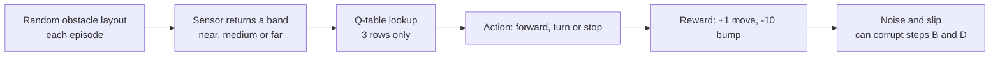

{:class="cover"}

---

By the end of this lesson you will be able to name the main causes of the sim-to-real gap, train a sensor-only policy with noise and wheel slip in the simulator, and read the trade-off between safety and progress.

---

You have trained a lovely Q-table. The simulated robot sails round the grid. You copy it to a real robot and it drives into the first chair leg it meets.

Welcome to the **sim-to-real gap**. A simulation is a model of the world, and every model is wrong somewhere. When it is wrong in a way that matters, the policy breaks. This lesson is about knowing where the gaps are, and what to do about them before you power up the hardware.

---

## Why policies fail on real hardware

| What the simulator does | What a real robot does |
|---|---|
| Turns exactly 90 degrees | Turns 80 to 100 degrees, depending on floor, battery and motors |
| Reads the distance perfectly | Gets occasional wild readings, misses soft or angled surfaces |
| Reacts instantly | Spends time reading the sensor while still moving |
| Knows its row and column | Has no idea where it is without extra sensors |
{:class="table table-single"}

Taking each in turn:

- **Wheel slip and motor mismatch.** After a few turns the real heading drifts away from what the robot believes.
- **Sensor noise.** An HC-SR04 can miss a surface that bounces its sound away, or report nonsense from a reflection.
- **Timing.** Reading the sensor three times for a filter takes tens of milliseconds, during which the robot keeps rolling.
- **State aliasing.** Three bands squash many real situations into one label, so two different situations get the same response.
- **No position.** This is the big one for us. Our grid policy from lesson 10 used `(row, col)` as part of the state, and a Pico with no wheel encoders cannot know that. A real policy has to work from what the robot can actually sense.

> **Note:** this is partial observability, which we mentioned in lesson 2. The honest answer is to train on a state the real robot can measure, which is what the rest of this lesson does.

---

## A reflex policy that uses only the sensor

For the real robot we will train a **reflex policy**: the state is just the distance band (`near`, `medium` or `far`), and the robot never knows where it is. That is a much smaller task than reaching a particular goal, and it is honest about what a one-sensor robot can do: wander without bumping into things.

The simulator below changes in three ways from lesson 10. It randomises the obstacle layout each episode, so the policy cannot memorise one map. It lets you switch on **sensor noise** (the sensor occasionally returns a random band) and **wheel slip** (a turn occasionally does nothing). And it compares three policies: a hand-written `if` rule, a policy trained in a clean simulator, and one trained with noise and slip.



Save this as `avoid_sim.py` and run it with `python3 avoid_sim.py`.

```python
"""
avoid_sim.py - train a reflex obstacle-avoider in simulation, then
stress-test it with sensor noise and wheel slip. Standard library only.

Run with: python3 avoid_sim.py
"""
import json
import random

# ---------------------------------------------------------------------------
# Settings
# ---------------------------------------------------------------------------
SIZE = 8                 # 8 x 8 arena, one cell is roughly 30 cm
N_OBSTACLES = 10         # a fresh random layout every episode
EPISODE_STEPS = 60
ACTIONS = ["forward", "turn_left", "turn_right", "stop"]
BANDS = ["near", "medium", "far"]
HEADINGS = [(-1, 0), (0, 1), (1, 0), (0, -1)]   # north, east, south, west

ALPHA = 0.2
GAMMA = 0.9
EPSILON_START = 1.0
EPSILON_DECAY = 0.99
EPSILON_MIN = 0.02
EPISODES = 600


# ---------------------------------------------------------------------------
# Environment
# ---------------------------------------------------------------------------
class AvoidWorld:
    """A walled arena with random obstacles and a forward-facing sensor."""

    def __init__(self, noise=0.0, slip=0.0):
        self.noise = noise    # chance the sensor returns a random band
        self.slip = slip      # chance a turn does nothing (wheel slip)
        self.reset()

    def reset(self):
        cells = [(r, c) for r in range(SIZE) for c in range(SIZE)]
        random.shuffle(cells)
        self.obstacles = set(cells[:N_OBSTACLES])
        self.row, self.col = cells[N_OBSTACLES]        # a free cell
        self.heading = random.randrange(4)
        return self.sense()

    def free_cells_ahead(self):
        dr, dc = HEADINGS[self.heading]
        r, c, n = self.row + dr, self.col + dc, 0
        while (0 <= r < SIZE and 0 <= c < SIZE
               and (r, c) not in self.obstacles and n < 5):
            n += 1
            r += dr
            c += dc
        return n

    def sense(self):
        """The robot's whole view of the world: one distance band."""
        if random.random() < self.noise:
            return random.choice(BANDS)
        n = self.free_cells_ahead()
        if n == 0:
            return "near"       # obstacle in the very next cell (< 30 cm)
        if n <= 2:
            return "medium"     # 30 to 90 cm
        return "far"            # more than 90 cm

    def step(self, action):
        """Return (band, reward, crashed)."""
        reward, crashed = -0.1, False
        if action == "forward":
            dr, dc = HEADINGS[self.heading]
            r, c = self.row + dr, self.col + dc
            if (0 <= r < SIZE and 0 <= c < SIZE
                    and (r, c) not in self.obstacles):
                self.row, self.col = r, c
                reward = 1.0
            else:
                reward, crashed = -10.0, True   # bumped; robot stays put
        elif action in ("turn_left", "turn_right"):
            if random.random() >= self.slip:
                step = 1 if action == "turn_right" else -1
                self.heading = (self.heading + step) % 4
        return self.sense(), reward, crashed


# ---------------------------------------------------------------------------
# Q-learning
# ---------------------------------------------------------------------------
def new_q_table():
    return {band: {a: 0.0 for a in ACTIONS} for band in BANDS}


def best_action(q_table, band):
    values = q_table[band]
    return max(values, key=lambda a: values[a])


def train(noise=0.0, slip=0.0, seed=1):
    random.seed(seed)
    env = AvoidWorld(noise, slip)
    q_table = new_q_table()
    epsilon = EPSILON_START
    for _ in range(EPISODES):
        band = env.reset()
        for _ in range(EPISODE_STEPS):
            if random.random() < epsilon:
                action = random.choice(ACTIONS)
            else:
                action = best_action(q_table, band)
            next_band, reward, _ = env.step(action)
            target = reward + GAMMA * max(q_table[next_band].values())
            q_table[band][action] += ALPHA * (target - q_table[band][action])
            band = next_band
        epsilon = max(EPSILON_MIN, epsilon * EPSILON_DECAY)
    return q_table


def evaluate(policy, noise=0.0, slip=0.0, episodes=300, seed=99):
    """Return (bumps, forward moves) per 60-step run on fixed test layouts."""
    random.seed(seed)
    env = AvoidWorld(noise, slip)
    bumps = moves = 0
    for _ in range(episodes):
        band = env.reset()
        for _ in range(EPISODE_STEPS):
            band, reward, crashed = env.step(policy(band))
            bumps += crashed
            moves += reward == 1.0
    return bumps / episodes, moves / episodes


def hand_written_rule(band):
    """The if-statement we are comparing the learned policy against."""
    return "turn_right" if band == "near" else "forward"


if __name__ == "__main__":
    clean = train(noise=0.0, slip=0.0)
    robust = train(noise=0.10, slip=0.05)

    for name, table in (("clean-trained", clean), ("noise-trained", robust)):
        print(f"{name} policy:")
        for band in BANDS:
            print(f"  {band:<7} -> {best_action(table, band)}")

    print("\nPer 60-step run: bumps / forward moves")
    print(f"{'test noise':>11} {'hand rule':>14} {'clean-trained':>16} {'noise-trained':>16}")
    for noise in (0.0, 0.1, 0.2, 0.3):
        cells = []
        for policy in (hand_written_rule,
                       lambda b: best_action(clean, b),
                       lambda b: best_action(robust, b)):
            bumps, moves = evaluate(policy, noise, 0.05)
            cells.append(f"{bumps:.2f} / {moves:.1f}")
        print(f"{noise:>10.0%} {cells[0]:>14} {cells[1]:>16} {cells[2]:>16}")

    # Save the noise-trained policy for the Pico (lesson 13).
    with open("q_table.json", "w") as f:
        json.dump(robust, f, indent=2)
    print("\nSaved q_table.json")
```

Output (the seeds are fixed, so you will see exactly this):

```
clean-trained policy:
  near    -> turn_right
  medium  -> forward
  far     -> forward
noise-trained policy:
  near    -> turn_left
  medium  -> turn_left
  far     -> forward

Per 60-step run: bumps / forward moves
 test noise      hand rule    clean-trained    noise-trained
        0%    0.00 / 41.2      0.00 / 41.2      0.00 / 24.4
       10%    1.19 / 40.6      1.19 / 40.6      0.24 / 24.4
       20%    2.40 / 38.8      2.40 / 38.8      0.59 / 23.2
       30%    3.69 / 36.9      3.69 / 36.9      0.78 / 23.4

Saved q_table.json
```

---

## Reading the results

1. **The learned policy rediscovered the hand-written rule.** With no noise, the clean-trained policy goes forward unless the sensor says `near`, then turns. It matches `hand_written_rule` in every column, with 0 bumps. For a task this small, Q-learning is not magic: it finds what a thoughtful programmer would write.
2. **Noise breaks the simple rule.** At 10% sensor noise both the hand rule and the clean-trained policy bump about once per run, and at 30% nearly four times. A wrong `far` reading sends them straight into an obstacle.
3. **Training with noise bought safety, at a price.** The noise-trained policy turns even at `medium` range, leaving more margin, so it bumps far less (0.24 against 1.19 at 10% noise). But it makes only about 24 forward moves per run instead of 41, because it spends more time turning.

That last point is the real lesson: there is no free lunch. A more cautious policy is safer and slower, and training with noise is how you choose where to sit on that line. Note that "turn left" versus "turn right" here is an arbitrary tie that training happens to settle; neither is cleverer.

> **Tip:** the policy we will deploy is the noise-trained one, so the program also writes it to `q_table.json`. It has three rows, small enough to read in a text editor.

---

## Other mitigations

- **Conservative thresholds.** On the robot, set "near" a little further out than the simulator, so there is room to stop. A policy that learned "near means turn" does not care whether near is 30 cm or 40 cm.
- **A hard safety override.** Whatever the Q-table says, stop if the filtered distance is critically small. Lesson 13 includes one.
- **Calibrate the hardware.** Equalise motors and measure a 90 degree turn on the real floor. That is calibration, not learning, and it is always worth doing.
- **Test gently.** Charge the battery, choose a clear floor, keep a hand near the power switch.

---

## Try it Yourself

1. Change `evaluate(...)` in the loop to test at noise levels 0.4 and 0.5. At what level does even the noise-trained policy start to bump more than once per run?
2. Train a third policy with noise 0.3 and slip 0.1 (`train(noise=0.3, slip=0.1)`). Is it safer still? How many forward moves does it make?
3. Change the bump penalty in `step()` from `-10.0` to `-2.0`. How does the learned policy's behaviour change?
4. Challenge: add a "turned last step" flag to the state, giving six states. Does the policy gain anything?

## Common Issues

- **Problem**: All three columns show identical results at 0% noise.
- **Solution**: That is expected. With a perfect sensor the simple rule is already ideal.
- **Why**: There is nothing for training to improve on when the information is perfect, so noise is what makes the comparison interesting.

- **Problem**: The noise-trained policy barely moves.
- **Solution**: Lower the training noise to 0.05, or raise the forward reward.
- **Why**: Too much noise makes every forward move look risky, so the safest policy hides.

- **Problem**: Results change every time I run it.
- **Solution**: Check `random.seed(seed)` is still called in `train()` and `evaluate()`.
- **Why**: Both functions reseed so that the same layouts are tested every time.

## Check your understanding


? Why did we drop (row, col) from the state for the real robot?
- [ ] The Pico cannot store tuples
- [x] The real robot has no way to measure its grid position
- [ ] Position makes training slower
> A policy can only use what the robot can sense, and a Pico with no encoders does not know where it is.

? What did training with sensor noise change about the policy?
- [x] It turns earlier, bumping less but making fewer forward moves
- [ ] It bumps more but moves faster
- [ ] Nothing, the results were identical
> The noise-trained policy turned at `medium` range, which cost progress but added safety.

? Why do we randomise the obstacle layout every episode?
- [ ] To make the simulation faster
- [x] So the policy cannot just memorise one map
- [ ] Because the real arena changes every second
> Varied training layouts push the agent to learn a rule that works in general.


> **Teachers**: this lesson is a good one for discussion before any hardware is touched. Ask groups to predict which of the four gaps will hurt their robot most, then test with the real thing in lesson 13. It is also an honest way to show learners that a simulation result is a hypothesis, not a guarantee.

---

Next up: reading the real ultrasonic sensor on the Pico, and mapping it into the same three bands we trained with.
