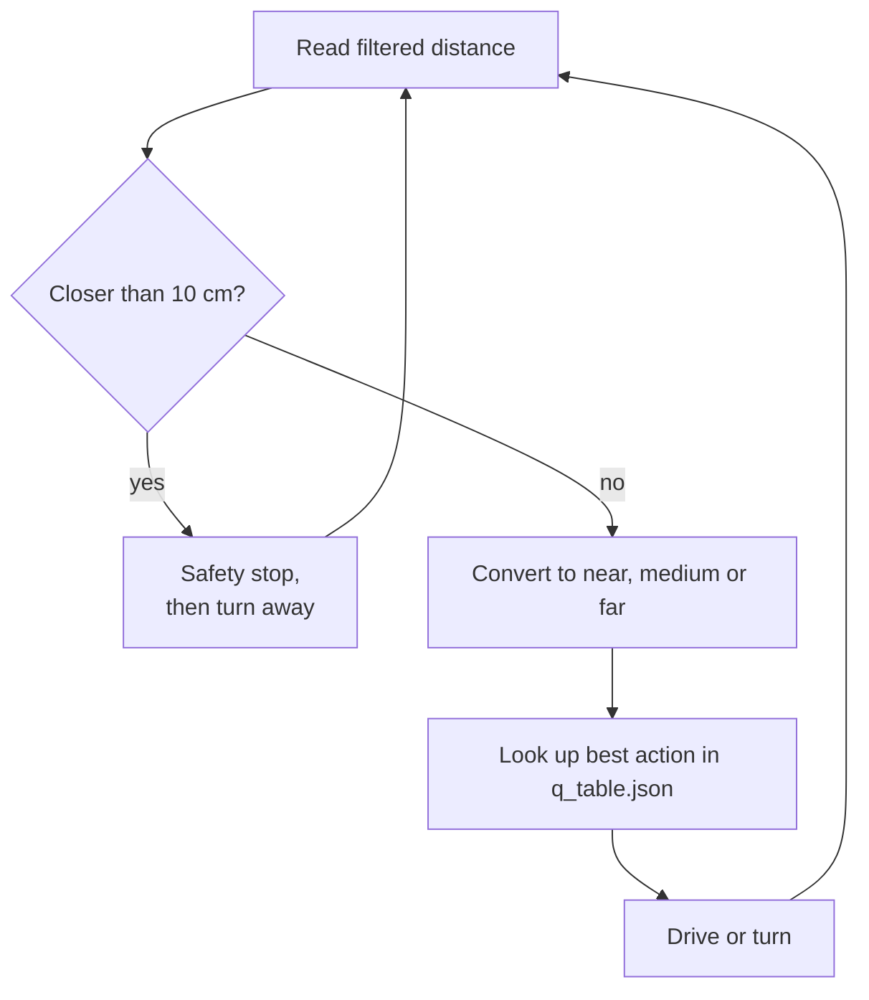

{:class="cover"}

---

By the end of this lesson you will be able to copy a trained Q-table to a Raspberry Pi Pico and run a MicroPython program that uses it to drive an obstacle-avoiding robot.

---



This is the payoff lesson. We trained a policy, learned where simulation misleads us, and built the sensor code. Now the Q-table travels from your computer to the Pico as a small JSON file, and a MicroPython script runs it in a loop: sense, look up, act.

> **Teachers**: this lesson needs a built robot, so plan one per group of two to four. Allow about 45 minutes, most of it for wiring and calibration. If you have no robots, run the lesson as a demonstration, or stop after lesson 11 with the simulation.

---

## Step 1: Get the Q-table

Run the trainer from lesson 11 (`python3 avoid_sim.py`) on your computer. It writes `q_table.json` beside the script. It holds the three-state, noise-trained policy, and looks like this (values are rounded here):

```json
{
  "near":   {"forward": -6.77, "turn_left": 2.85, "turn_right": -0.29, "stop": -0.97},
  "medium": {"forward":  0.24, "turn_left": 3.17, "turn_right":  0.78, "stop":  1.39},
  "far":    {"forward":  4.27, "turn_left": 1.93, "turn_right":  1.09, "stop":  2.23}
}
```
{: .no-snakie }

The keys are plain words, so the Pico can read the file with `json.load` and nothing more. (We avoided tuple keys and `eval()` on purpose: running `eval()` on file contents is a bad habit to teach.)

## Step 2: Copy it to the Pico

In Thonny, open `q_table.json`, choose **File, Save as**, pick **Raspberry Pi Pico**, and save it as `q_table.json`. Or, with the `mpremote` tool installed on your computer:

```bash
mpremote cp q_table.json :q_table.json
```
{: .no-snakie }

## Step 3: Wire the motors

Use the same pins as the [MicroPython Robotics Projects](/learn/micropython_robotics/) course. The sensor stays on GP8 and GP9 from lesson 12.

| L298N pin | Pico pin | Job |
|---|---|---|
| IN1 | GP0 | Left motor direction A |
| IN2 | GP1 | Left motor direction B |
| ENA | GP2 | Left motor speed (PWM) |
| IN3 | GP3 | Right motor direction A |
| IN4 | GP4 | Right motor direction B |
| ENB | GP5 | Right motor speed (PWM) |
{:class="table table-single"}

Power the motors from the battery pack, not from the Pico, and join the grounds. If a wheel spins the wrong way, swap that motor's two wires.



---

## Step 4: The complete program

Save this on the Pico as `main.py`. It runs the greedy policy for at most `MAX_STEPS` loops, then stops the motors, so the robot cannot run off forever.

> **Warning:** a file named `main.py` runs as soon as the Pico gets power. For the first tests keep the wheels off the ground, or run it from Thonny with the Run button instead.

```python
import json
import time
from machine import Pin, PWM, time_pulse_us

# --- Settings you may need to tune ---------------------------------------
NORMAL_SPEED = 40000      # PWM duty, 0 to 65535 (about 61 per cent)
TURN_SPEED = 35000
TURN_MS = 500             # how long a 90 degree spin takes: calibrate this
NEAR_CM = 30              # same cut-offs as the simulator
FAR_CM = 90
EMERGENCY_CM = 10         # stop and turn away regardless of the Q-table
MAX_STEPS = 300           # the robot stops by itself after this many loops
CALIBRATE = False         # set True to test turns only (see below)

# --- Pins ----------------------------------------------------------------
IN1 = Pin(0, Pin.OUT)
IN2 = Pin(1, Pin.OUT)
ENA = PWM(Pin(2))
ENA.freq(1000)
IN3 = Pin(3, Pin.OUT)
IN4 = Pin(4, Pin.OUT)
ENB = PWM(Pin(5))
ENB.freq(1000)
TRIG = Pin(8, Pin.OUT)
ECHO = Pin(9, Pin.IN)


# --- Motors --------------------------------------------------------------
def set_motors(left_duty, left_fwd, right_duty, right_fwd):
    ENA.duty_u16(left_duty)
    IN1.value(1 if left_fwd else 0)
    IN2.value(0 if left_fwd else 1)
    ENB.duty_u16(right_duty)
    IN3.value(1 if right_fwd else 0)
    IN4.value(0 if right_fwd else 1)


def motor_stop():
    ENA.duty_u16(0)
    ENB.duty_u16(0)
    IN1.value(0)
    IN2.value(0)
    IN3.value(0)
    IN4.value(0)


def forward():
    set_motors(NORMAL_SPEED, True, NORMAL_SPEED, True)


def turn(direction):
    """Spin on the spot for TURN_MS. 'left' = left wheel back, right wheel forward."""
    if direction == "left":
        set_motors(TURN_SPEED, False, TURN_SPEED, True)
    else:
        set_motors(TURN_SPEED, True, TURN_SPEED, False)
    time.sleep_ms(TURN_MS)
    motor_stop()
    time.sleep_ms(50)


# --- Sensor (from lesson 12) ----------------------------------------------
def get_distance_cm():
    TRIG.low()
    time.sleep_us(2)
    TRIG.high()
    time.sleep_us(10)
    TRIG.low()
    duration = time_pulse_us(ECHO, 1, 30000)
    if duration < 0:
        return -1.0
    return duration / 58.0


def get_distance_filtered():
    readings = []
    for _ in range(3):
        d = get_distance_cm()
        if d > 0:
            readings.append(d)
        time.sleep_ms(20)
    if not readings:
        return -1.0
    readings.sort()
    return readings[len(readings) // 2]


def discretize_distance(distance_cm):
    if distance_cm < 0 or distance_cm < NEAR_CM:
        return "near"
    if distance_cm < FAR_CM:
        return "medium"
    return "far"


# --- Policy --------------------------------------------------------------
def load_q_table(filename="q_table.json"):
    with open(filename) as f:
        return json.load(f)


def best_action(q_table, band):
    values = q_table[band]
    return max(values, key=lambda a: values[a])


def execute(action):
    if action == "forward":
        forward()
    elif action == "turn_left":
        motor_stop()
        turn("left")
    elif action == "turn_right":
        motor_stop()
        turn("right")
    else:                       # "stop"
        motor_stop()
        time.sleep_ms(200)


# --- Main loop -----------------------------------------------------------
def run():
    try:
        q_table = load_q_table()
    except OSError:
        print("q_table.json not found on the Pico. Copy it over first.")
        return
    print("Q-table loaded:", len(q_table), "states")
    time.sleep_ms(1000)
    try:
        for step in range(MAX_STEPS):
            distance = get_distance_filtered()
            if 0 < distance < EMERGENCY_CM:
                print(f"SAFETY STOP at {distance:.1f} cm")
                motor_stop()
                turn("right")
                continue
            band = discretize_distance(distance)
            action = best_action(q_table, band)
            execute(action)
            print(f"Step {step:3d} | {distance:6.1f} cm | {band:<6} | {action}")
            time.sleep_ms(100)
    finally:
        motor_stop()            # always leave the motors off, even on Ctrl+C
        print("Stopped.")


if CALIBRATE:
    for _ in range(4):
        turn("right")
        time.sleep_ms(1000)
    motor_stop()
else:
    run()
```

Typical console output (distances will differ):

```
Q-table loaded: 3 states
Step   0 |  112.0 cm | far    | forward
Step   1 |   96.4 cm | far    | forward
Step   2 |   71.3 cm | medium | turn_left
Step   3 |  118.9 cm | far    | forward
```

---

## Calibrate the turn first

Set `CALIBRATE = True`, run the file, and watch. The robot makes four right turns. If each is exactly 90 degrees it ends up facing the way it started. Too short a turn: raise `TURN_MS`. Overshoot: lower it. Aim for roughly 80 to 100 degrees, which is plenty for this policy, then set `CALIBRATE` back to `False`.

---

## What to expect, and what not to

The robot should wander the room, turning away from obstacles it sees ahead. That is all. It has no map, no goal and no memory, just three rows of numbers. Be ready for these honest limits:

- It cannot see to the side, so it can clip a corner it never sensed.
- It reacts only once per loop, so a fast robot may see an obstacle late.
- It may circle: with no memory, a repeating pattern is possible.
- The policy is not "smarter" than the hand rule from lesson 11. What you have gained is the method, which is the same idea that scales when the state and action sets get bigger.

---

## Try it Yourself

1. Run in a big clear space first. Which action does the console show most often, and does that fit the Q-table?
2. Place a box about 50 cm ahead and watch the robot approach it. At what distance does it turn? Does that match your `FAR_CM` and `NEAR_CM`?
3. Count how many of the 300 steps are `forward`. A healthy wanderer should be well over half.
4. Challenge: copy the policy trained with clean (noise-free) settings from lesson 11 into `q_table.json` instead, and compare the two on the real floor. Which bumps less?

## Common Issues

- **Problem**: The robot spins in circles.
- **Solution**: Check the console. If it is always `near`, the sensor is blocked or the wiring is wrong. If bands change but it keeps turning, raise `TURN_SPEED` to match the floor.
- **Why**: A sensor stuck at `near` tells the policy to keep turning, and a weak turn may not clear the obstacle.

- **Problem**: It bumps into obstacles before the safety stop fires.
- **Solution**: Raise `EMERGENCY_CM` to about 15, slow down `NORMAL_SPEED`, and shorten the loop delay.
- **Why**: The robot keeps rolling during the three-reading filter, so it needs more margin at speed.

- **Problem**: A wheel spins the wrong way, or only one wheel turns.
- **Solution**: Swap that motor's two wires, check the pin table, and check each enable pin is wired to a PWM-capable GPIO.
- **Why**: Direction pins set which way the current flows, and the enable pin sets how hard the motor is driven.

- **Problem**: "q_table.json not found".
- **Solution**: Copy the file to the Pico's own storage (not just your computer), and check the name matches.
- **Why**: The Pico reads files from its own flash, not from your computer's folders.

## Check your understanding


? Why does the Pico code store plain keys like "near" instead of tuples?
- [ ] MicroPython cannot use tuples
- [x] It lets us load the file with `json.load` and no `eval()`
- [ ] The table would be too big otherwise
> Text keys avoid evaluating text from a file, which is a safety and simplicity win.

? What does the safety check do?
- [ ] It retrains the Q-table
- [x] It stops and turns away when something is very close, whatever the Q-table says
- [ ] It slows the loop down
> The override catches cases where noise or delay let the policy miss a close obstacle.

? Why is a file called `main.py` risky during testing?
- [x] It starts running as soon as the Pico is powered
- [ ] It deletes the Q-table
- [ ] It disables Thonny
> Keep the wheels off the ground, or run from Thonny, until you trust the robot.


---

Congratulations, your robot is now running a policy it learned. Next up: where tabular Q-learning runs out of road, and what deep RL does instead.
