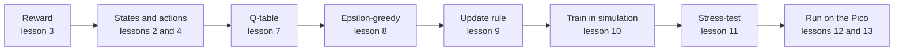

{:class="cover"}

---

By the end of this lesson you will be able to explain the whole Q-learning pipeline from reward to robot in your own words, and choose a next step.

---

You made it! Let's look back at the journey from "my robot crashes into the sofa" to "my robot runs a policy it learned from experience".



---

## What you have built

1. **Why rules struggle.** A one-rule robot circled a room for ever, because the rule was written for a different layout.
2. **The vocabulary.** Agent, environment, state, action and reward, and the loop between them.
3. **A reward function.** And how to catch statues and spinners by scoring behaviours before training.
4. **Discrete states.** Turning sensor readings into labels a table can index.
5. **The framework.** The Markov property, discounted returns and the Bellman idea.
6. **A Q-table and epsilon-greedy exploration.** Plus epsilon decay.
7. **The Q-learning update.** And a corridor where you watched the goal's value spread backwards.
8. **A grid-world trainer.** With a learning curve from about -8.6 to about 60.
9. **A stress test.** Sensor noise and wheel slip, and the trade-off between safety and progress.
10. **A real sensor and a real deployment.** Median filtering, matching thresholds and a three-row Q-table on a Pico.
11. **An honest view of deep RL.** Where tables stop and what carries over.

---

## The update rule, one last time

Everything comes down to this one line, in plain text:

`Q[s][a] = Q[s][a] + alpha * (reward + gamma * max(Q[s2]) - Q[s][a])`

Here it is with real numbers, so you can check your understanding. Suppose the current estimate is 0, the reward is 1, the best Q-value in the next state is 5, alpha is 0.2 and gamma is 0.9.

```python
q_sa = 0.0          # Q[s][a], the current estimate
reward = 1.0
best_next = 5.0     # max(Q[s2])
alpha = 0.2         # learning rate
gamma = 0.9         # discount factor

td_target = reward + gamma * best_next      # 1 + 0.9 * 5 = 5.5
td_error = td_target - q_sa                 # 5.5 - 0 = 5.5
q_sa = q_sa + alpha * td_error              # 0 + 0.2 * 5.5 = 1.1

print(f"TD target {td_target:.2f}, TD error {td_error:.2f}, new Q {q_sa:.2f}")
```

```
TD target 5.50, TD error 5.50, new Q 1.10
```

---

## Key concepts checklist

Can you explain each of these in your own words?

- What an agent, environment, state, action and reward are
- Why reward design matters, and what reward hacking looks like
- Why we discretise sensor readings
- What the Markov property says, and what gamma controls
- What a Q-value represents, and how the Q-table is indexed
- Why epsilon-greedy needs both exploring and exploiting
- Each term in the update rule: alpha, gamma, TD target and TD error
- Three causes of the sim-to-real gap
- Why the real robot uses a state it can actually measure
- When a table stops being enough

---

## What's next

**Stay on the robot**

- [Reinforcement Learning with Gymnasium](/learn/gymnasium/): the direct sequel. It moves the same BurgerBot grid world onto the standard Gymnasium API and Stable-Baselines3.
- [MicroPython Robotics Projects](/learn/micropython_robotics/): consolidate the motors, sensors and PWM used in lessons 12 and 13.
- [Learn ROS](/learn/learn_ros/): the standard framework for bigger robots with many parts.
- [Robotics 101](/learn/robotics_101/): the wider picture of how robots sense, think and move.

**Go deeper on AI**

- [Pandas and NumPy](/learn/pandas_and_numpy/): numerical arrays, the foundation of nearly all deep learning code.
- Reading: Watkins and Dayan (1992) on Q-learning, and Mnih and colleagues (2015, Nature) on DQN.

---

## Try it Yourself

1. Redo lesson 10 on a new map you design. Does the same code learn it? How many episodes does it need?
2. Write your own reward table for a different robot task, then score three hand-written behaviours with it, as in lesson 3.
3. Choose one setting from `avoid_sim.py`, such as the obstacle count, predict how the results change, then check.
4. Challenge: add a second sensor band for left and right to the simulator, so there are more states. Does a smarter state help?

## Common Issues

- **Problem**: My results do not match the lessons.
- **Solution**: Check you copied each program whole, and that seeds are set the way the lesson shows.
- **Why**: Every random choice flows from the seed, so small edits change the numbers.

- **Problem**: My robot works in simulation and not on the floor.
- **Solution**: Revisit lesson 11's checklist: thresholds, noise, calibration and the safety override.
- **Why**: A simulation is a model, and the gap between the model and the real robot is where policies fail.

## Check your understanding


? What does the TD error measure?
- [ ] How often the robot explores
- [x] The gap between the TD target and the current Q estimate
- [ ] The total reward in an episode
> The update moves the estimate a fraction alpha of the way across that gap.

? Why does the real robot use only the distance band as its state?
- [ ] The Pico cannot run Python
- [x] It can only use what it can actually sense, and it has no way to measure its grid position
- [ ] Three states are always best
> A deployed policy can only use inputs that exist on the robot.

? Which is true about our trained reflex policy?
- [x] It is no cleverer than a hand-written rule, but it uses the same method that scales up
- [ ] It learns in real time on the Pico
- [ ] It builds a map of the room
> The value of the course is the method. The three-state policy matches the simple rule.


---

## A final word

When you started, a robot that *learns* may have seemed like something for research labs with expensive GPUs. I hope this course has shown that the core ideas are within reach: a Python dictionary, a reward signal, and the patience to let a virtual robot bump into walls a few hundred times.

The same Bellman idea that sits inside research systems is running in your `q_table[state][action]` line. The scale is different. The principle is the same.

Keep building, keep experimenting, and keep letting your robots learn. If you build something with it, I would love to see it, so share it and tag [@kevinmcaleer28](https://www.youtube.com/@kevinmcaleer28).
