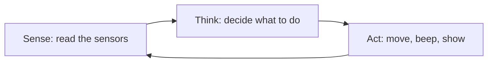

{:class="cover"}

---

Every robot, from a toy to a Mars rover, does the same three things over and over. It **senses** the world, **thinks** about what it found, and **acts**. Then it goes round again. Once you can see that loop, every sensor in this course will make sense.

## The loop



- **Sense** means turning something in the world into a number. A distance sensor turns "a wall is close" into `8.2`.
- **Think** means your code. It turns numbers into a decision. For example, "8.2 is less than 10, so stop".
- **Act** means anything the robot does. Driving a motor, playing a note, or lighting a face are all actions.

If you've read [How does a Robot think?](/learn/robotics_101/lesson_05.html) in Robotics 101, this is the same idea with real parts attached.

## Why the loop speed matters

Imagine the robot reads its sensor, then plays a long tune before reading it again. While the tune plays, the robot is blind. If it's driving, it keeps driving. The loop has to come round quickly, and nothing inside it should block for long. We'll meet that problem again with the buzzer and the face.

## A robot in a few lines

Here is the whole loop in plain MicroPython. It has no hardware, so you can run it right now. A made-up list stands in for the distance sensor.

```python
from time import sleep_ms

# Made-up readings: a robot driving towards a wall (centimetres)
readings = [60, 45, 30, 18, 9, 7]

def sense(step):
    # Real robot: read the distance sensor here
    return readings[step]

def think(distance):
    # Turn the number into a decision
    if distance < 10:
        return "stop"
    return "forward"

def act(decision):
    # Real robot: set the motor speeds here
    print("Robot says:", decision)

for step in range(len(readings)):
    distance = sense(step)
    decision = think(distance)
    print("Saw", distance, "cm")
    act(decision)
    sleep_ms(100)
```

Notice that the robot's sensing and acting are small and boring. All the interesting behaviour comes from `think()`. In this course the senses and actions are quick lessons, and the thinking is where we spend our time.

## Senses you will meet

Humans have five senses. Our robot has five modules, and we'll look at each one in turn.

| Robot sense | Module | What it gives the robot |
|---|---|---|
| See | Modulino Distance | How far away the nearest thing is |
| Measure | Modulino Movement | Which way is down, and how fast it is turning |
| Hear and speak | Modulino Buzzer | A voice made of tones and tunes |
| Show | Modulino LED Matrix | A face on an 8 by 12 grid of lights |
| Move | Modulino Motors | Driving, with a read-out of motor current |
{:class="table table-single"}

Strictly, the buzzer, matrix and motors are outputs, not sensors. But a robot that can tell you how it feels is easier to debug, so we count them. The motors even report their own current, which is a kind of touch.

## Try it Yourself

1. Change the `readings` list so the robot never gets closer than 20 cm. What does it print?
2. Change the stop distance from `10` to `25`. Which reading does it stop at now?
3. Challenge: add a third decision, `"slow"`, for distances between 10 and 25 cm.

## Common Issues

**Problem**: The robot ignores something right in front of it.
**Solution**: Print the sensor reading every loop and look at the actual numbers.
**Why**: Nine times out of ten the sensor is fine and the threshold in `think()` is wrong. You can only see that if you print what the robot sees.

## Check your understanding


? In the sense, think, act loop, which part is your code?
- [ ] Sense
- [x] Think
- [ ] Act
> Sensors and actuators are hardware. Think is where your decisions live.

? Why shouldn't a robot's loop play a long tune before reading its sensor again?
- [ ] The buzzer would overheat
- [x] The robot is blind while the tune plays
- [ ] MicroPython can't play tunes
> Nothing is read while the loop is stuck, so a moving robot cannot react.

