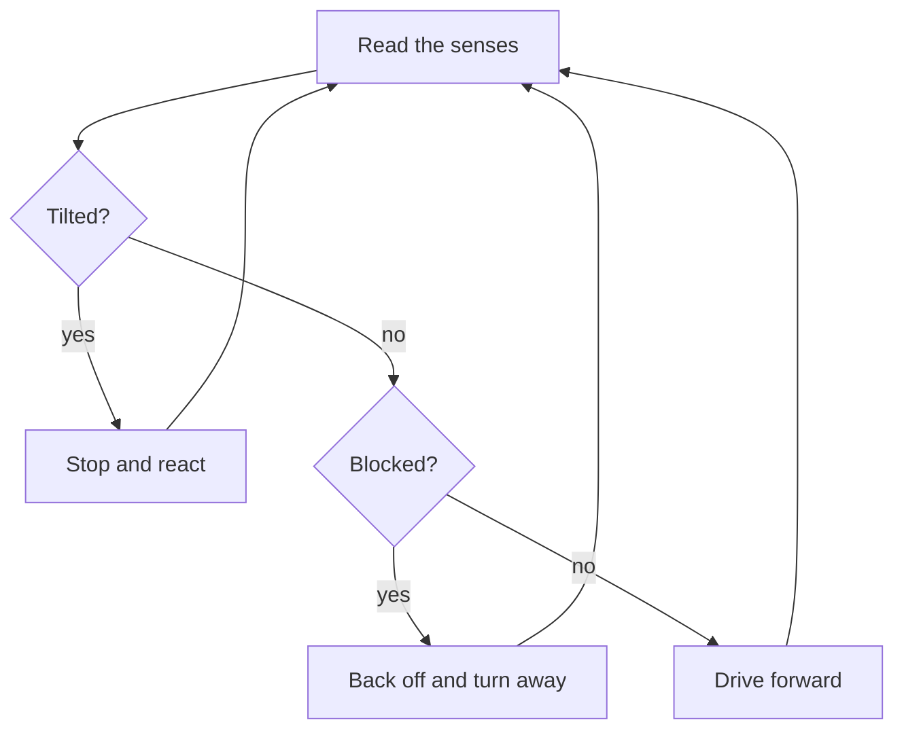

{:class="cover"}

---

One sense is easy. Five senses all shouting at once need rules. What should the robot do if it sees a wall *and* you pick it up at the same moment? This lesson is about giving the robot a sensible order of importance.

## One loop, many senses

A robot doesn't run five separate programs. It runs one loop that checks the senses in order, and does the first thing that matters. Here is the order Kev's `main.py` uses:

1. **Measure:** has someone picked the robot up or tipped it? If so, stop and react.
2. **See:** is something in the way? If so, back off and turn.
3. **Move:** otherwise, drive forward.
4. **Show:** whenever there's time, blink the face.



Safety comes first. If the robot has been lifted, nothing it sees on the way matters. Its tracks shouldn't spin in mid-air at all.

## A priority loop you can run

This program runs the same priority order with made-up sensor values, so you can watch the decisions without hardware. Each loop reads two fake sensors and picks one action.

```python
STOP_DISTANCE_CM = 10
TILT_THRESHOLD_G = 0.35

def choose_action(distance, pitch, roll):
    # 1. Safety first: picked up or tipped
    if abs(pitch) > TILT_THRESHOLD_G or abs(roll) > TILT_THRESHOLD_G:
        return "stop and react"
    # 2. Obstacle in the way
    if distance is not None and distance < STOP_DISTANCE_CM:
        return "back off and turn"
    # 3. Otherwise carry on
    return "forward"

# (distance, pitch, roll) at each moment
timeline = [
    (80, 0.0, 0.0),     # open floor
    (30, 0.0, 0.0),     # getting closer
    (7, 0.0, 0.0),      # a wall
    (7, 0.6, 0.0),      # picked up AND wall in front
    (None, 0.0, 0.0),   # put back down, nothing in range
]
for distance, pitch, roll in timeline:
    print((distance, pitch, roll), "->", choose_action(distance, pitch, roll))
```

Look at the fourth row. A wall is in front and the robot has been lifted. Tilt wins, because it comes first in the function.

## Never block the loop

The loop only works if it comes round quickly. Two senses in this course are slow if you're careless:

- **The buzzer.** A blocking note holds up the loop for as long as the note lasts. Use `blocking=False` in the loop.
- **The face.** Kev's six-frame blink at 125 ms per frame takes three quarters of a second. Playing that with `sleep_ms` inside a driving robot means the robot isn't looking where it's going for the whole blink.

The fix for the blink is to make it non-blocking. Instead of waiting, the loop asks "is it time for the next frame?" and draws one frame only if so. You can write the same idea with `ticks_ms()` and `ticks_diff()`. This complete program runs anywhere and prints a blink, a frame at a time, while pretending to do other work:

```python
from time import sleep_ms, ticks_ms, ticks_diff

FRAMES = ["eyes open", "half shut", "shut", "half shut", "eyes open"]
FRAME_MS = 125

blink_frame = None        # None means no blink is playing
last_frame_time = 0
loops = 0

start = ticks_ms()
while ticks_diff(ticks_ms(), start) < 1200:
    loops += 1            # the "real work": sensing and driving goes here
    now = ticks_ms()

    # Start a blink after 300 ms
    if blink_frame is None and ticks_diff(now, start) > 300 and loops > 1:
        blink_frame = 0
        last_frame_time = now
        print("blink starts:", FRAMES[0])

    # Advance the blink only when its next frame is due
    if blink_frame is not None and ticks_diff(now, last_frame_time) >= FRAME_MS:
        blink_frame += 1
        last_frame_time = now
        if blink_frame < len(FRAMES):
            print("  frame:", FRAMES[blink_frame])
        else:
            blink_frame = None
            print("blink done")
            break

    sleep_ms(20)

print("The loop ran", loops, "times while the blink played.")
```

The loop kept running throughout, so sensing never stopped. Kev's repository does this with `start_blink()` and `tick_blink()`, called every time round.

**Common mistakes:**

- Checking the obstacle first and the tilt second. The robot will try to drive while held in your hand.
- Using blocking sleeps for anything longer than a few milliseconds.
- Forgetting that a sense can be missing. Kev's code attaches each module defensively, so one loose cable doesn't stop the robot booting.

## Try it Yourself

1. Add a third check to `choose_action()` for a "hold still" case, such as a tilt only in roll.
2. Reorder the checks and see which timeline row changes.
3. Challenge: add a rule that says the robot should beep when it backs off but not when it only turns.

## Common Issues

**Problem**: The robot keeps driving while you hold it.
**Solution**: Check the tilt before anything else in the loop.
**Why**: Order is priority. The first matching rule wins.

**Problem**: The robot hits things while it blinks or beeps.
**Solution**: Use non-blocking beeps and a tick-based blink.
**Why**: A blocking call stops the loop, so the robot isn't sensing.
