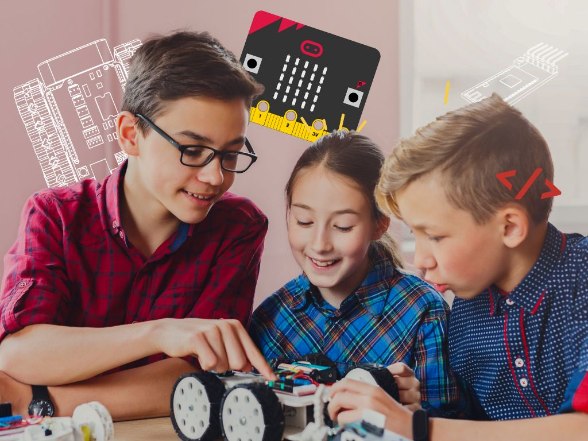

{:class="cover"}

## Watch the video



---

## Overview

New to robots? Start here. Robotics 101 is a short, friendly introduction to what robots are, where they came from and what goes into building one. There's no code and no hardware needed, just curiosity.

## Course Content

In this course you will learn:

* What is a Robot - a definition
* A quick history of robotics
* The skills and knowledge you need to build robots
* The different parts of a robot
* How a robot "thinks"

## Key Results

By the end of this course you'll be able to:

* Explain what makes a machine a robot
* Name some famous robots from history
* Describe the main parts of a robot: brain, body, power, sensors and motors

## What you'll need

* Nothing but a web browser! Each lesson ends with a short quiz.

## How the course works

Each lesson is short and has lots of pictures. Work through them in order, and try the quiz at the end of each one to check your understanding.
