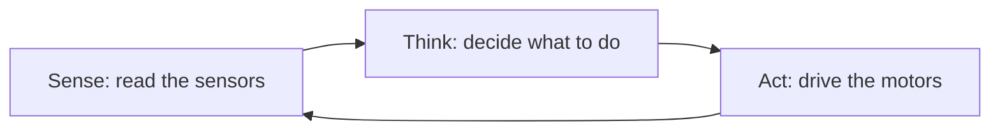
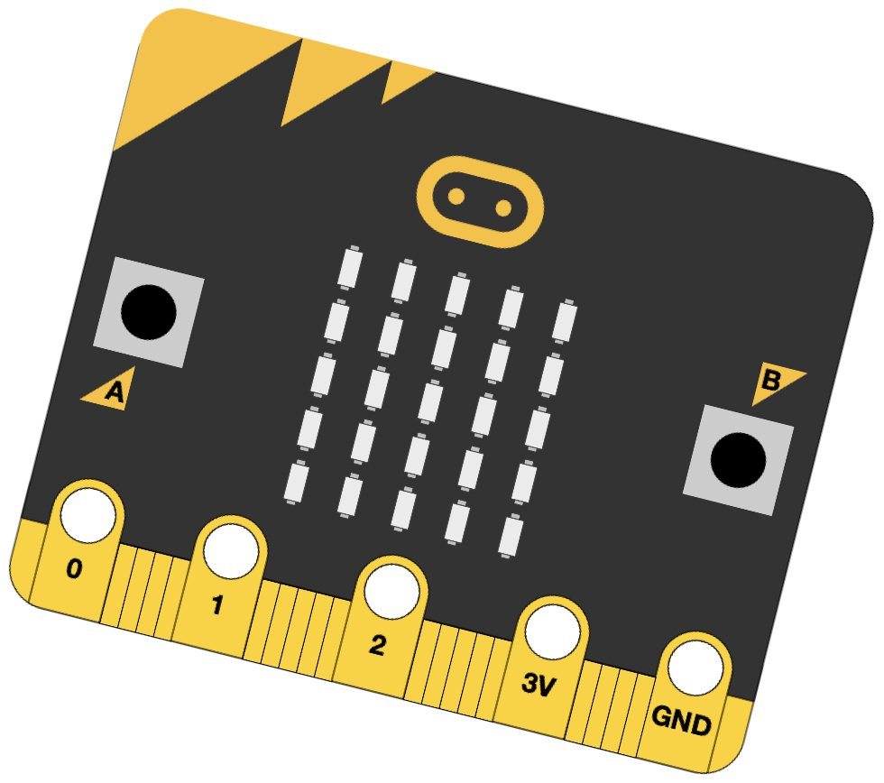

{:class="cover"}

---

By the end of this lesson you will be able to describe the sense, think, act loop that a robot repeats to make decisions, and pick your next course.

---

## Video

This video explains what a robot is, with examples of early robots. If you watched it at the start of the course, skip ahead to the robot brain.



---

## The robot Brain

- Most robots have a computer or micro-controller to perform the instructions from the program
- The ‘brain’ could just be a simple circuit, without a central processing unit (CPU)
- Common microcontrollers include:

  - BBC micro:bit
  - Raspberry Pi Pico
  - Arduino Uno
  - NodeMCU (ESP8266)

A robot "thinks" by running its program in a loop, over and over, many times a second:

1. **Sense**: read the sensors (how far away is that wall?)
2. **Think**: decide what to do (it's close, so turn)
3. **Act**: drive the motors

This sense, think, act loop is at the heart of almost every robot, from a SMARS to a self-driving car.

Here is the loop for a robot that avoids walls:

1. Sense: the ultrasonic sensor says the wall is 10 cm away.
2. Think: the program has the rule "if closer than 15 cm, turn".
3. Act: the motors turn in opposite directions to spin the robot.
4. Sense again: the wall is no longer in the way, so the robot drives forward.

The robot has no idea it is "avoiding" anything. It just repeats the loop, and the behaviour comes from the rules in the program.

A BBC micro:bit. Visit <https://www.microbit.org> for more about this amazing device.

[{:class="img-fluid w-25"}](https://www.microbit.org)

---

## Try it Yourself

1. Write the sense, think, act loop for a robot that follows a line on the floor. What does it sense? What are its rules?
2. Act the loop out with a friend: one of you is the robot with a blindfold and only moves when told, the other is the sensor and calls out "wall ahead" or "clear". What rules do you need?
3. Challenge: write the loop for a robot that finds the brightest spot in a room. What happens if two spots are equally bright?

## Common Issues

- **Problem**: My loop makes the robot jitter back and forth at the edge of a rule.
- **Solution**: Add a gap between the rules, such as turn if closer than 15 cm and drive forward only when further than 20 cm.
- **Why**: A sensor reading wobbles a little, so a single threshold flips between the two actions again and again.

> **Teachers**: The blindfold game in Try it Yourself needs clear floor space and a helper to stop walkers from tripping. Use soft obstacles, not furniture, and make it clear that the blindfold is optional.

## Check your understanding


? What are the three steps of the loop a robot runs to "think"?
- [ ] Charge, drive, stop
- [x] Sense, think, act
- [ ] Print, build, code
> The robot reads its sensors, decides what to do, then drives its motors, over and over.

? Which of these is a microcontroller that could be a robot's brain?
- [x] Raspberry Pi Pico
- [ ] An ultrasonic sensor
- [ ] A 9V battery
> The Pico, BBC micro:bit, Arduino Uno and ESP8266 are all popular robot brains.

? In the loop, what happens straight after the robot drives its motors?
- [ ] It switches itself off
- [x] It goes back to sensing, and the loop repeats
- [ ] It waits for a person to press a button
> The loop runs over and over, many times a second, so the robot keeps reacting to what it senses.


---

## What's next

Congratulations on finishing Robotics 101! Now build your first robot:

- [Electronics basics](/learn/electronics_basics/): voltage, current and your first circuits, before you build
- [Build a SMARS Robot](/learn/smars/): a 3D-printed tracked robot
- [Build your own BurgerBot](/learn/burgerbot/): a Raspberry Pi Pico robot you program in MicroPython
- [Motors and motor drivers](/learn/motors_and_drivers/): how robots really move
- [Learn MicroPython - The basics](/learn/micropython/)
