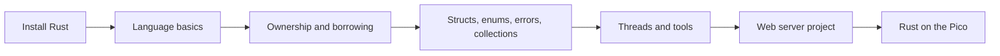

{:class="cover"}

---



By the end of this lesson you will be able to explain what makes Rust different from Python, and say what you will build in this course.

---

## Overview

Rust is a systems programming language. That means it is built for the jobs where speed and reliability matter most: operating systems, game engines, web servers and the firmware inside robots. It runs as fast as C and C++, but the compiler checks your program for a whole family of memory bugs before it will let you run it.

This course is written for people who already know a little Python or MicroPython, perhaps from programming a Raspberry Pi Pico. We start on your computer, so you can learn the language with fast feedback. Then we point Rust at the Pico and make an LED blink.

## Course Content

- Installing Rust and running your first program
- How Rust differs from Python and MicroPython
- Variables, types and control flow
- Ownership, borrowing and lifetimes
- Structs, enums and pattern matching
- Error handling with `Option` and `Result`
- Vectors, strings and hash maps
- Threads, channels and shared data
- Cargo, rustfmt, Clippy and tests
- A small web server for a robot
- Setting up Rust for the Raspberry Pi Pico and blinking the on-board LED

## Key Results

After completing this course, you will:

- Write, build and run Rust programs with `cargo`
- Explain ownership, borrowing and why the compiler sometimes says no
- Model robot data with structs and enums, and handle failures with `Result`
- Use vectors, strings, hash maps and threads safely
- Build a small web server with a JSON endpoint
- Know the toolchain and crates needed to put Rust on a Raspberry Pi Pico

## What you'll need

- A computer running Windows, macOS or Linux, and an internet connection
- A text editor (Visual Studio Code with the rust-analyzer extension works well)
- A terminal, such as Command Prompt, PowerShell, Terminal or a Linux shell
- For the last lesson only, a standard Raspberry Pi Pico and a micro-USB cable. Everything else needs no hardware at all

## How the course works

Each lesson teaches one idea, starts with a sentence saying what you will be able to do, and ends with exercises, common problems and a short quiz. Code blocks marked `rust` are complete programs unless the lesson says they are snippets. Every desktop program in this course was compiled and run on the current stable Rust, so the output you see is the output you should get. Typing the examples yourself, rather than pasting them, teaches your fingers where the braces go.

Rust's compiler error messages are famously helpful. When one appears, read it from the top: it usually tells you the fix.

> **Teachers**: this course suits learners aged about 14 and up who have written a little Python. Allow 45 to 60 minutes per lesson. Lessons 1 to 10 need only a computer with permission to install software, or a shared server with Rust already installed. If school machines are locked down, ask IT to install Rust with rustup, or use a Linux or Raspberry Pi OS machine. Only lesson 11 needs hardware: one Raspberry Pi Pico per pair of learners, and it is fine to skip or demonstrate it on one board.

## Where Rust came from

Graydon Hoare started Rust as a personal project in 2006. Mozilla began sponsoring it in 2009 and announced it publicly in 2010, and Rust 1.0, the first stable release, arrived on 15 May 2015. The name comes from a group of fungi called rust fungi.

Four ideas shape the language:

1. **Memory safety without a garbage collector.** The compiler tracks who owns each piece of data, so no separate cleaner runs while your robot is busy.
2. **Safe concurrency.** Rules about sharing data catch data races when you compile, not when your robot is already driving.
3. **Zero-cost abstractions.** High-level features such as iterators compile down to code as fast as hand-written loops.
4. **Friendly tooling.** One tool, Cargo, builds, tests, formats and manages libraries.

## Prerequisites

Rust is easier if you have met programming before. These courses on this site help:

- [Learn MicroPython - The basics](/learn/micropython/) for general programming ideas
- [Getting Started with C on the Raspberry Pi Pico](/learn/c_pico/) if you want to compare Rust with another compiled language

## Try it Yourself

1. Write down three bugs you have met in Python or MicroPython, such as a typo in a variable name or a wrong type. Keep the list: at the end of the course, tick off the ones Rust would have caught before running.
2. Look up one program you use every day (a browser, a game or an operating system) and find out whether any part is written in Rust.
3. Challenge: sketch, on paper, a robot with three sensors and two motors. Which parts of its software must never crash?

## Common Issues

- **Problem**: You feel you should learn all of Rust before writing anything.
- **Solution**: Follow the lessons in order and type each example. Each lesson adds one idea.
- **Why**: Rust has a steep first week and then gets easier. Small, working programs build confidence faster than reading.

## Check your understanding


? What does Rust use instead of a garbage collector to manage memory?
- [ ] It never frees memory
- [x] An ownership system checked by the compiler
- [ ] Reference counting for every value
> Ownership rules are checked at compile time, so there is no collector running while your program works.

? Which lesson of this course needs a Raspberry Pi Pico?
- [ ] Every lesson
- [x] Only the last hands-on lesson, Rust for Raspberry Pi Pico
- [ ] The lessons on ownership
> The desktop lessons need only a computer. The Pico appears in lesson 11.

? In what year did Rust 1.0, the first stable release, appear?
- [ ] 2006
- [ ] 2010
- [x] 2015
> Hoare began the project in 2006, it was announced in 2010, and 1.0 came on 15 May 2015.

