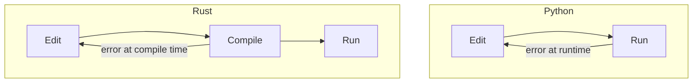

{:class="cover"}

---

By the end of this lesson you will be able to describe four differences between Rust and Python, and say when each language is the better choice for a robot.

---

## The same function in two languages

Let's start with a job every robot has: keeping a motor speed between 0 and 100. Here it is in Python:

```python
def clamp_speed(speed):
    return max(0, min(100, speed))

print(clamp_speed(140))
```

And here is the same program in Rust:

```rust
fn clamp_speed(speed: i32) -> i32 {
    speed.clamp(0, 100)
}

fn main() {
    println!("{}", clamp_speed(140));
}
```

Both print `100`. Notice the differences: Rust uses braces instead of indentation, and `speed: i32` says the input is a 32-bit whole number, while `-> i32` says what comes back. Python works that out while the program runs, but Rust is told up front.

## Compiled versus interpreted

Python reads your program and runs it line by line. Rust is **compiled**: the whole program is turned into machine code first, and every type and ownership rule is checked at that point.



That is slower to start, but the program you run has already passed a strict check, and it is usually much faster because there is no interpreter in the way.

## Four differences that matter

| Topic | Python | Rust |
| --- | --- | --- |
| Types | Checked while running | Checked at compile time |
| Memory | Garbage collector frees it | Ownership rules free it, no collector |
| Errors | Exceptions can happen anywhere | `Result` and `Option` values you must handle |
| Threads | The standard CPython interpreter runs one thread of Python at a time (the GIL) | Threads run in parallel, and the compiler checks sharing |
{:class="table table-single"}

**Types.** A wrong type in Python only shows up when that line runs. This fails, but only when the robot reaches it:

<!-- code-check: skip -->
```python
speed = "50"
total = speed + 10  # TypeError: can only concatenate str to str
```

In Rust the same mistake stops the build, so it can never reach the robot.

**Memory.** Python tidies up with a garbage collector that runs when it likes. Rust decides when memory is freed by following ownership rules (lesson 4), so timing is predictable. Predictable timing is valuable when a motor controller must react in a few milliseconds.

**Errors.** Python raises exceptions. Rust returns values that say "this worked" or "this failed", and the compiler makes you deal with them (lesson 6).

## MicroPython and Rust on the Pico

MicroPython gives you a **REPL**, an interactive prompt where you type a line and see the result. Standard Rust has no REPL, so the cycle is write, compile, run. In return you get small, fast programs.

| | MicroPython on a Pico | Rust on a Pico |
| --- | --- | --- |
| Getting started | Flash MicroPython once, then copy `.py` files | Install the toolchain, then build a `.uf2` file |
| Feedback | Instant, via the REPL | After each compile |
| Speed and size | Slower, needs an interpreter on the board | Fast, no interpreter |
| Best for | Learning, quick experiments | Tight timing, big projects, reliability |
{:class="table table-single"}

Neither is better in general. MicroPython is wonderful for trying ideas. Rust is worth the extra setup when speed, memory use and reliability matter. Many makers prototype in MicroPython and move to Rust for the final version.

## Why this matters

Knowing the trade-off helps you choose. A blinking-LED test? MicroPython. A flight controller that must never stall? Rust earns its place.

## Try it Yourself

1. Take a small Python function you wrote earlier and rewrite it in Rust, adding the types. Run it with `cargo run`.
2. In the Rust `clamp_speed` above, change both `i32` types to `u8` (an unsigned 8-bit number, 0 to 255) and call it with `-5`. What does the compiler say, and why can a `u8` never be negative?
3. Challenge: write a Rust `fn average(a: f32, b: f32) -> f32`, then try calling it with the text `"3"` and read the error.

## Common Issues

- **Problem**: You expect to type Rust lines into a prompt like the MicroPython REPL.
- **Solution**: Write a file, then run `cargo run`. Use `cargo check` for a quicker syntax and type check.
- **Why**: Standard Rust is compiled, so there is no interactive prompt.

- **Problem**: The compiler complains about a type when your Python habits say it should work.
- **Solution**: Add the type to the variable or function, for example `let x: f32 = 3.0;`.
- **Why**: Rust will not guess when two types could both fit, so it asks you to say which.

## Check your understanding


? When does Rust check that types match?
- [ ] While the program runs
- [x] At compile time
- [ ] Never, it trusts you
> Rust checks types and ownership before the program is ever run.

? Which feature does Rust use instead of exceptions for things that can fail?
- [ ] Garbage collection
- [x] `Result` and `Option` values
- [ ] The GIL
> Functions return a `Result` or `Option` and you must handle both outcomes.

? Which is an advantage of MicroPython over Rust for a first experiment on the Pico?
- [x] An interactive REPL gives instant feedback
- [ ] It always runs faster
- [ ] It needs no board at all
> The REPL lets you test a line at a time. Rust gives speed and reliability but needs a compile step.

