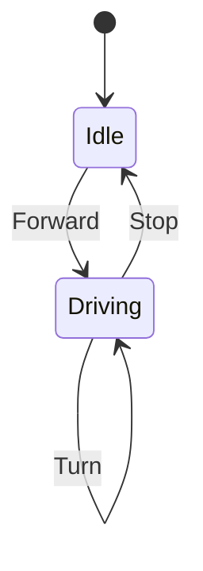

{:class="cover"}

---

By the end of this lesson you will be able to define a struct and an enum, add methods to them, and use `match` to respond to each variant.

---

## Describing a robot

A **struct** groups related data under one name. An **enum** describes something that can be one of several choices. Together they let you model a robot and the commands you send it. Let's build a small program that does exactly that:

```rust
#[derive(Debug)]
enum Command {
    Stop,
    Forward(u8),
    Turn { degrees: i16 },
}

struct Robot {
    name: String,
    battery_percent: u8,
    speed: u8,
}

impl Robot {
    fn new(name: &str) -> Robot {
        Robot { name: String::from(name), battery_percent: 100, speed: 0 }
    }

    fn run(&mut self, command: Command) {
        match command {
            Command::Stop => {
                self.speed = 0;
                println!("{}: stopping", self.name);
            }
            Command::Forward(speed) => {
                self.speed = speed;
                println!("{}: driving at {}%", self.name, speed);
            }
            Command::Turn { degrees } => {
                println!("{}: turning {} degrees", self.name, degrees);
            }
        }
        self.battery_percent -= 1;
    }
}

fn main() {
    let mut robot = Robot::new("Scout");
    let plan = [Command::Forward(60), Command::Turn { degrees: -90 }, Command::Stop];
    for command in plan {
        println!("command: {:?}", command);
        robot.run(command);
    }
    println!("battery {}%, speed {}", robot.battery_percent, robot.speed);
}
```

Running it prints:

```text
command: Forward(60)
Scout: driving at 60%
command: Turn { degrees: -90 }
Scout: turning -90 degrees
command: Stop
Scout: stopping
battery 97%, speed 0
```

## Structs

`struct Robot` has three named **fields**. A struct is like a Python class with only data, plus the methods you attach in an `impl` block. `Robot::new` is an ordinary function that builds a robot, and `run` is a method that takes `&mut self`, so it can change the robot's fields.

**Why this matters:** instead of passing `name`, `speed` and `battery` around as separate variables, you carry one `Robot` and the compiler knows which fields belong together.

## Enums

An enum lists every possible variant. `Command` is a stop, a forward with a speed, or a turn with an angle. Each variant can carry different data: `Forward(u8)` holds one number, and `Turn { degrees: i16 }` holds a named field. The line `#[derive(Debug)]` lets us print a command with `{:?}`.



## Pattern matching

`match` compares a value against each pattern and runs the first one that fits. The compiler also checks that you covered **every** variant. Delete the `Stop` arm and the program will not build, with an error like `non-exhaustive patterns: Command::Stop not covered`. That is a powerful guard: if you later add a `Reverse` command, the compiler points to every `match` that needs updating.

## Try it Yourself

1. Add a `Reverse(u8)` variant to `Command` and see where the compiler asks you to handle it.
2. Add a `fn status(&self) -> String` method to `Robot` that returns the name and battery level.
3. Make `run` refuse a `Forward` command when `battery_percent` is under 10, and print a warning instead.
4. Challenge: add a `Beep { times: u8 }` variant and print "beep" that many times.

## Common Issues

- **Problem**: `non-exhaustive patterns` from `match`.
- **Solution**: Add an arm for the missing variant, or a catch-all `_ => {}` arm if you really want to ignore the rest.
- **Why**: Rust wants every case handled so a new variant cannot be silently ignored.

- **Problem**: `cannot borrow robot as mutable` when calling `run`.
- **Solution**: Declare it with `let mut robot`.
- **Why**: `run` takes `&mut self` because it changes the robot.

- **Problem**: `attempt to subtract with overflow` panic.
- **Solution**: Use `saturating_sub`, for example `self.battery_percent = self.battery_percent.saturating_sub(1);`.
- **Why**: A `u8` cannot go below 0, and in a debug build going below stops the program.

## Check your understanding


? What does `impl Robot { ... }` do?
- [ ] Imports the Robot type
- [x] Attaches methods and functions to the Robot struct
- [ ] Makes Robot immutable
> An `impl` block holds the functions and methods for a type.

? What does Rust check about a `match` on an enum?
- [ ] That the variants are in alphabetical order
- [x] That every variant is handled
- [ ] Nothing, it picks one at random
> The compiler requires exhaustive matches.

? How can one enum variant carry data?
- [ ] It cannot
- [x] Put values in brackets or named fields after the variant, such as `Forward(u8)`
- [ ] Only by using a struct instead
> Variants like `Forward(u8)` and `Turn { degrees: i16 }` hold their own data.

