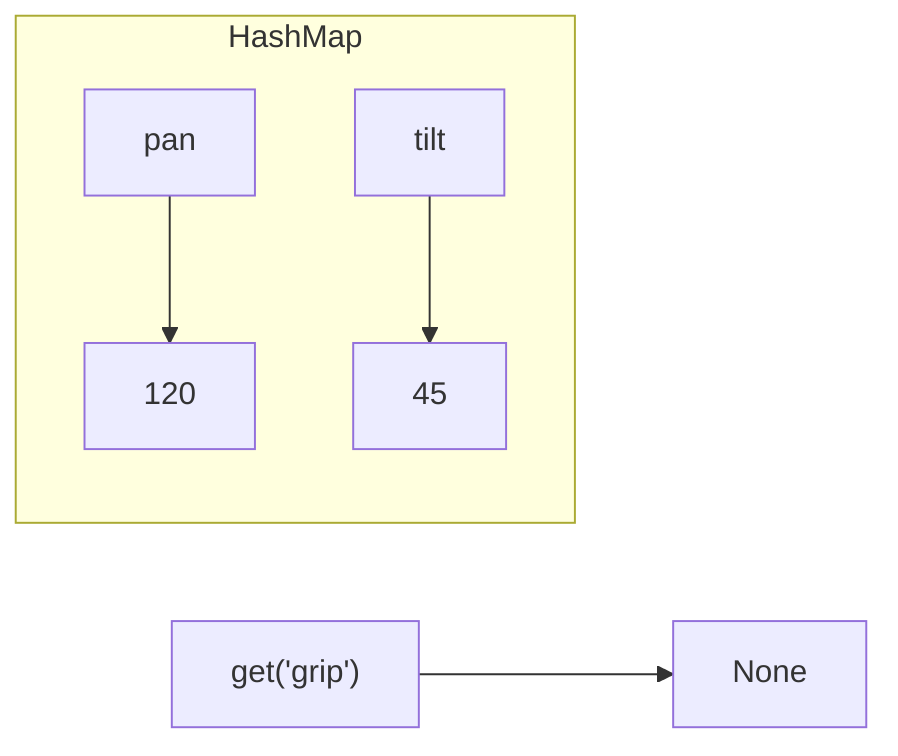

{:class="cover"}

---

By the end of this lesson you will be able to store values in a `Vec`, build up a `String`, and look values up by name in a `HashMap`.

---

## Three collections for a robot

Robots collect things: a list of distance readings, a status message, and the current angle of each servo. Rust's standard library has a collection for each. Unlike fixed-size arrays, these live on the heap and can grow while the program runs. Here is a complete program that uses all three:

```rust
use std::collections::HashMap;

fn main() {
    let mut readings: Vec<f32> = Vec::new();
    readings.push(31.5);
    readings.push(29.0);
    readings.push(12.5);

    let total: f32 = readings.iter().sum();
    let average = total / readings.len() as f32;
    println!("{} readings, average {:.1} cm", readings.len(), average);

    for (i, r) in readings.iter().enumerate() {
        println!("reading {}: {} cm", i, r);
    }
    println!("first: {:?}, tenth: {:?}", readings.first(), readings.get(9));

    let mut status = String::from("battery");
    status.push_str(": ok");
    println!("{} ({} bytes)", status, status.len());

    let mut servo_angles: HashMap<String, u8> = HashMap::new();
    servo_angles.insert(String::from("pan"), 90);
    servo_angles.insert(String::from("tilt"), 45);
    servo_angles.insert(String::from("pan"), 120); // replaces the old value

    println!("pan is {:?}", servo_angles.get("pan"));
    println!("grip is {:?}", servo_angles.get("grip"));
    println!("{} servos tracked", servo_angles.len());
}
```

Output:

```text
3 readings, average 24.3 cm
reading 0: 31.5 cm
reading 1: 29 cm
reading 2: 12.5 cm
first: Some(31.5), tenth: None
battery: ok (11 bytes)
pan is Some(120)
grip is None
2 servos tracked
```

## Vectors

A `Vec<T>` is a growable list where every item has the same type, like a Python list that only holds one kind of thing. `push` adds to the end, `.len()` counts, and `.iter()` goes through the items. Notice `readings.get(9)` returns `None` rather than crashing, because `get` returns an `Option`. Writing `readings[9]` instead would panic.

## Strings

A `String` is growable text stored as UTF-8, so it can hold accented letters and symbols from any language. That means one character can use more than one byte, which is why `.len()` counts bytes and why you cannot index a string with `status[0]`. Use `push_str` to add text, `push` for one character, and `&str` for a borrowed piece of text.

## Hash maps

A `HashMap<K, V>` looks values up by key, like a Python dictionary. It is perfect for servo angles by name. Inserting the same key twice replaces the old value. Looking up a missing key with `.get()` gives `None`. Remember the `use std::collections::HashMap;` line at the top, because hash maps are not in the default set of names.



A hash map does not keep items in the order you put them in, so never rely on the order when printing all of them.

## Try it Yourself

1. Add a fourth reading to the vector and check the average changes.
2. Find the smallest reading. Hint: loop with a `let mut smallest = f32::MAX;` and compare.
3. Add a `"grip"` servo at 10 degrees to the hash map and look it up.
4. Challenge: use `if let Some(angle) = servo_angles.get("pan")` to print the angle only when the servo exists.

## Common Issues

- **Problem**: Your program panics with `index out of bounds`.
- **Solution**: Use `.get(index)` and handle the `Option`.
- **Why**: Square-bracket indexing panics when the item is missing, while `get` returns `None`.

- **Problem**: `cannot find type HashMap in this scope`.
- **Solution**: Add `use std::collections::HashMap;` at the top of the file.
- **Why**: `Vec` and `String` are always available, but other collections must be imported.

- **Problem**: `the type str cannot be indexed by integer`.
- **Solution**: Use `.chars().nth(0)` or `&text[0..1]` for plain ASCII text.
- **Why**: UTF-8 characters vary in length, so a byte position is not always a character position.

## Check your understanding


? What does `readings.get(9)` return for a vector of three items?
- [ ] It panics
- [x] `None`
- [ ] `0.0`
> `get` returns an `Option`, so a missing index gives `None`.

? Which collection looks values up by a key?
- [ ] `Vec`
- [ ] `String`
- [x] `HashMap`
> A `HashMap` associates keys with values.

? Why can't you write `status[0]` on a `String`?
- [x] Text is UTF-8, so characters can have different lengths
- [ ] Strings are always empty at first
- [ ] Indexing needs `mut`
> A byte position may fall in the middle of a character.

