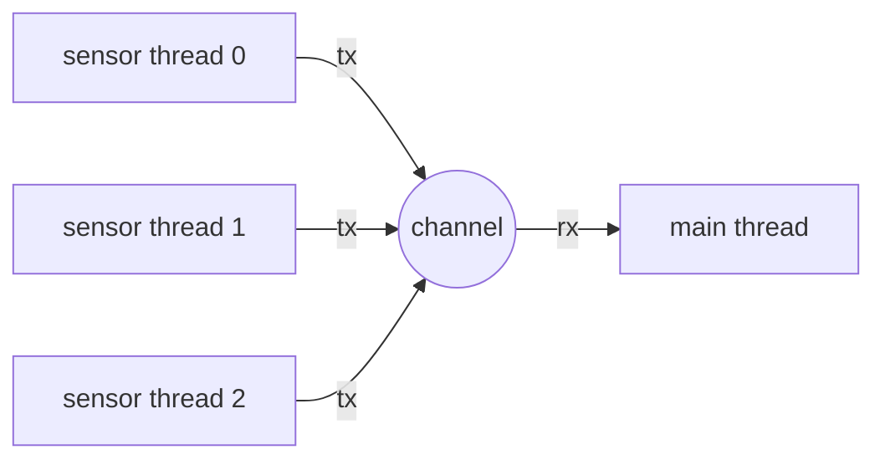

{:class="cover"}

---

By the end of this lesson you will be able to start threads, collect their results with a channel, and share data between them with `Arc<Mutex<T>>`.

---

## Several jobs at once

A robot often needs to do several things together: read three sensors, drive the motors and talk to a phone. Threads let separate pieces of code run at the same time. In many languages the danger is a **data race**, where two threads change the same value at once and corrupt it. Rust's ownership rules make that a compile-time error, which is why people call it **fearless concurrency**.

Here is a complete program with three techniques:

```rust
use std::sync::mpsc;
use std::sync::{Arc, Mutex};
use std::thread;
use std::time::Duration;

fn main() {
    // 1. Spawn a thread and wait for it
    let handle = thread::spawn(|| {
        for i in 1..4 {
            println!("spawned thread: step {}", i);
            thread::sleep(Duration::from_millis(1));
        }
    });
    handle.join().unwrap();

    // 2. Three sensor threads send readings down a channel
    let (tx, rx) = mpsc::channel();
    for id in 0..3 {
        let tx = tx.clone();
        thread::spawn(move || {
            for n in 0..3 {
                tx.send((id, id * 10 + n)).unwrap();
            }
        });
    }
    drop(tx); // close our own sender so the receiver knows when to stop

    let mut received: Vec<(i32, i32)> = rx.iter().collect();
    received.sort();
    println!("received {} readings, first {:?}, last {:?}", received.len(), received[0], received[received.len() - 1]);

    // 3. Shared counter protected by a Mutex
    let counter = Arc::new(Mutex::new(0));
    let mut handles = Vec::new();
    for _ in 0..4 {
        let counter = Arc::clone(&counter);
        handles.push(thread::spawn(move || {
            for _ in 0..100 {
                *counter.lock().unwrap() += 1;
            }
        }));
    }
    for h in handles {
        h.join().unwrap();
    }
    println!("counter = {}", *counter.lock().unwrap());
}
```

Output:

```text
spawned thread: step 1
spawned thread: step 2
spawned thread: step 3
received 9 readings, first (0, 0), last (2, 22)
counter = 400
```

## Spawning and joining

`thread::spawn` runs a closure on a new thread and returns a handle. `join()` waits for it to finish. Without `join`, `main` can end first and the spawned thread is cut off, which is the mistake in many first examples.

## Channels

A channel is a pipe. Each sensor thread owns a clone of the sender (`tx`) and the main thread holds the receiver (`rx`). Values sent into the pipe are **moved** to the receiver, so the sender cannot touch them afterwards. That is ownership doing its job. We sort the results before printing because threads finish in any order.



## Sharing data: Arc and Mutex

When several threads must change the same value, wrap it in a `Mutex`, which allows one thread in at a time through `lock()`, and put that in an `Arc`, a reference-counted pointer that is safe to share across threads. Each thread gets its own `Arc::clone`. The four threads added 100 each, and the total is always exactly 400.

The marker traits `Send` and `Sync` are how the compiler knows what is safe to move to, or share with, another thread. You rarely write them, but they explain the errors you will see.

## The error that protects you

Forget `move` on the closure and the compiler stops you:

<!-- code-check: skip -->
```rust
let readings = vec![1, 2, 3];
let handle = thread::spawn(|| {
    println!("{:?}", readings);
});
```

```text
error[E0373]: closure may outlive the current function, but it borrows `readings`, which is owned by the current function
help: to force the closure to take ownership of `readings` (and any other referenced variables), use the `move` keyword
```

The thread might outlive `readings`, so Rust will not let it borrow. Add `move` and the thread owns the data.

## Try it Yourself

1. Change the number of sensor threads from 3 to 5 and check the received count.
2. Make each spawned thread sleep for a different time before sending, and confirm the sorted output stays the same.
3. Make the counter threads each add 1000. Does the total stay exact?
4. Challenge: send a `String` such as `"left sensor"` instead of a number, and print each name on the receiving side.

## Common Issues

- **Problem**: The spawned thread's output never appears.
- **Solution**: Store the handle and call `.join().unwrap()` before `main` ends.
- **Why**: When `main` returns, the program exits and all other threads are stopped.

- **Problem**: The receiver loop never finishes.
- **Solution**: Make sure every sender is dropped, including the original `tx`.
- **Why**: `rx.iter()` waits until all senders are gone.

- **Problem**: `Rc<...> cannot be sent between threads safely`.
- **Solution**: Use `Arc` instead of `Rc`.
- **Why**: `Rc` counts references without thread safety. `Arc` counts atomically.

## Check your understanding


? Why do we call `join()` on a thread handle?
- [ ] To speed the thread up
- [x] To wait for the thread to finish before `main` ends
- [ ] To share data with it
> If `main` ends first, the program exits and the thread is stopped.

? What does `Arc<Mutex<i32>>` give you?
- [x] A number several threads can share, one at a time
- [ ] A number that is copied for each thread
- [ ] A faster integer
> `Arc` shares ownership between threads, and `Mutex` lets only one change the value at a time.

? What does the `move` keyword on a closure do?
- [ ] Moves the thread to another core
- [x] Makes the closure take ownership of the variables it uses
- [ ] Runs the closure twice
> A spawned thread may outlive the function, so it must own its data.

