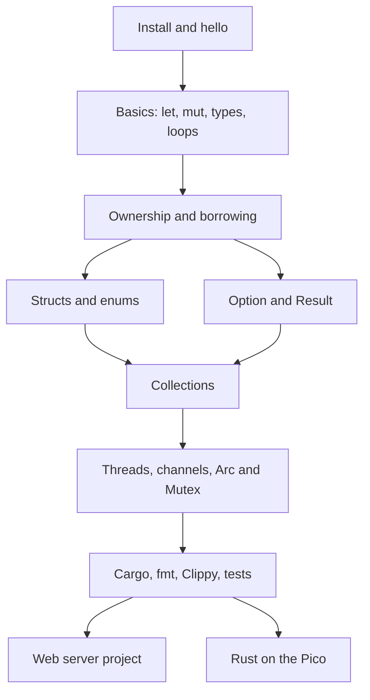

{:class="cover"}

---

By the end of this lesson you will be able to explain the main ideas from each lesson in one sentence, and choose what to learn next.

---

## What you have learned

Congratulations on getting this far! Rust has a reputation for being hard, and you have met its trickiest ideas. Here is the course in one picture, followed by one sentence per lesson.

- **Installing and hello**: rustup installs Rust, and Cargo builds and runs your projects.
- **Rust vs Python**: Rust checks types and ownership at compile time, so many bugs never reach the robot.
- **Basics**: variables are immutable unless marked `mut`, and the last expression of a function is its value.
- **Ownership and borrowing**: each value has one owner, and `&` and `&mut` lend it out.
- **Structs and enums**: a struct groups data, an enum lists choices, and `match` handles every one.
- **Error handling**: `Option` and `Result` make failure part of the type, and `?` passes it up.
- **Collections**: `Vec`, `String` and `HashMap` hold growing groups of data.
- **Concurrency**: threads, channels and `Arc<Mutex<T>>` share work safely.
- **Tools**: `cargo fmt`, `cargo clippy` and `cargo test` keep your code tidy and correct.
- **Web project**: warp and serde serve JSON from a Rust program.
- **Pico**: `no_std`, the `thumbv6m-none-eabi` target and UF2 files get Rust onto a microcontroller.

## Where to go next

On this site:

- [Getting Started with C on the Raspberry Pi Pico](/learn/c_pico/) is another compiled language on the same board, good for comparing.
- [Learn MicroPython - The basics](/learn/micropython/) and [MicroPython GPIO](/learn/micropython_gpio/) cover the quick, interactive way to program the Pico.

Elsewhere:

- [The Rust Programming Language](https://doc.rust-lang.org/book/): the official book, an excellent next step.
- [Rust by Example](https://doc.rust-lang.org/rust-by-example/): runnable examples of each idea.
- [Rustlings](https://github.com/rust-lang/rustlings): small exercises that get you used to reading and fixing compiler errors.
- [The Embedded Rust Book](https://docs.rust-embedded.org/book/): the guide to microcontrollers like the Pico.
- [Rust Users Forum](https://users.rust-lang.org/): a friendly place to ask questions.
- [Awesome Rust](https://github.com/rust-unofficial/awesome-rust): a curated list of libraries and tools.

For the Pico, the crates used in lesson 11 each have a README and examples: `rp-pico`, `rp2040-hal`, and `cortex-m-rt`. The `rp-pico` crate's `examples` folder shows PWM, I2C, SPI and USB serial.

## Try it Yourself

1. Go back to your earlier lesson programs and run `cargo fmt` and `cargo clippy` on each one.
2. Write a small program that combines a struct, an enum, a `Vec` and a `Result`, for example a robot that follows a list of commands and reports a bad command as an error.
3. Install Rustlings and complete the first five exercises.
4. Challenge: add a `/robot/command` route to the web project that accepts a `Command` and stores it in an `Arc<Mutex<Vec<Command>>>`.

## Common Issues

- **Problem**: You feel stuck on ownership errors.
- **Solution**: Reread lesson 4 and try the Rustlings exercises on ownership. Read the compiler's `help:` lines.
- **Why**: Almost everyone needs a few weeks of practice before ownership feels natural.

- **Problem**: A tutorial's crate version does not compile.
- **Solution**: Check the crate's page on docs.rs for the current API, and pin the version in `Cargo.toml`.
- **Why**: Crates change, and embedded crates change quickly. Warp moved from 0.3 to 0.4 and needed a new feature flag.

## Check your understanding


? Which tool checks your code for idiomatic improvements?
- [ ] rustfmt
- [x] Clippy
- [ ] elf2uf2-rs
> Clippy gives advice on code that compiles but could be better.

? What did the Pico lesson's `#![no_std]` remove?
- [ ] Variables
- [x] The standard library, including `println!`
- [ ] Ownership
> Ownership still applies. The operating-system parts of the standard library do not.

? Which is a good next step from this course?
- [ ] Stopping practice
- [x] Working through The Rust Programming Language book or Rustlings
- [ ] Avoiding the compiler's errors
> Reading the official book and solving small exercises builds fluency.

