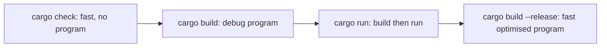

{:class="cover"}

---

By the end of this lesson you will be able to create a project with Cargo, add a dependency, and choose between `cargo check`, `cargo build` and `cargo build --release`.

---

## What Cargo does for you

Cargo is Rust's build system and package manager in one. It creates projects, downloads libraries (called **crates**) and their dependencies, runs the compiler with the right options, and runs tests. You used it in earlier lessons. Now let's look at how it works.

## Creating a project

```bash
cargo new robot_math
cd robot_math
```

Cargo creates:

```text
robot_math/
  Cargo.toml
  src/
    main.rs
```

It also sets up a version-control repository with a sensible ignore file. `Cargo.toml` is the **manifest**. Here is what a fresh one looks like on current Rust:

```toml
[package]
name = "robot_math"
version = "0.1.0"
edition = "2024"

[dependencies]
```

The **edition** is the version of the language rules the project follows. New projects use the newest, and older code keeps working on its older edition. Everything under `[dependencies]` is a crate your project uses.

## Adding a dependency

The easiest way is the `cargo add` command, which edits `Cargo.toml` for you:

```bash
cargo add serde --features derive
```

Your manifest now includes a line like this, where the version number is the newest at the time you ran it:

```toml
[dependencies]
serde = { version = "1.0.229", features = ["derive"] }
```

You can also type the line by hand. `"1.0"` means "any compatible 1.x version at or above 1.0". **Features** are optional parts of a crate you switch on. In lesson 10, `warp` needed the `server` feature.

The first time you build, Cargo downloads the crate and everything it depends on, and records the exact versions in a file called `Cargo.lock`. Commit `Cargo.lock` for programs, such as robot firmware, so that everyone builds with the same versions.

## Build, check, run



| Command | What it does | When to use it |
| --- | --- | --- |
| `cargo check` | Checks the code compiles, makes no program | While writing, it is the quickest |
| `cargo build` | Builds a debug program in `target/debug/` | Everyday development |
| `cargo run` | Builds if needed, then runs | Trying your program |
| `cargo build --release` | Builds an optimised program in `target/release/` | Finished programs and robots |
| `cargo test` | Builds and runs the tests | Before you trust a change |
{:class="table table-single"}

Debug builds compile fast but run slowly and include extra checks such as number overflow. Release builds take longer to compile and run much faster. If your robot code feels slow, check you ran it with `--release`.

Everything Cargo creates goes in the `target` folder. It can get large, and you can delete it at any time with `cargo clean`: it will simply be rebuilt.

**Why this matters:** on the Pico in lesson 11 you used `cargo run --release` for exactly this reason: debug builds are bigger and slower, which matters on a chip with limited memory.

## Try it Yourself

1. Make a project called `robot_math`, add `serde`, and run `cargo build`. Look inside `Cargo.lock`.
2. Run `cargo build` and `cargo build --release`, then look in `target/` to find both programs.
3. Add `[profile.release]` with `opt-level = "z"` to `Cargo.toml` and rebuild. Look up in the Cargo documentation what it does.
4. Challenge: run `cargo doc --open` in a project with a dependency and browse the generated documentation.

## Common Issues

- **Problem**: `error: no matching package named ... found`.
- **Solution**: Check the crate name's spelling on crates.io. Crate names often use hyphens, for example `rp-pico`.
- **Why**: Cargo looks up the exact name on the crates.io index.

- **Problem**: A dependency fails to compile after you update.
- **Solution**: Restore the old `Cargo.lock`, or pin an exact version such as `serde = "=1.0.229"`.
- **Why**: `cargo update` moves to newer compatible versions, which may behave differently.

- **Problem**: The `target` folder is taking a lot of disk space.
- **Solution**: Run `cargo clean`.
- **Why**: Cargo keeps every build of every dependency so rebuilds are quick.

## Check your understanding


? What does `cargo check` do?
- [x] Checks the code compiles without producing a program
- [ ] Runs the tests
- [ ] Deletes the target folder
> It is the quickest way to find errors while you write.

? What is the `Cargo.lock` file for?
- [ ] Locking your files from being edited
- [x] Recording the exact versions of every dependency used
- [ ] Choosing the edition
> It makes builds repeatable.

? Where does `cargo build --release` put the program?
- [ ] `target/debug/`
- [x] `target/release/`
- [ ] `src/`
> Debug builds go in `target/debug/` and release builds in `target/release/`.

