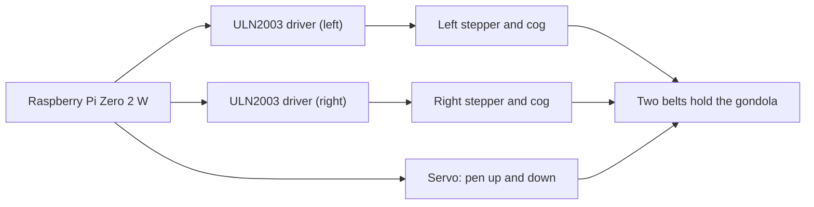

{:class="cover"}

---

By the end of this lesson you will be able to explain how Scrawly Wally draws with just two motors, and know what you will build in the rest of the course.

Ahoy there makers! Welcome to the Wall Drawing Robot course. Kev built Scrawly Wally to draw on a whiteboard, and in this course we'll build one together, from a pile of parts to a pen that draws a square on the wall.



---

## Overview

Scrawly Wally is a **wall drawing robot**, sometimes called a polargraph or a vertical plotter. A small 3D printed **gondola** carries a pen and hangs from two toothed timing belts. Each belt runs over a cog on a **28BYJ-48 stepper motor** fixed at the top corners of a board. Wind a belt in and that side of the gondola rises. Let it out and that side drops. Control both together and the pen can reach any point on the board.

A **Raspberry Pi Zero 2 W** drives the motors through two **ULN2003** driver boards, and a small **servo** lifts the pen off the wall and puts it back.

## Course Content

- **Build the Robot**: the parts and 3D prints, assembling the left and right sides and the gondola, and wiring the Pi to the drivers and servo
- **Programming**: setting up the Pi, getting the software, testing the motors and servo, turning an (x, y) position into belt lengths, and drawing a first shape
- **Going further**: turning a picture into an SVG, then into wall coordinates
- **Summary**: what you built, and where to go next

## Key Results

After completing this course, you will:

- Explain how two belt lengths fix the position of the pen
- Assemble and wire a two-motor wall plotter around a Raspberry Pi Zero 2 W
- Test stepper motors and a pen servo from Python
- Convert an (x, y) position into belt lengths and then into motor steps
- Draw a square from a complete Python program, after a dry run on your computer
- Convert a simple SVG into coordinates the plotter can follow

## What you'll need

- The parts listed in lesson 2, including the three 3D printed parts
- A whiteboard or smooth board to hang it on. Kev's is about 90 cm by 60 cm
- A Raspberry Pi Zero 2 W, a microSD card and a good power supply
- A computer to write code and prepare drawings on
- Basic Python. If you're new, try the [Python course](/learn/python/)
- A little comfort in a terminal. The [Linux command line course](/learn/linux_intro/) helps

New to steppers? [Motors and motor drivers](/learn/motors_and_drivers/) shows how a 28BYJ-48 works. Fancy a robot arm that draws? Try the [BrachioGraph tutorial](/learn/brachiograph/).

## How the course works

**Build, then calibrate.** We don't know your board size or your belt, so where a number depends on your robot, the lesson shows you how to measure it. Nothing here pretends every build is identical.

**Dry runs first.** The drawing programs have a switch that pretends to move the motors, so you can check the numbers on any computer before the robot moves.

**Photos and diagrams.** Assembly steps come with Kev's step-by-step pictures. Maths comes with diagrams.

**Quizzes and exercises.** Each lesson ends with a short quiz, a Try it Yourself list and a Common Issues list.

**Two places to type.** Code for the robot runs on the Pi. The maths and SVG programs also run on any computer with Python 3.

> **Teachers**: this course suits students aged about 11 and up with adult help for the build, and older students for the code. Allow 45 to 60 minutes per lesson; printing the parts takes longer, so print ahead. One robot per group of three or four works well. Lessons 8 and 9 (dry run) and 10 need no hardware, so a class without kit can still do the maths and simulations. The finished robot hangs above head height if you mount the board on a wall, so fix it securely and keep people from standing beneath it. A board leaning on an easel or a desk is a safer way to start.

Ready? Let's meet the parts.
