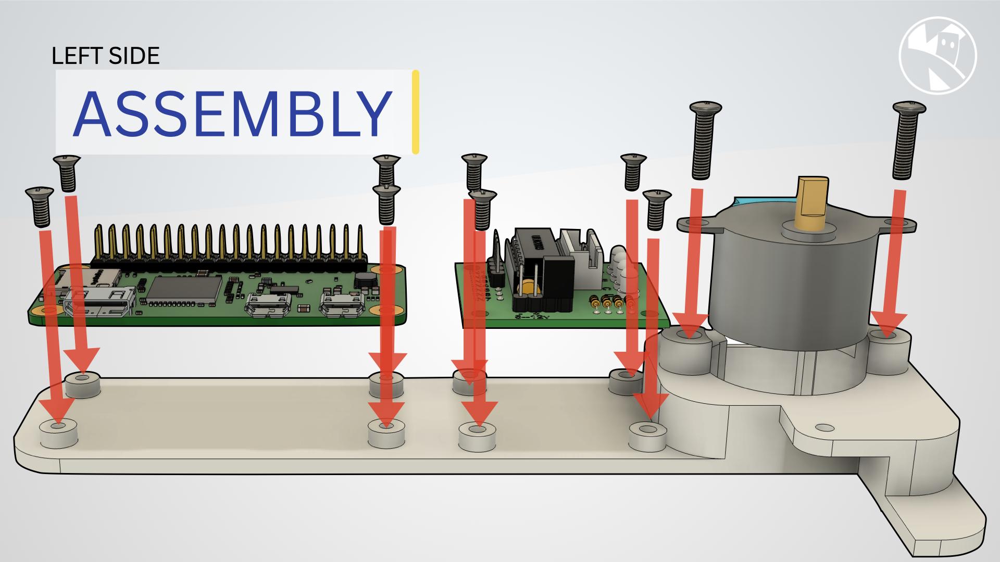
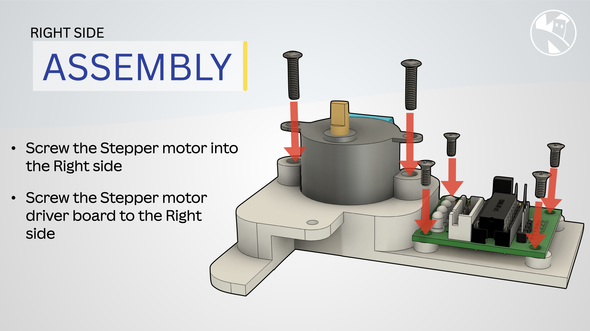
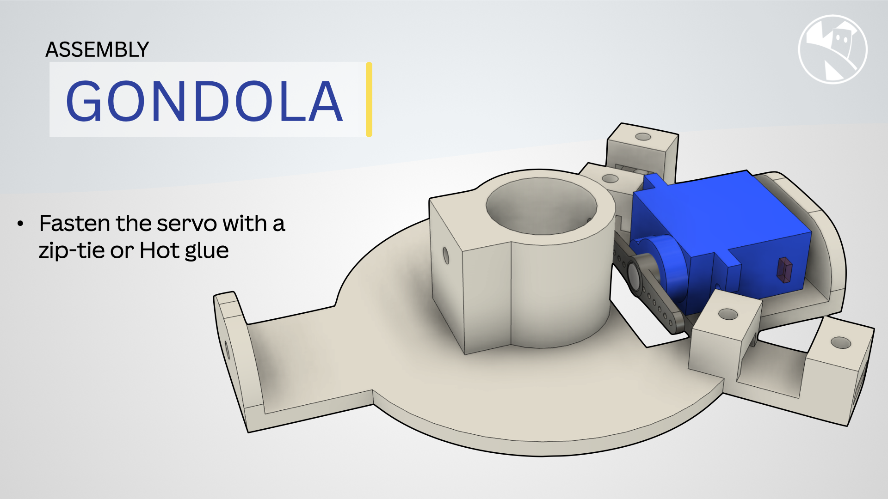
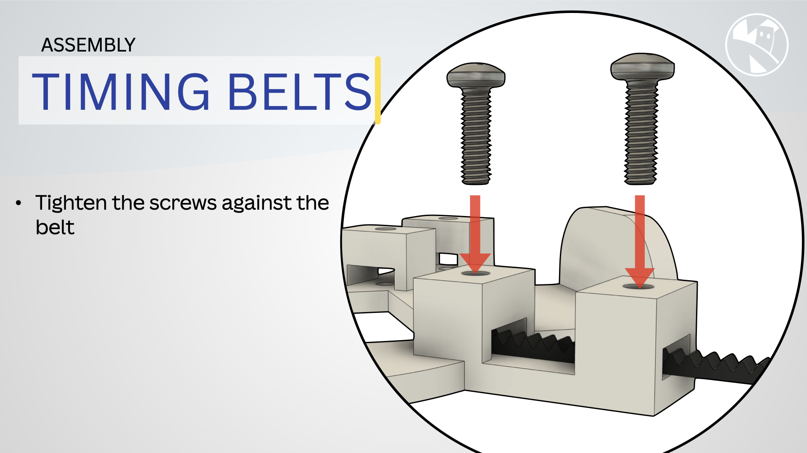
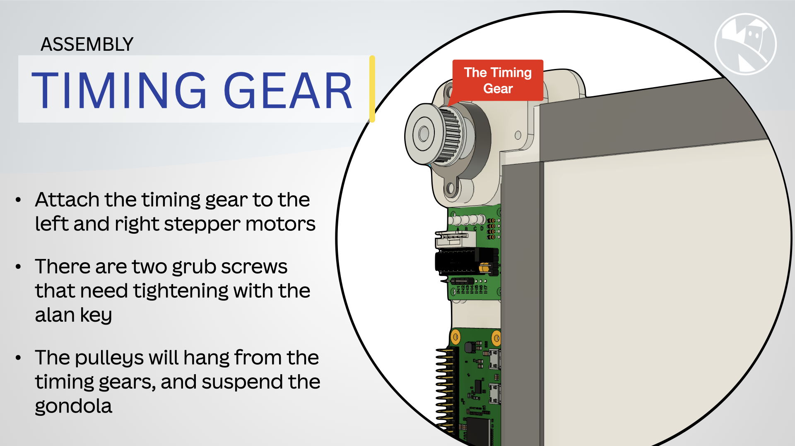
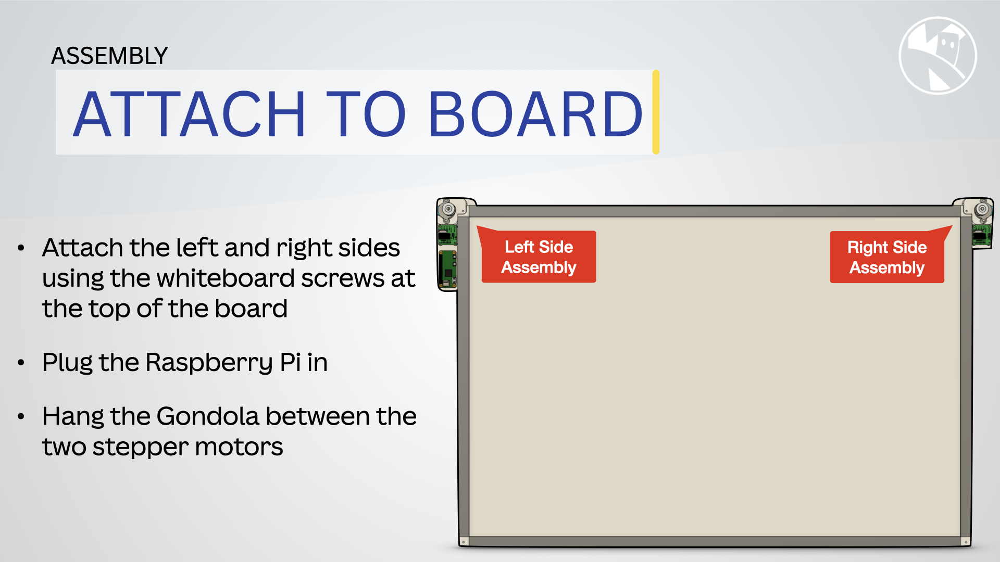
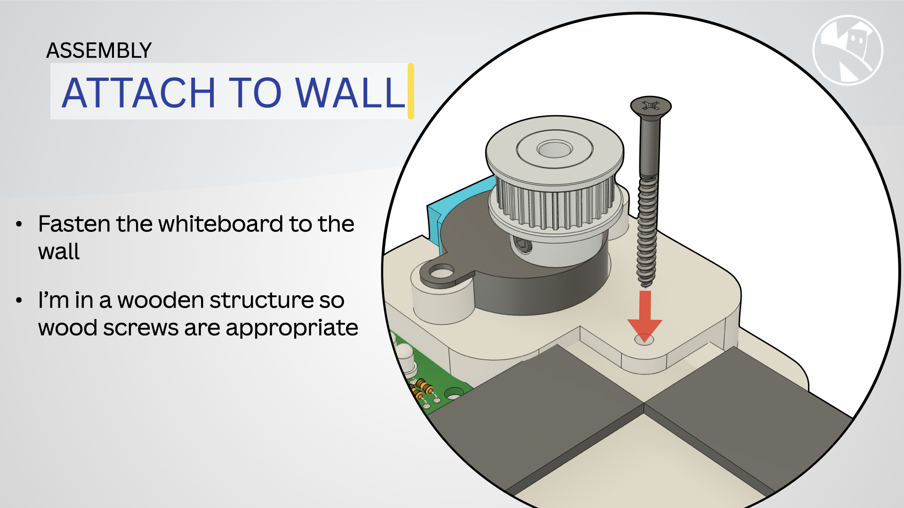

{:class="cover"}

---

By the end of this lesson you will be able to assemble the left and right motor mounts, build the gondola, and hang it from the two cogs.

Let's build! We'll make the two sides first, then the gondola, then bring them together on the board. Work in the order below, because a couple of steps are fiddly once the board is up.

## Step 1: the left side

Screw the 28BYJ-48 stepper into the printed `left_side.stl`, then fix the ULN2003 driver board and the Raspberry Pi Zero 2 W to the posts on the mount. Kev's picture shows where every screw goes. The Pi uses M2.5 screws.

{:class="w-100 img-fluid rounded-3 card-shadow card-hover"}

## Step 2: the right side

The right side is the same idea without the Pi: motor into `right_side.stl`, then the driver board onto its posts.

{:class="w-100 img-fluid rounded-3 card-shadow card-hover"}

Plug each motor's white connector into the matching ULN2003 board. The connector only goes in one way round, so don't force it.

## Step 3: the gondola

Slide your marker into the round socket of `gondola.stl`. Fasten the servo into its cradle with a zip tie or hot glue, so its horn can swing the pen towards and away from the wall.

{:class="w-100 img-fluid rounded-3 card-shadow card-hover"}

Next, clamp the belts into the gondola. Each belt end slides into a slot in the printed block, and a screw tightened down onto it holds it fast.

{:class="w-100 img-fluid rounded-3 card-shadow card-hover"}

## Step 4: the timing cogs

Slide a 3GT cog onto each motor shaft. Each cog has two grub screws, and they need tightening with a small Allen key. Make sure one screw sits on the flat of the shaft, or the cog will slip and your drawings will drift.

{:class="w-100 img-fluid rounded-3 card-shadow card-hover"}

## Step 5: onto the board

The left and right assemblies sit on the top corners of the whiteboard. The Pi goes on the left. Hang the gondola from the two belts, one over each cog.

{:class="w-100 img-fluid rounded-3 card-shadow card-hover"}

Finally, fasten the board and the mounts to the wall. Kev's wall is a wooden structure, so he uses wood screws.

{:class="w-100 img-fluid rounded-3 card-shadow card-hover"}

> **Teachers**: the finished plotter is two motors, a Pi and a hanging gondola fixed to a wall, and the screws must suit the wall. Wood screws suit a wooden frame, but plasterboard and masonry need different fixings and perhaps permission. Ask your site team before drilling. Mount the board low, keep people out from under the gondola while it moves, and let learners build and test flat on a desk first.

## Try it Yourself

1. Before you fix anything to the wall, build both sides and the gondola on a desk and check the cogs turn freely by hand.
2. Hang the gondola from the belts and check it moves smoothly when you pull each belt by hand. Does it swing or twist?
3. Challenge: measure the distance between the centres of the two cogs and write it down. You'll need this number in lesson 8.

## Common Issues

- **Problem**: A cog spins on the shaft, but the belt doesn't move.
- **Solution**: Tighten both grub screws, with one of them on the flat of the shaft.
- **Why**: A grub screw on the round part of the shaft has nothing to bite on.

- **Problem**: The gondola hangs crooked.
- **Solution**: Check both belts are clamped at the same height in the gondola and that no belt has twisted.
- **Why**: Uneven clamping tilts the pen, and a tilted pen draws a different shape from a vertical one.

- **Problem**: The driver board does not sit flat on its posts.
- **Solution**: Check the posts for stringy bits of plastic and trim them.
- **Why**: A rocking board puts strain on the pins you will wire up in the next lesson.

## Check your understanding


? What stops a timing cog slipping on the motor shaft?
- [ ] Hot glue on the belt
- [x] Two grub screws, one of them on the flat of the shaft
- [ ] Tightening the belt clamp
> The grub screws grip the shaft, and the flat gives one of them something to bite on.

? Which parts go on the left side mount?
- [ ] Only the stepper motor
- [x] The stepper motor, a ULN2003 driver and the Raspberry Pi
- [ ] The servo
> The Pi sits on the left mount with the left driver and motor. The servo is on the gondola.

? Why build and test on a desk before fixing to the wall?
- [ ] The wall is too cold for the parts
- [x] Faults are much easier to find and fix when the robot is at hand and not above your head
- [ ] The motors only work flat
> A desk test shows up slipping cogs and crooked belts before you have to reach them on a wall.


Your robot is assembled. Now we'll wire it up.
