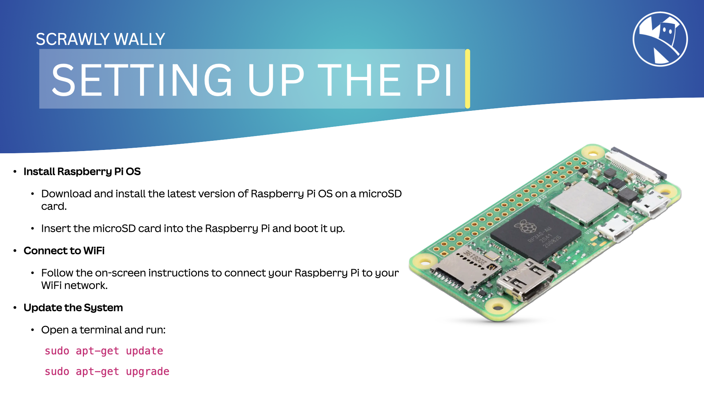

{:class="cover"}

---

By the end of this lesson you will be able to get a Raspberry Pi Zero 2 W running Raspberry Pi OS on your WiFi, up to date, and ready for the robot's code.

Let's wake up the brain. The Pi Zero 2 W has no Ethernet port and is tucked away on the robot's mount, so we'll set it up so that you can reach it over WiFi from your computer.

{:class="w-100 img-fluid rounded-3 card-shadow card-hover"}


## Step 1: install Raspberry Pi OS

Download the latest Raspberry Pi OS and write it to a microSD card with Raspberry Pi Imager. In the Imager's settings you can give the Pi a hostname, a username and password, your WiFi details, and switch on SSH. If you set those now, the Pi joins your network on its first boot, and you can use it from your computer without a screen.

Put the card in the Pi, power it up and give it a couple of minutes on the first boot.

## Step 2: join WiFi

If you set up WiFi in the Imager, it joins by itself. If you started the Pi with a monitor and keyboard, follow the on-screen instructions to join your network.

## Step 3: update the system

Open a terminal on the Pi (or connect over SSH) and run:

```sh
sudo apt-get update
sudo apt-get upgrade
```

Updates on a Pi Zero 2 W can take a while, so be patient and don't unplug it half-way.

## Step 4: leave serial, SPI and I2C off

Many guides tell you to turn interfaces on in `raspi-config`. For Scrawly Wally we do the opposite. The wiring in lesson 4 uses GPIO 14 and 15 (serial), 7 and 8 (SPI) and 1 (the ID EEPROM line). If those interfaces are switched on, the Pi keeps those pins for itself.

You can check with:

```sh
ls /dev/spidev* /dev/i2c*
```

If everything is off, you'll see `No such file or directory` for both. If you see device names such as `/dev/spidev0.0`, run `sudo raspi-config`, open **Interface Options**, switch those interfaces off, and reboot.

## Try it Yourself

1. Find your Pi's address on your network and connect to it over SSH from your computer.
2. Run `uname -a` and `cat /etc/os-release`, and write down which Raspberry Pi OS version you have.
3. Challenge: run `ls /dev/spidev*`, then enable SPI in `raspi-config`, run it again and see what changes. Switch it back off afterwards.

## Common Issues

- **Problem**: The Pi doesn't appear on the network.
- **Solution**: Check the WiFi name and password, and that your network is 2.4 GHz.
- **Why**: The Pi Zero 2 W's radio only connects to 2.4 GHz networks, so a 5 GHz-only network won't show up.

- **Problem**: `apt-get update` says it can't reach the servers.
- **Solution**: Check that the Pi really is online, with `ping -c 3 raspberrypi.org`, and wait a minute after boot.
- **Why**: The Pi can take a short time to join WiFi, and the commands need a working connection.

- **Problem**: The motors act strangely or the pins don't respond.
- **Solution**: Run the `ls /dev/spidev* /dev/i2c*` check above and turn off any interface you see.
- **Why**: An enabled interface takes over the pins the robot is wired to.

> **Teachers**: school networks often block new devices, or need a login page the headless Pi cannot show. Ask your network manager about getting the Pi on the network before the lesson, or use a phone hotspot (with permission). Give each Pi its own labelled microSD card and a unique hostname so that groups don't connect to each other's robots.

## Check your understanding


? Why do we set the Pi up so we can reach it over WiFi?
- [ ] The Pi Zero 2 W cannot use a screen
- [x] It has no Ethernet port and is mounted on the robot, so we will use it from our computer
- [ ] WiFi is faster than the robot's pins
> The Pi sits on the robot's mount, so it's easiest to work with it over the network.

? Why do we leave serial, SPI and I2C off?
- [ ] They use too much power
- [x] Some of the robot's pins would be taken over by those interfaces
- [ ] They are not available on the Zero 2 W
> The robot is wired to pins that those interfaces would use.

? What does seeing `/dev/spidev0.0` tell you?
- [ ] The servo is connected
- [x] SPI is switched on and is holding some of the robot's pins
- [ ] The Pi is ready to run the robot
> That device only exists when SPI is enabled.


Your Pi is ready. Next, the robot software.
