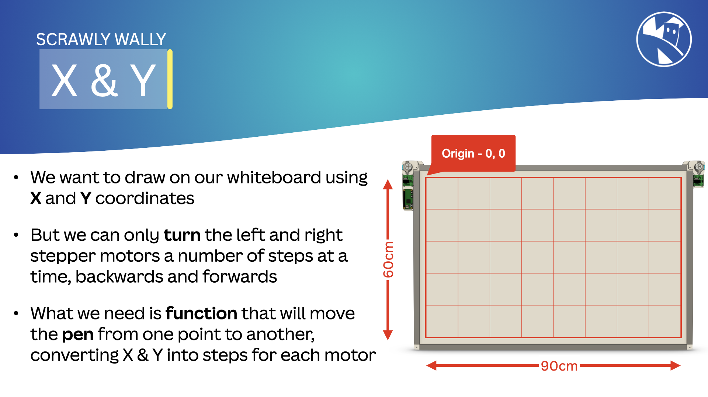
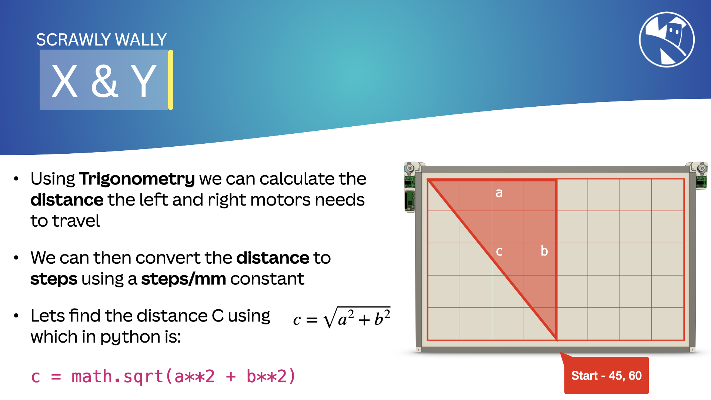
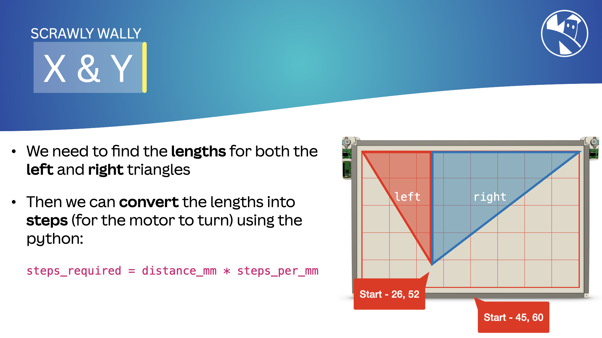
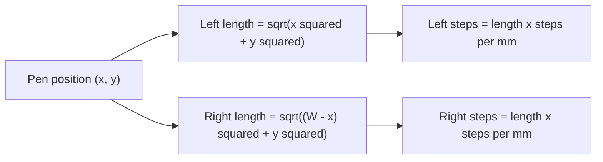

{:class="cover"}

---

By the end of this lesson you will be able to work out how long each belt must be for any pen position, convert that into motor steps, and calibrate the numbers for your own board.

We want to draw with x and y positions, but the robot can only turn two motors. The bridge between them is a little geometry. It's just Pythagoras, so let's build it.

{:class="img-fluid w-100 card-hover card-shadow rounded-3"}

## Two numbers fix the pen

Imagine the two cogs at the top corners of the board. The pen hangs from one belt from the left cog and one from the right. If you know how long each belt run is, there is only one place the pen can be, where the two runs meet.

So the plan is: pick a point (x, y) on the board, work out the two belt lengths that put the pen there, and turn the motors by the difference from where they are now.

## The coordinates

We put the **origin** `(0, 0)` where the left belt leaves the left cog. **x** runs to the right along the top, and **y** runs **down** the board, as in Kev's diagram. The right cog is at `(W, 0)`, where `W` is the width between the two cogs.

{:class="img-fluid w-100 card-hover card-shadow rounded-3"}

From the left cog, the pen is `x` across and `y` down, so the belt run is the long side of a right-angled triangle. From the right cog, the pen is `W - x` across and `y` down.

{:class="img-fluid w-100 card-hover card-shadow rounded-3"}



## A program to try

Here is the idea as a complete program. It runs on any computer with Python 3, no Raspberry Pi needed. The board is 900 mm between cogs, and the pen moves from the middle of the board to a point to the right.

```python
import math

BOARD_W = 900.0        # mm between the two cog centres: measure yours
STEPS_PER_MM = 68.27   # nominal: 4096 half-steps per turn / 60 mm of belt per turn


def string_lengths(x, y, width=BOARD_W):
    """Belt length from each cog to the pen, in mm. Origin is the left cog, y is down."""
    left = math.sqrt(x ** 2 + y ** 2)
    right = math.sqrt((width - x) ** 2 + y ** 2)
    return left, right


def to_steps(mm):
    return round(mm * STEPS_PER_MM)


home = (450, 300)
target = (600, 300)

left_home, right_home = string_lengths(*home)
left_target, right_target = string_lengths(*target)

print(f"At {home}: left {left_home:.2f} mm, right {right_home:.2f} mm")
print(f"At {target}: left {left_target:.2f} mm, right {right_target:.2f} mm")

change_left = left_target - left_home
change_right = right_target - right_home
print(f"Left belt changes by {change_left:+.2f} mm = {to_steps(change_left):+d} steps")
print(f"Right belt changes by {change_right:+.2f} mm = {to_steps(change_right):+d} steps")

print()
print("Corners and the middle of the top edge:")
for point in [(0, 0), (450, 0), (900, 0), (450, 600)]:
    left, right = string_lengths(*point)
    print(f"  {point}: left {left:.1f} mm, right {right:.1f} mm")
```

When we run it, it prints:

```text
At (450, 300): left 540.83 mm, right 540.83 mm
At (600, 300): left 670.82 mm, right 424.26 mm
Left belt changes by +129.99 mm = +8874 steps
Right belt changes by -116.57 mm = -7958 steps

Corners and the middle of the top edge:
  (0, 0): left 0.0 mm, right 900.0 mm
  (450, 0): left 450.0 mm, right 450.0 mm
  (900, 0): left 900.0 mm, right 0.0 mm
  (450, 600): left 750.0 mm, right 750.0 mm
```

Look at what happened when the pen moved 150 mm to the right: the left belt got longer, the right belt got shorter, and by different amounts. They aren't equal because the triangles are different shapes. The last line matches Kev's diagram: a 90 cm by 60 cm board with the pen at (45, 60) cm has each belt run at 750 mm, which is 75 cm.

## From millimetres to steps

The belt moves with the cog. A 3GT belt has teeth 3 mm apart, and our cog has 20 teeth, so one turn of the cog moves 60 mm of belt. The motor takes 4096 half-steps per turn, so:

`4096 / 60 = 68.27` steps per millimetre.

That's a starting point built on part numbers and a quoted gearbox ratio, and real parts vary. So we calibrate.

## Measure and calibrate

1. **Measure `W`.** Measure from the centre of the left cog to the centre of the right cog, in millimetres. Use that for `BOARD_W`.
2. **Calibrate steps per mm.** Run the test program from lesson 7 with several turns, for example `turn(LEFT_PINS, 4096 * 10, 1)`. Mark the belt where it leaves the cog before and after, measure how far the belt travelled, and divide the steps by the millimetres. If the belt moved 600 mm, you get 68.27. If it moved 590 mm, you get about 69.4.
3. **Check the direction.** Note whether `+1` lengthens or shortens each belt, as the next lesson needs this.

## Why we can't just run the motors at a steady speed

Our belts change length at different rates, so a straight line on the board is not a straight line in belt length. Run this program to see how far off a naive move gets:

```python
import math

BOARD_W = 900.0


def string_lengths(x, y):
    return math.hypot(x, y), math.hypot(BOARD_W - x, y)


def position_from_lengths(left, right):
    """The reverse trip: two belt lengths back to an (x, y) on the wall."""
    x = (left ** 2 - right ** 2 + BOARD_W ** 2) / (2 * BOARD_W)
    y = math.sqrt(left ** 2 - x ** 2)
    return x, y


start = (150, 150)
end = (750, 450)

left_a, right_a = string_lengths(*start)
left_b, right_b = string_lengths(*end)

# What if both motors simply ran at a steady rate from start to end?
halfway_left = (left_a + left_b) / 2
halfway_right = (right_a + right_b) / 2
x, y = position_from_lengths(halfway_left, halfway_right)

print("A straight line passes through (450, 300) at the halfway point")
print(f"Two steady motors put the pen at ({x:.1f}, {y:.1f})")
print(f"That is {math.hypot(x - 450, y - 300):.1f} mm off the line")
```

It prints:

```text
A straight line passes through (450, 300) at the halfway point
Two steady motors put the pen at (400.8, 367.0)
That is 83.1 mm off the line
```

That's more than 8 cm off a straight line. The fix in lesson 9 is to cut each line into short pieces and work out the belt lengths for each piece.

> **Teachers**: this lesson needs no hardware, only Python, so it works as a maths lesson in its own right on Pythagoras, coordinates and ratios. Learners can check the results with a ruler and string on a real board, or with squared paper. Ask them to explain why `y` points down.

## Try it Yourself

1. Put your own measured `BOARD_W` into the first program and rerun it. Work out the belt lengths for the middle of your board.
2. Change `target` to `(300, 300)`. Before you run it, predict whether the left belt gets longer or shorter. Then check.
3. Using a calculator, work out the belt lengths for `(450, 600)` by hand and compare with the program.
4. Challenge: write a function that takes an (x, y) and returns `True` if both belt lengths are at most the length of belt you have.

## Common Issues

- **Problem**: The left and right belt lengths look swapped.
- **Solution**: Check you put the origin at the left cog and that `x` increases towards the right cog.
- **Why**: The left length uses `x` and the right length uses `W - x`, so measuring from the wrong cog swaps them.

- **Problem**: A drawn shape comes out a different size than you asked for.
- **Solution**: Recalibrate `STEPS_PER_MM` by measuring belt travel for a known number of steps.
- **Why**: Every size error comes from a wrong steps-per-millimetre or a wrong cog size.

- **Problem**: `ValueError: math domain error`.
- **Solution**: Check the pen position is inside the board.
- **Why**: A square root of a negative number can't be calculated, which happens in the reverse calculation when the two lengths can't meet.

## Check your understanding


? A board is 900 mm between cogs. The pen is at (450, 300). How long is the left belt run?
- [ ] 450 mm
- [x] About 541 mm
- [ ] 750 mm
> The left run is the square root of 450 squared plus 300 squared, which is 540.83 mm.

? How far does the belt move for one turn of a 20 tooth 3GT cog?
- [ ] 20 mm
- [x] 60 mm
- [ ] 3 mm
> The belt teeth are 3 mm apart, and 20 teeth pass per turn, so 60 mm.

? Why do we calibrate steps per millimetre?
- [ ] The Pi forgets the number
- [x] The quoted numbers come from the parts, and real motors, cogs and belts vary
- [ ] Python needs it to run
> We measure how far the belt actually moves for a known number of steps.


We can now say where the pen should go. Let's draw something.
