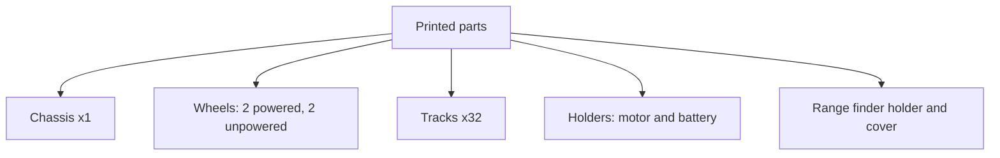

{:class="cover"}

---

By the end of this lesson you will be able to list the parts to print, the electronics to buy and the tools to gather for a SMARS.

## Watch the video



---

## Print the Parts

Let's get everything on the bench before we build. Download the build files from Thingiverse. [Click here for the latest version.](https://www.thingiverse.com/thing:2662828)

SMARS is made of a handful of printed parts plus a few electronics. The tracks are the part you print the most of, so start those early.

### 3D Printed Parts

It makes sense to print the parts in roughly the order you are going to construct it in:

1. [The chassis](/assets/stl/smars/chassis.stl)
1. [The powered wheels x2](/assets/stl/smars/powered_wheel.stl)
1. [The unpowered wheels x2](/assets/stl/smars/unpowered_wheel.stl)
1. [The mechanical tracks x32](/assets/stl/smars/tracks.stl)
1. [The holding board (for the 9v battery)](/assets/stl/smars/motor_holder.stl)
1. [The range finder holder](/assets/stl/smars/range_finder_holder.stl)
1. [The range finder cover](/assets/stl/smars/range_finder_cover.stl)

Why 32 tracks? In lesson 11 you can fit 16 tracks to each side in a caterpillar loop (2 sides times 16), or 8 tracks to each of the four wheels. Either way it comes to 32.

### Electronics Bill of Materials

Item                    | Description            | Qty | Price
------------------------|------------------------|:---:|-----:
Ultrasonic Range finder | HC-SR04 Range Finder  |  1  | £2.50
Arduino                 | Arduino Uno V3         |  1  | £14.99
Motor Shield            | Fundumoto motor shield |  1  | £15.00
Motors                  | 6v N20 150RPM motors   |  2  | £6.99
{:class="table table-single"}

The range finder is optional for this course: you will fit the Arduino, shield, motors and battery, and the final sketch drives the robot without it. You can add it later when you program obstacle avoidance in [Learn how to program SMARS with Arduino](/learn/smars_code/).

You will also need:

- some wire (preferably black and red)
- some solder
- some flux to make the solder adhere properly.

### Tools

Tools required are:

- a 3D printer
- filament (PLA is fine)
- a soldering iron

### 3D Printer settings

- The printer can be comfortably set to 50% infill
- Use different coloured filament to give your SMARS some style
- Prices are a guide from when the course was written; they change a lot

> **Teachers**: Printing is the slow part of this project. Start the print jobs a week ahead, and share one printer between groups by printing a chassis and a set of wheels per kit. If you have no printer, a local library or maker space may print the parts for you. Costs vary, so check current prices before ordering a class set.

## Try it Yourself

1. Tick off each printed part above against a photo of the finished robot (the one at the top of the summary page works well).
2. Add up the electronics prices in the table. How much does one robot cost before wire, solder and filament?
3. Challenge: choose two filament colours for your SMARS and decide which parts will be which. Which parts do you think will get the most wear?

## Common Issues

- **Problem**: The printed parts do not fit together neatly.
- **Solution**: Check the printer is calibrated, and tidy any rough edges or stringing with a craft knife or fine sandpaper.
- **Why**: SMARS has no screws, so it relies on snug, accurate printed joints. A small blob of plastic is enough to stop a part seating.

- **Problem**: You are not sure which motors to buy.
- **Solution**: Follow the bill of materials: 6v N20 150RPM geared motors, two of them.
- **Why**: The chassis has pockets sized for N20 motors, so other motor types will not fit.

## Check your understanding


? Which board is the brain of the original SMARS?
- [ ] Raspberry Pi Pico
- [x] Arduino Uno
- [ ] BBC micro:bit
> The original SMARS uses an Arduino Uno with a Fundumoto motor shield on top. (There's a Pico version too, but this course builds the original.)

? What does the ultrasonic range finder do?
- [ ] Plays sounds
- [x] Measures the distance to objects in front of the robot
- [ ] Charges the battery
> It sends out a pulse of sound and times the echo, so the robot can tell how far away an obstacle is.

? How many tracks do you need to print?
- [ ] 8
- [ ] 16
- [x] 32
> 16 on each side in the caterpillar arrangement, or 8 on each of four wheels. Either way, 32 in total.

