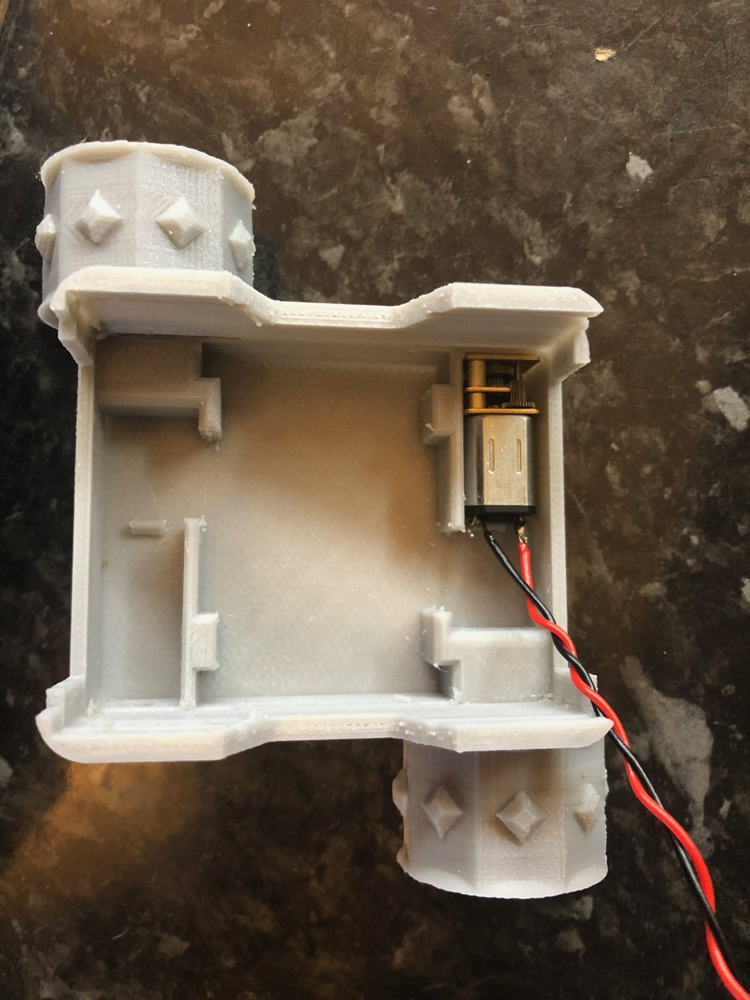

{:class="cover"}

---

By the end of this lesson you will be able to seat both motors in the chassis with their wires free and untrapped.

## Fit Motors

The motors will fix in the perfectly sized area behind the wheel hole.

{:class="img-fluid w-50"}

Take your time here. The pocket is a snug fit by design, and SMARS has no screws, so the motor is held by the printed plastic around it. In the next lessons you will add the battery and the motor holders that lock everything down.

## How to fit each motor

1. Check the soldered joints one more time, and make sure the wires are twisted and tidy.
2. Line the motor up with the pocket behind the wheel hole.
3. Slide it in gently and keep the wires clear of the edges, so nothing gets pinched.
4. Repeat on the other side. Left and right are mirror images of each other.

Wires trapped under a motor are the most common way to snap a joint later, so a moment spent here saves a repair.

## Try it Yourself

1. Fit one motor and then take it out again. Can you do it without stressing the wires?
2. Fit both motors. Hold the chassis up to the light: are both seated the same way round?
3. Challenge: gently wiggle each motor. How would you describe how firmly the pocket grips it before the holders go in?

## Common Issues

- **Problem**: The motor will not go all the way into the pocket.
- **Solution**: Check for stray wire or rough plastic in the way, and trim any stringing from the pocket with a craft knife or sandpaper.
- **Why**: The pocket is sized closely to the motor, so even a little extra plastic stops it seating.

- **Problem**: A soldered wire pulls off the motor while you fit it.
- **Solution**: Take the motor out and re-solder the joint as in lesson 2.
- **Why**: The joints are small and delicate, and a pinched wire pulls straight on them.

## Check your understanding


? Where do the motors sit in the chassis?
- [ ] On top of the chassis
- [x] In the pocket behind the wheel hole
- [ ] Inside the battery holder
> The pocket behind the wheel hole is sized to fit the motor.

? What should you check before fitting each motor?
- [x] That the soldered wires are secure and not going to be pinched
- [ ] That the Arduino is fitted
- [ ] That the tracks are on
> A pinched wire is the easiest way to break a joint.

? What actually holds the motors in place once the build is done?
- [ ] Screws
- [x] The printed pocket plus the motor holders
- [ ] The tracks
> SMARS is screwless: the pocket and the holders do the job.

