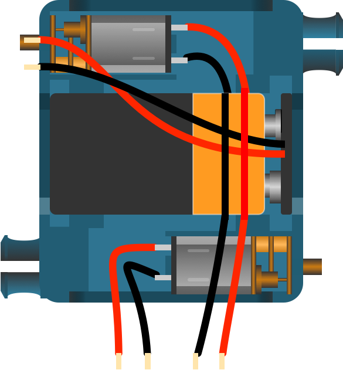
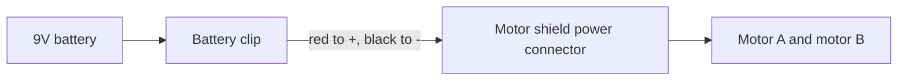

{:class="cover"}

---

By the end of this lesson you will be able to fit the 9V battery in the middle of the chassis and explain how its power reaches the motors.

## Fit battery

The battery fits in the middle of the robot, between the two motors. You will need to attach a battery connector to the battery.

{:class="img-fluid w-50"}

Putting the heaviest part in the middle keeps SMARS balanced, so it does not tip forwards or backwards as it drives. The battery clip has a red wire and a black wire, and these will go to the motor shield in lesson 10.

## Fitting tips

1. Clip the battery connector on first, so you do not have to push it on once the battery is wedged in place.
2. Check which way round the red and black wires point, and leave them where you can reach them later.
3. Slide the battery in between the motors, with the wires free and not trapped.

> **Teachers**: A 9V battery can get hot if its terminals are shorted by metal, so keep loose batteries and bare wire ends apart. Store the batteries disconnected at the end of each session, and use fresh or properly charged batteries. Check your school rules before letting younger learners handle them.

## Try it Yourself

1. Fit the battery and connector and make sure you can still reach both wires.
2. Look at how the red and black wires leave the battery clip. Which way will they point when the shield is on top?
3. Challenge: lift the robot gently. Is it balanced from side to side? How does the battery position help?

## Common Issues

- **Problem**: The battery will not fit between the motors.
- **Solution**: Check there are no wires or plastic stringing in the way, and make sure you are using a standard 9V battery.
- **Why**: The space is sized for the battery, and anything extra in the way will stop it seating.

- **Problem**: The robot does not turn on later, and the battery looks fine.
- **Solution**: Check the connector is pushed fully on the battery.
- **Why**: A loose clip gives a poor connection, so no power reaches the shield.

## Check your understanding


? Where does the battery sit in the chassis?
- [ ] Under the tracks
- [x] In the middle, between the two motors
- [ ] On top of the Arduino
> The middle position keeps the weight balanced.

? What do you attach to the battery so you can connect it to the shield?
- [x] A battery connector (clip)
- [ ] A USB cable
- [ ] A motor holder
> The clip gives you red and black wires to take to the shield.

? Why should loose batteries be kept apart from bare wire ends?
- [ ] They would lose their colour
- [x] Shorting the terminals can make the battery hot
- [ ] It makes the motors spin backwards
> Metal touching both terminals can heat the battery, so keep them apart.

