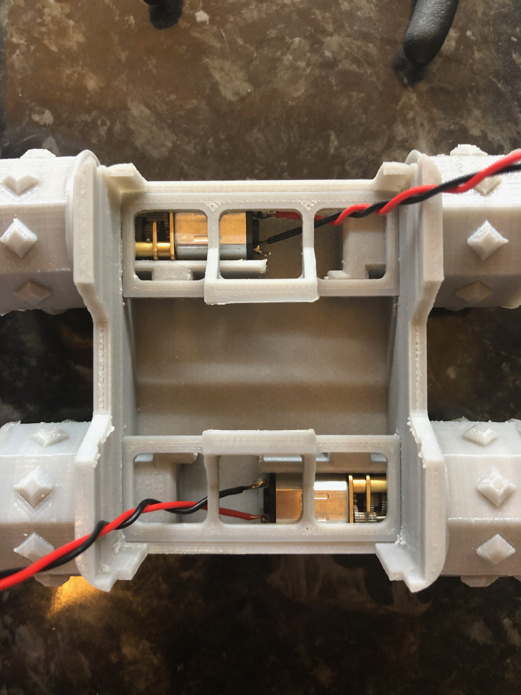

{:class="cover"}

---

By the end of this lesson you will be able to fit the motor holders so the motors are held firmly and the wires stay free.

## Fit Motors Holders

The motors are kept in place by the motor holders. You will have to bend these slightly to insert them into the little recess just above the motors. It is also good practice to push the motor wires through these before inserting. This will make them fit snug and will allow the motor wires to be free and untrapped.

{:class="img-fluid w-50"}

## Why the order matters

Printed plastic can flex a little, which is exactly how these holders work: you bend them slightly, and they spring back to grip the motor. That is also why you thread the wires first. Once a holder is in place, a wire on the wrong side of it is trapped, and you would have to take the holder out again.

## Step by step

1. Pick up one motor holder and one pair of motor wires.
2. Push the red and black wires through the holder before you do anything else.
3. Bend the holder gently, no more than you need, and slide it into the recess just above the motor.
4. Check the motor is held firmly and the wires are free to move.
5. Repeat for the other motor.

Bend gently and steadily. Printed parts are strongest when flexed slowly, and a sudden push can snap them.

## Try it Yourself

1. Fit one holder. Can you still move the wires freely afterwards?
2. Press on the motor with a finger. Does it stay put now?
3. Challenge: look at how far you had to bend the holder. If a holder snaps, how would you print a replacement?

## Common Issues

- **Problem**: A holder cracks as you bend it.
- **Solution**: Print a replacement, and bend the new one slowly and only as far as needed.
- **Why**: A holder only needs to flex slightly to clear the recess. Bending it too far or too fast can break the layers.

- **Problem**: The motor wires are trapped under the holder.
- **Solution**: Lift the holder out, thread the wires through, and fit it again.
- **Why**: A trapped wire can break a delicate solder joint when the robot moves.

## Check your understanding


? Why should you push the motor wires through the holder before inserting it?
- [ ] It makes the wires look neat on the outside
- [x] It lets the wires stay free and untrapped
- [ ] It makes the motors spin faster
> A holder fitted over a wire can trap it, so thread the wires first.

? How do the motor holders go into place?
- [x] You bend them slightly and slide them into the recess above the motors
- [ ] You screw them in
- [ ] You glue them on
> SMARS is screwless, so the holders spring into the recess.

? What do the motor holders do?
- [ ] Hold the battery
- [x] Keep the motors in place
- [ ] Power the wheels
> They stop the motors from coming out of their pockets.

