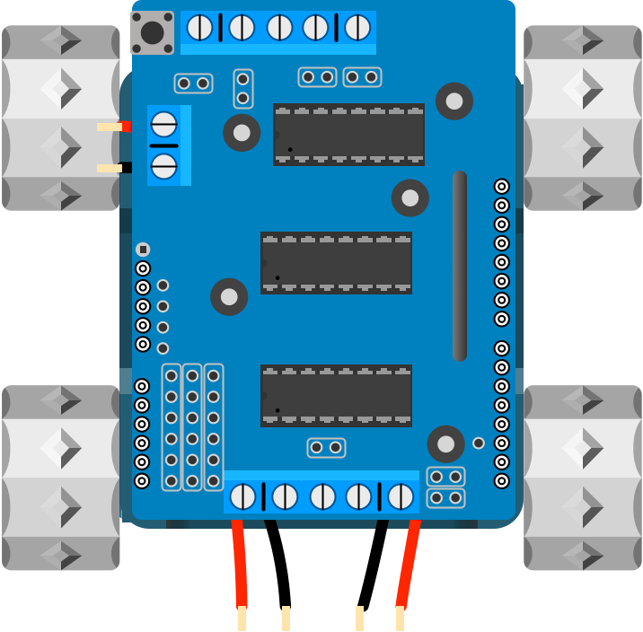

## Insert Wires

Insert the battery wires into the power connector on the motor shield (red to `+`, black to `-`), and each motor's wires into the motor A and motor B connectors.

If a motor turns the wrong way later on, just swap its two wires over.

{:class="img-fluid w-50"}

---
