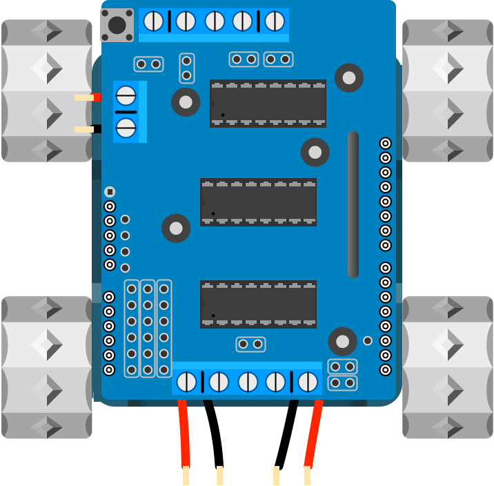
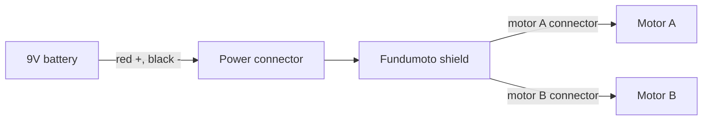

{:class="cover"}

---

By the end of this lesson you will be able to connect the battery and both motors to the right terminals on the motor shield.

## Insert Wires

Insert the battery wires into the power connector on the motor shield (red to `+`, black to `-`), and each motor's wires into the motor A and motor B connectors.

If a motor turns the wrong way later on, just swap its two wires over.

{:class="img-fluid w-50"}

## The wiring map

Everything in the robot now comes together at the shield. Here is the whole picture, so you can check each wire against it:

| Wire | Goes to |
| --- | --- |
| Battery red | Power connector `+` |
| Battery black | Power connector `-` |
| One motor's red and black wires | Motor A connector |
| The other motor, red and black wires | Motor B connector |
{:class="table table-single"}

Which motor is A, and which is B? It does not matter for now. You can choose, and fix it later in software or by swapping the leads if the robot turns the wrong way when you drive it.

## Wiring it up

1. Take the battery clip wires and put red into `+` and black into `-` on the power connector. Check this twice, because power the wrong way round can damage electronics.
2. Take the first motor's pair of wires and put them into the motor A connector.
3. Take the second motor's pair of wires and put them into the motor B connector.
4. Give each wire a gentle tug to check it is held.
5. Leave the battery clip unplugged from the battery until the code is loaded.

If a motor turns the wrong way later on, you do not need to rebuild anything: swap that motor's two wires over, and it turns the other way.

## Try it Yourself

1. Say out loud which colour goes to `+` and which to `-` on the power connector.
2. Tug each wire gently. Are all six held firmly?
3. Challenge: after driving the robot in lesson 13, send the forward command. If one side runs backwards, swap its wires over and test again.

## Common Issues

- **Problem**: A wire pulls out of the connector.
- **Solution**: Push the wire in fully, and if the connector has a clamping screw, tighten it. Strip a little more insulation if the bare wire does not reach.
- **Why**: The connector can only grip bare copper, not insulation.

- **Problem**: The robot spins on the spot instead of going forward, or one track runs backwards.
- **Solution**: Swap the two wires of the motor that is turning the wrong way.
- **Why**: Reversing a DC motor's power wires reverses its direction.

- **Problem**: Nothing at all happens once the battery is connected.
- **Solution**: Check red is in `+` and black in `-`, then check the battery is charged.
- **Why**: Reversed or loose battery wires mean no power reaches the shield.

## Check your understanding


? Which way round do the battery wires go in the power connector?
- [ ] Black to +, red to -
- [x] Red to +, black to -
- [ ] It doesn't matter
> Red is positive and black is negative. Wiring it the wrong way round can damage the electronics.

? A motor turns the wrong way. What's the quickest fix?
- [x] Swap that motor's two wires over
- [ ] Rebuild the chassis
- [ ] Use a bigger battery
> Swapping the leads reverses a DC motor.

? Where do the motor wires connect on the shield?
- [ ] The Arduino USB socket
- [x] The motor A and motor B connectors
- [ ] The range finder holder
> The shield has a connector for each motor.

