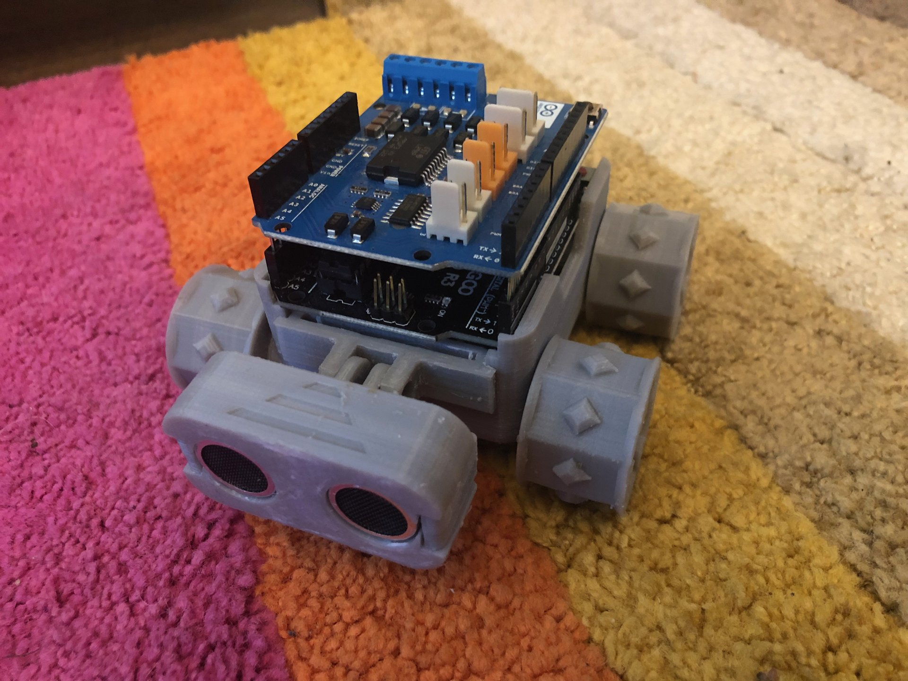
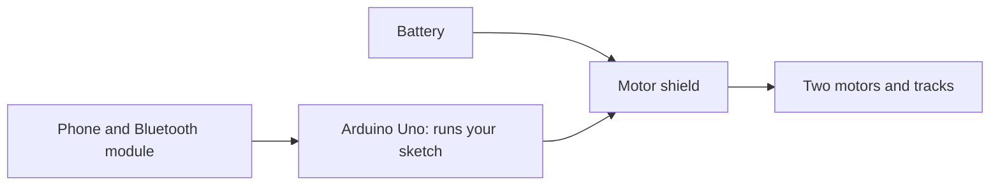

{:class="cover"}

By the end of this lesson you will be able to describe how every part of your SMARS fits together, and choose what to build or learn next.

## Summary of learning

Congratulations, you've built a robot! Let's review what you've learned in this course.

### Printing the parts

You learned where to download the SMARS files, which parts to print and what electronics you need.

### Assembling the robot

You soldered wires to the motors, then fitted the motors, battery, motor holders and wheels, and tested the motors.

### Wiring up the robot

You added the Arduino and motor shield, connected the motor and battery wires, and fitted the tracks.

### Code

You loaded code onto the Arduino and controlled your SMARS over Bluetooth.

---

## Watch: next steps and recap



Having trouble? This video covers the five most common SMARS problems and how to fix them.



---

## What's next

- [Learn how to program SMARS with Arduino](/learn/smars_code/): make your SMARS avoid obstacles with the range finder
- [Build a SMARS Quad](/learn/smars_quad/): a four-legged walking SMARS
- [Design a SMARS Robot in Fusion 360](/learn/smars_fusion360/): design the chassis yourself

## Try it Yourself

1. Drive your SMARS in a straight line for a metre. Does it drift to one side, and which motor do you think is faster?
2. Use the commands from lesson 13 to drive a square. How many `u` and `r` commands does it take?
3. Challenge: sketch a plan for adding the range finder. Which Arduino pins are already used by the motor shield, and which would be free?

## Common Issues

- **Problem**: SMARS drifts to one side when it should go straight.
- **Solution**: Check both tracks are the same tightness and that no wheel is stiff, then check the battery is fresh.
- **Why**: Small differences in friction or motor speed add up, and a tired battery makes them worse.

- **Problem**: Something that worked has stopped working.
- **Solution**: Go back through the wiring map in lesson 10 and check each wire is still in its connector.
- **Why**: Wires and solder joints are the parts that get knocked and loosened most as the robot moves.

## Check your understanding


? Which part of SMARS switches the battery power to the motors?
- [ ] The Arduino pins directly
- [x] The motor shield
- [ ] The tracks
> The Arduino sends small control signals and the shield switches the larger current from the battery.

? In the Bluetooth sketch, which pins set the motor speeds?
- [ ] 12 and 13
- [x] 10 and 11
- [ ] 4 and 5
> `ch_A_speed` is 10 and `ch_B_speed` is 11.

? You want to teach SMARS to avoid obstacles. Which part will you use?
- [ ] The battery clip
- [x] The ultrasonic range finder
- [ ] The motor holders
> It measures the distance in front of the robot, and the programming course shows how to use it.

