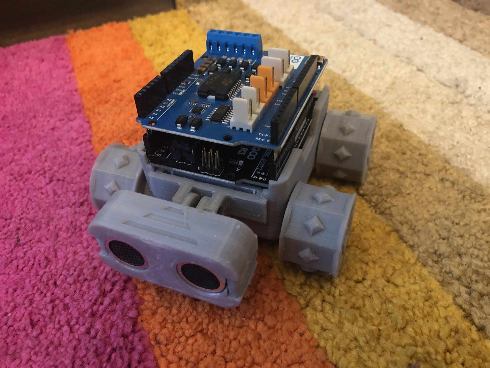

{:class="cover"}

## Summary of learning

Congratulations, you've built a robot! Let's review what you've learned in this course.

### Printing the parts

You learned where to download the SMARS files, which parts to print and what electronics you need.

### Assembling the robot

You soldered wires to the motors, then fitted the motors, battery, motor holders and wheels, and tested the motors.

### Wiring up the robot

You added the Arduino and motor shield, connected the motor and battery wires, and fitted the tracks.

### Code

You loaded code onto the Arduino and controlled your SMARS over Bluetooth.

---

## Watch: next steps and recap



Having trouble? This video covers the five most common SMARS problems and how to fix them.



---

## What's next

- [Learn how to program SMARS with Arduino](/learn/smars_code/): make your SMARS avoid obstacles with the range finder
- [Build a SMARS Quad](/learn/smars_quad/): a four-legged walking SMARS
- [Design a SMARS Robot in Fusion 360](/learn/smars_fusion360/): design the chassis yourself
