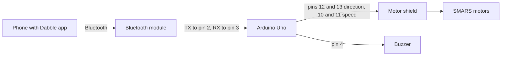

{:class="cover"}

---

By the end of this lesson you will be able to wire a Bluetooth module to SMARS and drive the robot, beep the buzzer and play a tune from the Dabble gamepad on your phone.

## Watch the livestream



---

## What you'll learn

In this lesson you will learn how to connect a Bluetooth module to your Arduino and use it to pair with an iOS or Android phone. We will then modify the code written in previous [lessons](02_lesson_02.html) to remotely control our SMARS.

---

## What you'll need

Before you begin, you'll need to make sure you have a couple of things before you start this lesson:

* A [SMARS robot](/learn/smars/)
* A USB Cable to connect to your computer
* A Computer that can run the [Arduino IDE](https://www.arduino.cc/en/software)
* A Bluetooth module: an HM-10 or HC-08 (Bluetooth Low Energy, works with iPhone and Android) or an HC-05 / HC-06 (Android only)
* The free [Dabble](https://ai.thestempedia.com/docs/dabble-app/getting-started-with-dabble/) app on your phone

---

## Preparation

1. Connect the SMARS to the USB cable, and the USB Cable to your computer
1. Launch the [Arduino IDE](https://www.arduino.cc/en/software) on your computer
1. Create a new Sketch, by clicking the `New Sketch` button

---

## Let's code

You can download the code below from [GitHub](https://www.github.com/kevinmcaleer/lesson_05_bluetooth), but it's better to type it in yourself line by line, as you will get to understand what each line means.

Make sure to download `pitches.h` from the github link above, and save it in the same folder as the sketch you create below. It defines the note names such as `F3` and `D3` used in the melody. (This sketch doesn't `#include` any other file, so you don't need `melody.h`.)

---

```cpp
// These two lines must come BEFORE #include <Dabble.h>
#define CUSTOM_SETTINGS
#define INCLUDE_GAMEPAD_MODULE
#include <Dabble.h>
#include "pitches.h"

// set Motor A to Arduino Pins
int motor_A = 12;
int motor_B = 13;
int buzzer = 4;

// set the Motor Speed using the Arduino Pins
int motor_A_speed = 10;
int motor_B_speed = 11;

// set the time between motor on and motor off
int wait_in_milliseconds = 100;

// notes in the melody:
int melody[] = {
  F3, D3, AS2, AS2, AS2, C3, D3, DS3, F3, F3, F3, D3
};

int noteDurations[] = {
  8, 8, 4, 4, 8, 8, 8, 8, 4, 4, 4, 8
};

void setup() {
  Dabble.begin(9600);   // Bluetooth module on pins 2 (RX) and 3 (TX)
  Serial.begin(9600);

  // set the Arduino pins to OUTPUT mode
  pinMode(motor_A, OUTPUT);
  pinMode(motor_B, OUTPUT);
  pinMode(buzzer, OUTPUT);
}

// set both motor directions, run for a short time, then stop
void drive(int dirA, int dirB) {
  digitalWrite(motor_A, dirA);
  digitalWrite(motor_B, dirB);
  analogWrite(motor_A_speed, 255);
  analogWrite(motor_B_speed, 255);
  delay(wait_in_milliseconds);
  analogWrite(motor_A_speed, 0);
  analogWrite(motor_B_speed, 0);
}

void forward()   { drive(LOW, HIGH); }
void backward()  { drive(HIGH, LOW); }
void turnLeft()  { drive(LOW, LOW); }
void turnRight() { drive(HIGH, HIGH); }

void beep() {
  tone(buzzer, 1000, 200);
}

void playMelody() {
  for (int thisNote = 0; thisNote < 12; thisNote++) {
    // note duration: one second divided by the note type
    // e.g. quarter note = 1000 / 4, eighth note = 1000 / 8
    int noteDuration = 1000 / noteDurations[thisNote];
    tone(buzzer, melody[thisNote], noteDuration);

    // leave a short gap between notes: the note's duration + 30% works well
    int pauseBetweenNotes = noteDuration * 1.30;
    delay(pauseBetweenNotes);
    noTone(buzzer);
  }
}

void loop() {
  Dabble.processInput();   // read the latest button presses from the app

  if (GamePad.isUpPressed())       forward();
  if (GamePad.isDownPressed())     backward();
  if (GamePad.isLeftPressed())     turnLeft();
  if (GamePad.isRightPressed())    turnRight();
  if (GamePad.isTrianglePressed()) beep();
  if (GamePad.isSquarePressed())   playMelody();
}
```

---

## What the code means

- **Dabble** is a free phone app (iOS and Android) with a gamepad screen. The Dabble Arduino library receives its button presses over Bluetooth.
- The `#define` lines tell the Dabble library which of its modules we want. They must come *before* `#include <Dabble.h>`, or the gamepad won't work.
- `Dabble.begin(9600)` talks to the Bluetooth module on pins 2 and 3 using software serial, so the USB serial port stays free for uploading and debugging.
- `drive()` is the movement code from lessons 1 and 2, squashed into one function that takes the two motor directions.
- In `loop()`, `Dabble.processInput()` reads the app, then each `if` checks one button.

## Connect your phone

1. Install the **Dabble** app and the **Dabble** library (**Tools > Manage Libraries**).
2. Wire the Bluetooth module: VCC to 5V, GND to GND, module TX to Arduino pin 2, module RX to Arduino pin 3. The buzzer goes between pin 4 and GND.
3. Upload the sketch, open Dabble, tap the connect icon and choose your module, then open the **Gamepad**.



Many Bluetooth modules, including the HM-10, use 3.3 volt signals. Check your module's data sheet: if the RX pin is 3.3 V only, put a simple voltage divider between Arduino pin 3 and the module's RX pin rather than connecting them directly.

Unlike the Bluetooth sketch in the build course, this one uses pins 2 and 3 and not the USB serial pins, so you can leave the module plugged in while you upload.

---

## Try it Yourself

1. Press each gamepad button and note what SMARS does. Which buttons do nothing yet?
2. Change `wait_in_milliseconds` from `100` to `300`. Is SMARS easier or harder to steer?
3. Change the `beep()` pitch from `1000` to `2000`, and its length from `200` to `500`.
4. Challenge: add a new `if` line so the Circle button (`GamePad.isCirclePressed()`) plays your own short tune. Make a new `melody` array using notes from `pitches.h`.

> **Teachers**: Bluetooth control brings phones into the room, so agree the rules first, and make sure learners are connecting to their own robot's module and not a neighbour's. Several robots in one room can look identical in the device list, so label each module with its own name or a sticker. School networks and device policies may block installing the Dabble app, so check before the lesson and have a spare phone or tablet available. Test the robot on the floor or in a tray with edges, because it is easy to drive off a table when you cannot see the robot's edge.

## Common Issues

- **Problem**: Verify fails with `Dabble.h: No such file or directory`, or `GamePad was not declared`.
- **Solution**: Install the Dabble library from the Library Manager, and check `#define CUSTOM_SETTINGS` and `#define INCLUDE_GAMEPAD_MODULE` come before `#include <Dabble.h>`.
- **Why**: The `#define` lines tell the library which parts to include, so the order matters.

- **Problem**: Verify fails with `pitches.h: No such file or directory`.
- **Solution**: Save `pitches.h` in the same folder as your sketch (the file must sit next to the `.ino` file).
- **Why**: `#include "pitches.h"` with quote marks looks in the sketch folder first.

- **Problem**: The phone cannot find or connect to the module.
- **Solution**: Check the module has power (its LED will blink), use an HM-10 or HC-08 for an iPhone, and connect from inside the Dabble app and not the phone's Bluetooth settings.
- **Why**: iPhones only talk to Bluetooth Low Energy modules, and Dabble does the pairing itself.

- **Problem**: It connects but the buttons do nothing.
- **Solution**: Swap the TX and RX wires, then check you opened the **Gamepad** screen in the app.
- **Why**: Each side's TX must go to the other's RX. Matching names (TX to TX) is the most common mistake.

---

## Check your understanding


? Why must `#define CUSTOM_SETTINGS` come before `#include <Dabble.h>`?
- [x] The library reads those settings while it's being included
- [ ] The Arduino IDE sorts the lines alphabetically
- [ ] It doesn't matter where it goes
> `#define` and `#include` are handled in order, top to bottom, before the code is compiled.

? Which Bluetooth module would you choose to control SMARS from an iPhone?
- [ ] HC-05
- [x] HM-10 (Bluetooth Low Energy)
- [ ] Any module works with iPhone
> iPhones only talk to Bluetooth Low Energy modules like the HM-10 or HC-08.

? Which Arduino pins does this sketch use to talk to the Bluetooth module?
- [ ] 0 and 1
- [x] 2 and 3
- [ ] 12 and 13
> The sketch uses pins 2 and 3, which keeps the USB serial port free for uploading and debugging.

