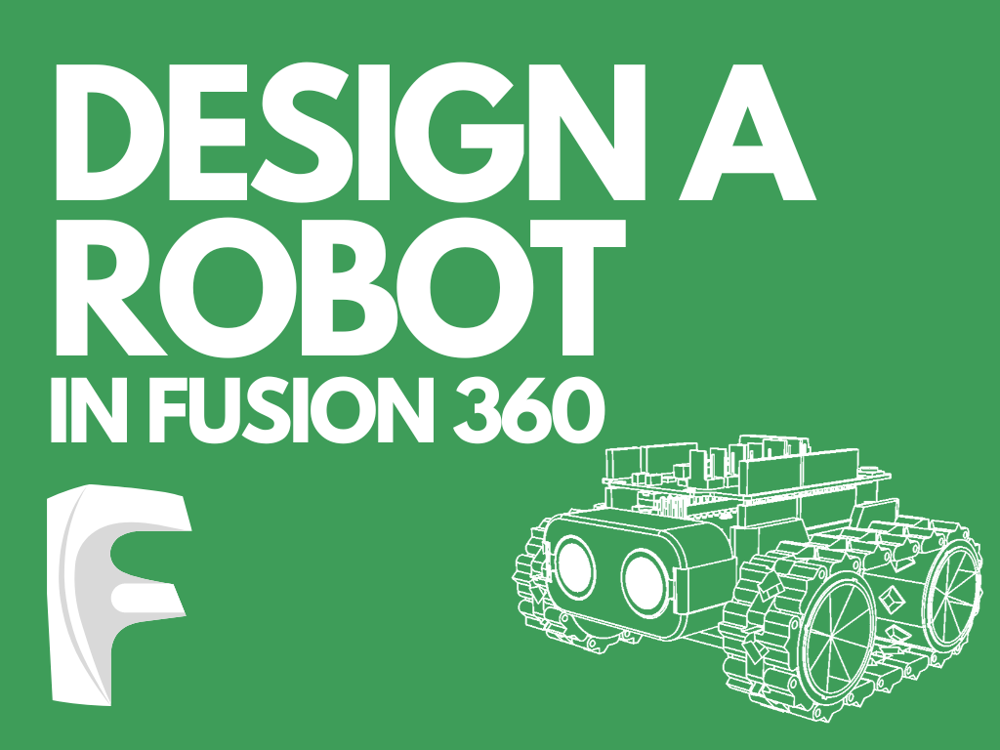

{:class="cover"}

## Watch the video first

This course goes with the video below. Watch it to see which planes each sketch goes on and how each step is done, then use the lessons as a step-by-step reference with every dimension you need.



---

## Overview

SMARS (Screwless Modular Assemblable Robotic System) is a small 3D-printed robot that's perfect for learning robotics. In this two-part course you'll design its chassis from scratch in Autodesk Fusion 360, using the same sketch, extrude, shell and fillet tools you'd use on any 3D-printed part.

Part 1 builds the outer shell. [Part 2](/learn/smars_fusion360_part2/) adds the motor holders and stub wheels.

## Course Content

- Sketch and extrude the chassis base
- Shell, fillet and thin the walls
- Cut out the front, back and the classic SMARS side shape
- Cut the wheel holes and the slots the Arduino slides into

## Key Results

By the end of Part 1 you will be able to:

- Create a sketch with dimensions and turn it into a solid with **Extrude**
- Hollow out a part with **Shell** and round edges with **Fillet**
- Use a sketch profile to **extrude-cut** through a body
- Mirror a feature to the other side of a part

## What you'll need

- [Autodesk Fusion 360](https://www.autodesk.com/products/fusion-360/personal) (the free personal-use licence is fine)
- A mouse with a scroll wheel makes orbiting and zooming much easier
- No previous CAD experience is needed

## How the course works

Each lesson is one step in the design: a short explanation, the dimensions to type in, and a drawing of what the part should look like afterwards. If you get stuck, jump to that point in the video. There's a quick quiz at the end of each section to check your understanding.

## Prerequisites

None! If you'd like to know more about the robot itself first, have a look at [Build a SMARS robot](/learn/smars/).
